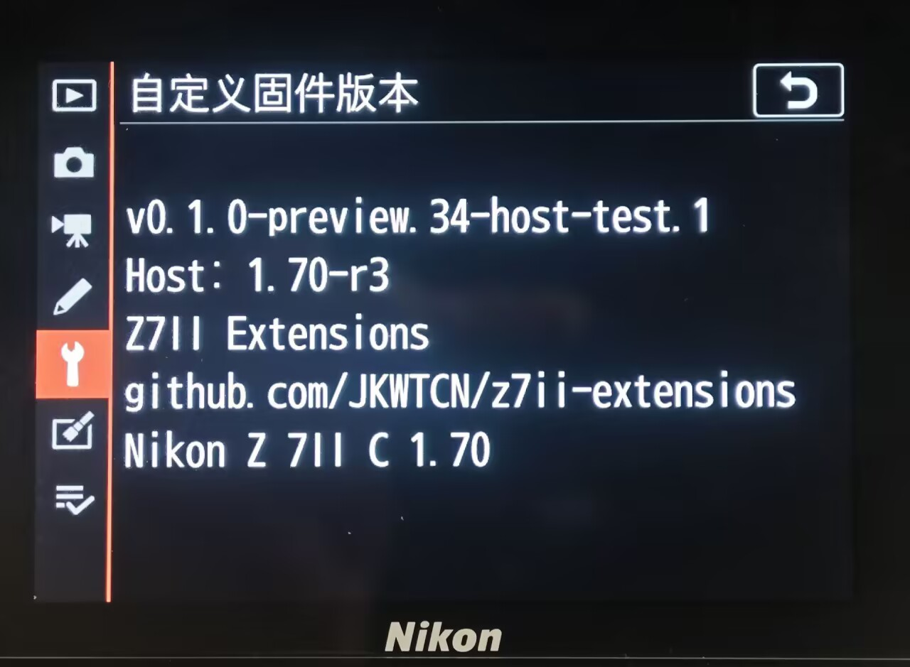

# Z7II Extensions

English | [简体中文](README.md)

Native C extensions loaded automatically from an SD card for the Nikon Z 7II running C 1.70.

## Features

| Feature                                                       | Description                                                                                                                             | Status             |
| ------------------------------------------------------------- | --------------------------------------------------------------------------------------------------------------------------------------- | ------------------ |
| [Framing grid](docs/framing-grid.md)                           | Off, 2×2, 3×3, 4×4, and Golden ratio, with persistent settings                                                                       | Hardware verified  |
| [Histogram and virtual horizon](docs/histogram-horizon.md)     | Live histogram and virtual horizon together on the rear screen and in the viewfinder in photo mode                                      | Hardware verified  |
| [Portrait display](docs/portrait-ui.md)                        | Rear-screen photo/video information, audio meters, i menu, and histogram rotate with the camera                                         | Hardware verified  |
| [Upside-down photo playback](docs/inverted-playback.md)        | Automatic JPG/NEF orientation with a separate playback switch, on by default                                                            | Hardware verified  |
| [Photo shooting highlights](docs/photo-highlights.md)          | Independent photo highlight stripes on LCD and EVF, with two patterns and eight thresholds                                              | Hardware verified  |
| [Custom DISP pages](docs/custom-disp.md)                       | Photo LCD page selection, four presets, eight shooting-information controls, native scrolling lists, and the native information display | Hardware verified  |
| [Focal length display](docs/focal-length.md)                   | Live focal length for electronically reporting manual-zoom lenses, with an independent DISP switch                                      | Hardware verified  |
| [Battery percentage display](docs/battery-percent.md)          | Transparent in-frame percentage on the photo and movie LCD, with a global switch that defaults to off                                   | Hardware verified  |
| [Extended movie recording](docs/movie-recording-limit.md)      | Ordinary movies beyond 29:59; 38:52 continuous recording verified at 1080/60p                                                           | Hardware verified  |
| [Automatic video orientation](docs/video-rotation.md#english)  | Locks orientation when each MOV or MP4 file opens and writes it to the video track                                                      | Hardware verified  |
| [Flexible Color](docs/flexible-color.md#english)               | SD-based NP3 B slots in the photo i menu, with live preview and startup restoration                                                     | Hardware verified  |
| [JPEG pre-capture](docs/jpeg-pre-capture.md)                   | Rolling JPEG buffer with selectable duration and continuous H+ capture through full press                                               | Hardware verified  |
| [Silent shutter sound](docs/shutter-sound.md)                  | Custom WAV clips from SD, with preview, five volume levels, and continuous-release controls                                             | Hardware verified  |
| [Filtered playback](docs/filtered-playback.md)                 | Filter full-frame and thumbnail playback by protection, image type, rating, and date                                                    | Hardware verified  |
| [AF-area shortcuts](docs/af-area-shortcut.md)                  | Assign photo AF-area shortcuts to five buttons through native Custom controls; press once to switch and keep the selected area          | Hardware verified  |
| [Custom wide-area AF (C1/C2)](docs/custom-wide-area-af.md)     | Set width, height, and subject detection for two photo AF presets. Select them with the i menu, command dials, or button shortcuts      | Hardware verified  |
| [Subject tracking](docs/subject-tracking.md)                   | Start tracking with a half-press or AF-ON in photo AF-C. The targeting reticle returns after power-up                                   | Hardware verified  |
| [Focus improvements](docs/focus-improvements.md)               | Optional assistance for reacquiring a briefly occluded subject in photo AF-C                                                            | Hardware verified  |
| [Pixel shift shooting](docs/pixel-shift.md)                    | Use in-body sensor shift to capture 4, 8, 16 or 32 NEFs for in-camera or NX Studio merging                                              | Hardware verified  |
| [Wi-Fi settings](docs/wifi-settings.md)                        | One submenu for region selection and an optional 80 MHz AP switch; 5 GHz STA and Wi-Fi 5 AP                                             | Hardware verified  |
| [FTP upload](docs/ftp-upload.md#english)                       | Select photos and videos from both cards in one grid and batch upload with an optional 4 MiB send buffer                                | Hardware verified  |
| [Browser gallery](docs/browser-gallery.md#english)             | Browse CFexpress/XQD and SD photos, filter by card, rating, protection, or date, and download original JPG and NEF files                | Hardware verified  |
| [Composition reference](docs/composition-reference.md#english) | Edit and upload reference images, choose from six thumbnails, and show an adjustable-opacity overlay in photo live view                 | Hardware verified  |
| [Menu localization](docs/menu-localization.md)                 | English, Simplified Chinese, and Traditional Chinese labels for the extension settings                                                  | Hardware verified  |

## Known issues

- Automatic video orientation is currently unavailable in the native playback menu. Players that support orientation metadata display the recording in its recorded orientation. [Automatic video orientation](docs/video-rotation.md#english)
- The Z 7II's CMOS sensor lacks dual data paths, so JPEG pre-capture relies on H+ burst mode. This can make live view stutter when pre-capture starts.
- During playback, some JPEG pre-capture photos may temporarily show “Cannot display this file.” The camera registers these photos before writing them to the card. The photos become viewable once writing finishes.
- The default half-pixel offsets of X=11 and Y=9 were calibrated on my camera. For in-camera or NX Studio merging, follow the [calibration guide](docs/IBIS-calibration.md#why-calibrate) to calibrate your own camera. To skip calibration, merge the original NEFs with [Parsek NEFX](releases/parsek-nefx-gui.exe), then export JPEG or TIFF in NX Studio.
- Pixel shift shooting records uncompressed 14-bit NEFs. NX Studio can merge the series and open or export the result directly. [Pixel shift shooting](docs/pixel-shift.md) · [Download Parsek NEFX for Windows x64](releases/parsek-nefx-gui.exe)

**Flash at your own risk. Modified firmware and native modules may cause crashes, data loss, hardware damage, or an unbootable camera (bricking), potentially requiring professional repair.** Successful testing does not guarantee safety on every camera or in every situation.

Proceed with caution: back up your data, verify the camera model, firmware version, and file checksums, ensure sufficient battery charge, and never interrupt a firmware update. Do not proceed unless you understand and accept these risks. This project is provided without warranty; see the [MIT License](LICENSE).

See the Wi-Fi settings [operating-region limits and risk notices](docs/wifi-settings.md#important-limits-and-risk-notice--使用限制与风险声明). Choose the actual operating region; hardware tests do not certify wireless compliance.

Extended recording can still stop or cause the camera to shut down because of overheating; see the [feature documentation](docs/movie-recording-limit.md).

## Checking the module and host firmware versions

Starting with `v0.1.0-preview.26`, **Custom firmware version**, the last item in the Setup Menu, shows the module version. Starting with `v0.1.0-preview.35`, it also shows the host firmware version.

If you are using `v0.1.0-preview.35` or later and the menu shows host firmware `1.70-r2` or earlier, we recommend upgrading to `1.70-r3` with the latest host firmware builder. Version `1.70-r3` fixes a first-startup issue that could cause live view to display incorrectly when the camera was turned on a short time after the card access lamp next to the **i** button went out.



## Installation

Install this repository's SD loader host before using extensions. Subsequent extension updates only require replacing `Z72APP.BIN` on the SD card.

The updated host fixes missing extension menus and incorrect framing grids on the first startup after reinserting the battery. The fix was verified on-camera. Extensions still load in the background after power-on. To install the fix, generate a new update package with the updated builder and install it on the camera. [Download the Windows host firmware builder](releases/build-master.exe)

For instructions on building the firmware update package yourself, see [Building](#building).

1. Wait for card access to finish, turn off the camera, and remove the memory card.
2. Copy [Z72APP.BIN](releases/v0.1.0-preview.46/Z72APP.BIN) to the SD card root. Keep your existing `Z72APP.CFG`, if present.
3. Reinsert the card and battery, wait until the card access lamp next to the **i** button goes out, then turn on the camera.

Current release `v0.1.0-preview.46` · 356,716 bytes · [SHA-256 checksums](releases/v0.1.0-preview.46/SHA256SUMS)

Fully power down before replacing or removing the module, and only load trusted modules.

## Building

To build the combined SD module, use Python 3.12 with LLVM’s `clang` and `ld.lld` on your PATH. Use Clang with `#embed` support and choose an output file that does not already exist.

```powershell
New-Item -ItemType Directory -Force artifacts | Out-Null
python -B tools/wifi_aux.py --ftp
python -B tools/module.py plugins/combined.c --output artifacts/Z72APP.BIN
```

`host/` contains the loader source, `sdk/` provides module interfaces, and `plugins/` contains plugin implementations.

The host and module builder accept up to **1 MiB per `Z72APP.BIN` file** and **4 MiB for the image plus BSS**. The file limit includes the header and relocation table.

Download [build-master.exe](releases/build-master.exe) for the standalone Windows GUI ([SHA-256](releases/SHA256SUMS)). It selects Chinese or English from the Windows display language and provides file pickers for the original firmware and host firmware output. The executable contains the binary patch and package verification logic. It writes the complete update and a JSON verification report. Its Rust source is in `tools/build-master`.

Build the desktop application with Rust on Windows:

```powershell
Push-Location tools/build-master
cargo build --release
Pop-Location
```

Run `tools/build-master/target/release/build-master.exe`, select the original C 1.70 update package and a new output filename, then click **Build host firmware**. The Windows x64 MSVC build links the C runtime statically.

With Python 3.12, `tools/build-master.py` applies the verified host's binary patch to the original C 1.70 update package and generates a complete firmware update plus a JSON verification report:

```powershell
New-Item -ItemType Directory -Force artifacts | Out-Null
python -B tools/build-master.py --stock-package "path/to/original/Z7_2_0170.bin" --output artifacts/Z7_2_0170.bin
```

This command reproduces the current release's 1 MiB / 4 MiB host using the embedded patch. It requires only Python's standard library.

To compile the host source, `tools/build.py` generates the same complete firmware update package. It requires the exact original C 1.70 update package and LLVM `clang`, `ld.lld`, `llvm-objcopy`, and `llvm-nm`:

```powershell
New-Item -ItemType Directory -Force artifacts | Out-Null
python -B tools/build.py --stock-package "path/to/original/Z7_2_0170.bin" --output artifacts/Z7_2_0170.bin
```

Both scripts extract the master internally and reuse the verified release's public header digest. They require exact SHA-256 matches for the inputs, resulting host, and complete output, then decode the result to check every member. Changed host builds are rejected because the fixed digest only applies to this release. Output files must not already exist. Original firmware and generated update packages are not included in the repository.

## License

[MIT](LICENSE) © 2026 JKWTCN. The supplemental menu glyphs for silent shutter sound, filtered playback, and the browser gallery carry their own [font license](releases/menu-font-license.txt).
