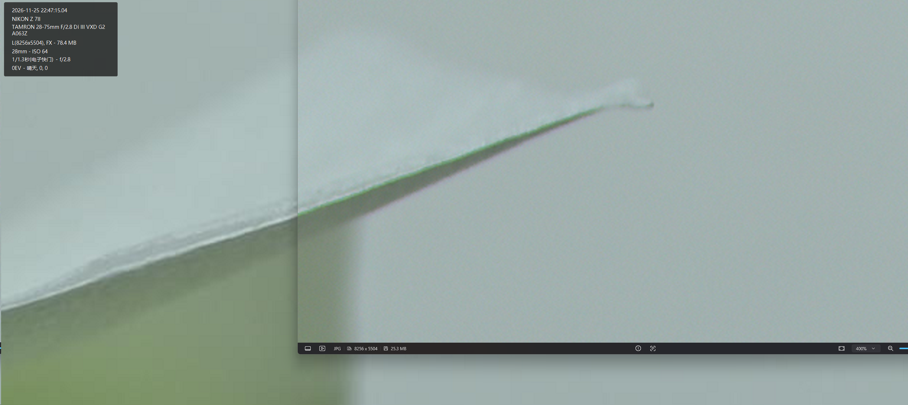
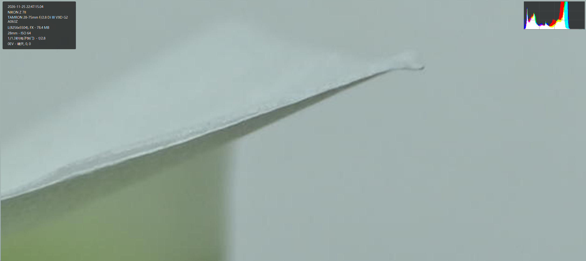
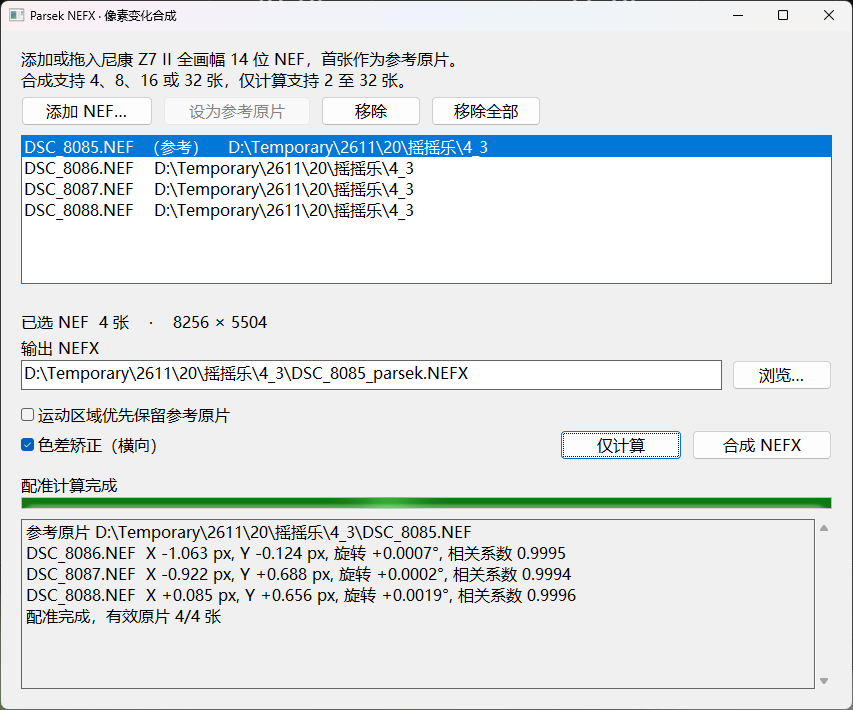

# 半格位移标定 / Half-step calibration

### 为什么要标定？

根据我的统计分析,不同的 z7ii 的防抖模组设置相同的值,得到的位移不太一样.如果不标定的话会导致合成产生非常大的色差.

下面两张图对比了未标定时合成结果的边缘色差。

### 如何标定

1. 找一张 A4 纸,随机打印几个点.
2. 相机固定 ISO,快门,白平衡,滤镜,光圈,焦距.确保在光线充足的情况下对焦对上 A4 纸的点,最好画面中除了 A4 纸没有其他东西.
3. 用像素变化拍摄拍一组 4 张，导出 NEF，用于测量整像素位移。
4. 在 [Parsek NEFX](../releases/parsek-nefx-gui.exe) 中添加 NEF，选择首张作为参考原片，点击 **仅计算**。检查发生整像素移动的轴，测得的位移绝对值应接近 1 像素。

   

5. 在 **设定菜单 → 像素变化拍摄 → 半格位移校准** 调整 X/Y 值。每次调整后重拍一组 **16 张**，按拍摄顺序添加原片，再点击 **仅计算**。以首张为参考，第 5 张测 X 轴，第 13 张测 Y 轴，目标位移的绝对值均为约 0.5 像素。

### Why calibrate?

In my measurements, different Z 7II bodies moved the sensor by different amounts for the same actuator command values. A mismatch in sensor movement can cause visible color fringing in the merged image.

The two images below compare color fringing along an edge in a merge made without calibration.

### How to calibrate

1. Print a few randomly placed dots on a sheet of A4 paper.
2. Keep ISO, shutter speed, white balance, filters, aperture, and focal length fixed. Focus on the dots in good light and fill the frame with the paper if possible.
3. Capture a four-shot pixel shift series and copy the NEFs to your computer to measure the full-pixel movement.
4. Add the NEFs to [Parsek NEFX](../releases/parsek-nefx-gui.exe), use the first shot as the reference, and select **Calculate only**. On the axis that moved by a full pixel, the absolute offset should be close to 1 pixel.

   

5. Adjust X and Y in **Setup Menu → Pixel shift shooting → Half-step calibration**. After each adjustment, capture a **16-shot** series, add the NEFs in capture order, and run **Calculate only** again. With the first shot as the reference, use shot 5 to measure X and shot 13 to measure Y. Aim for an absolute offset of about 0.5 pixels on each axis.
