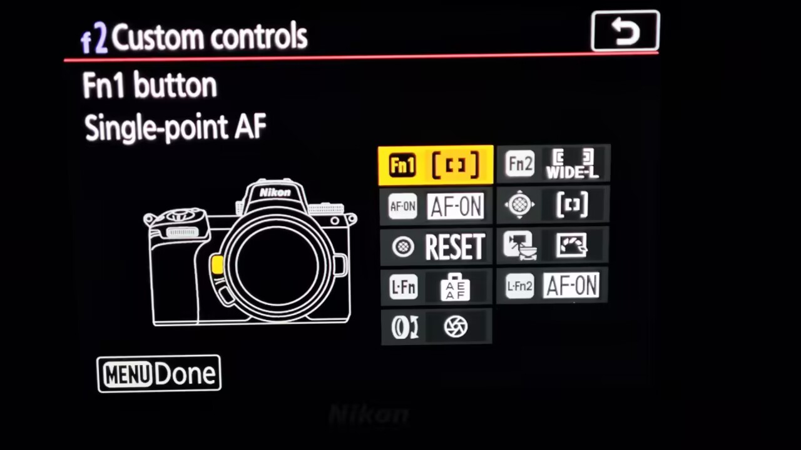
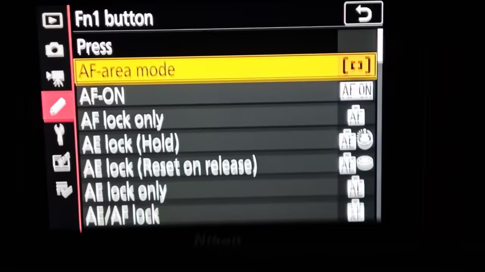
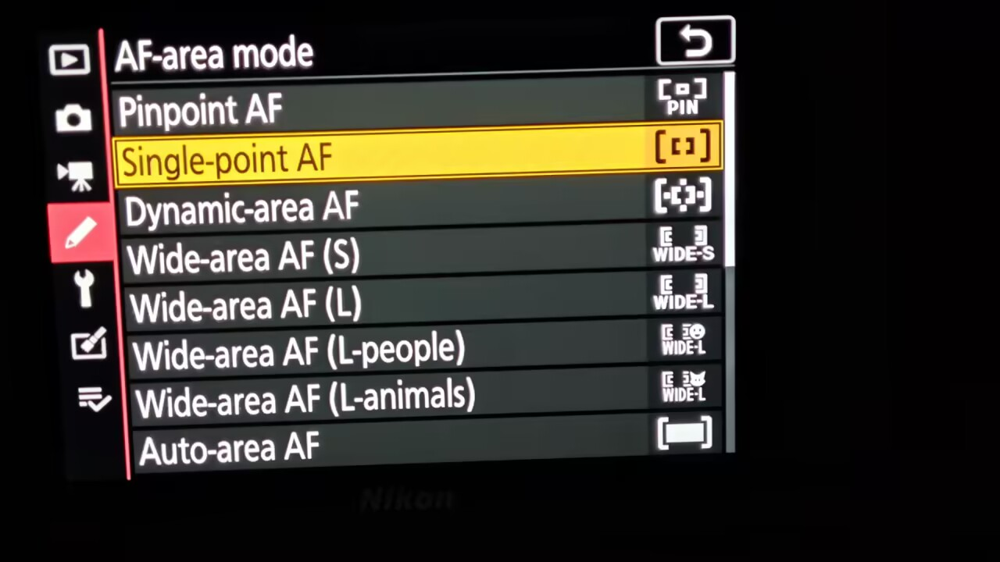
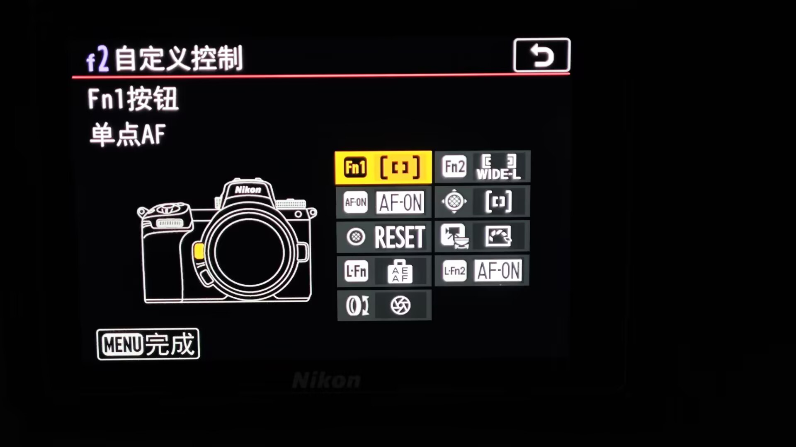
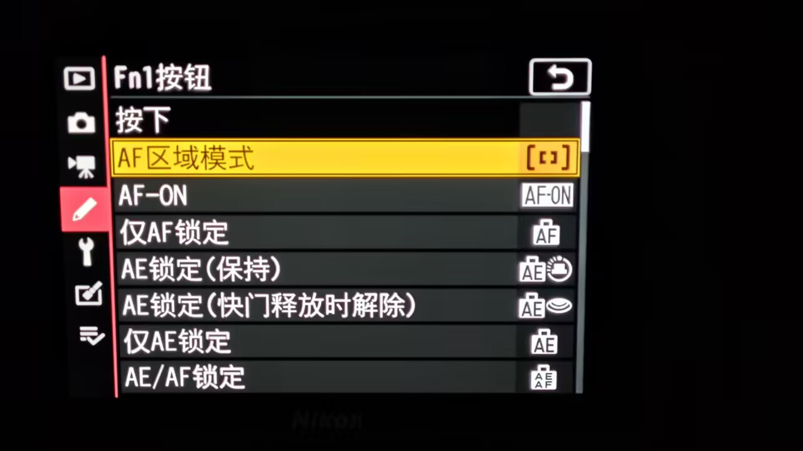
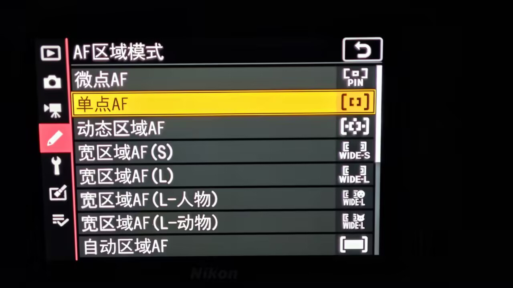

# AF-area shortcuts / AF 区域快捷切换

[English README](../README.md) · [中文说明](../README.zh-CN.md)

Assign a photo AF-area shortcut through the camera's native **f2 → Custom controls** menu. The Fn1, Fn2, AF-ON, sub-selector center, and movie-record buttons each have an **AF-area mode** entry immediately below **Press**. Pressing an assigned button selects its configured area and keeps it selected after release. Holding the button does not repeat the action.

在原厂照片 **f2 → 自定义控制** 中，为 Fn1、Fn2、AF-ON、辅助选择器中央及照片模式下的录像键提供 **AF 区域模式**。该项目位于「按下」标题的下一项。按一次切换到指定区域并保持，按住不重复触发，松开不恢复原区域。

| AF area / 区域 | Choices / 选项 |
| --- | --- |
| Pinpoint / 微点 | Pinpoint AF / 微点 AF |
| Single-point / 单点 | Single-point AF / 单点 AF |
| Dynamic-area / 动态区域 | Dynamic-area AF / 动态区域 AF |
| Wide-area / 宽区域 | S, L, L-people, L-animals / S、L、L-人物、L-动物 |
| Auto-area / 自动区域 | Normal, people, animals / 普通、人物、动物 |

- All five shortcuts are **unassigned by default**. Each button can select a different target.
- The assignment row shows `--` until configured, then shows the selected area's native icon. The native Custom controls overview shows the matching icon and localized area name.
- The scrolling assignment list preserves the original functions, submenus, and help actions. Choosing native **None** removes the shortcut; assigning another native function takes priority. Leaving the area submenu without confirming preserves the previous choice.
- A shortcut selects an area; it does not start autofocus. Reassigning AF-ON therefore replaces its normal AF-ON action.
- The shortcut applies to photo live view on LCD and EVF. Menus, playback, the information display, magnified view, and movie mode retain their native button handling. Native AF availability rules still apply, including the focus-mode restrictions for pinpoint and dynamic-area AF.

- 五个按键默认均**未分配**，可分别指定不同区域。
- 未分配时列表右侧显示 `--`；分配后显示所选区域的原厂图标。自定义控制总览显示对应图标和区域名称。
- 列表保留原厂功能、子菜单和帮助入口，右侧滚动条提示列表位置。选择原厂「无」可取消快捷功能；重新分配其他原厂功能后，原厂分配优先。进入区域子页后直接返回不会更改设置。
- 此功能只切换区域，不启动自动对焦；把 AF-ON 改为此功能后，该键不再执行原来的 AF-ON 动作。
- 适用于照片 LCD 和取景器取景。菜单、回放、参数信息页、放大取景及视频保留原厂按键行为。继续遵守原厂 AF 区域可用性规则，包括微点及动态区域与对焦模式之间的限制。

Labels and symbols use the camera's native language resources. The choices share `Z72APP.CFG` with the other extensions: assigning a shortcut uses the 120-byte v10 format, while v1–v9 remain readable and default to no shortcuts. Saving other extension settings preserves the assignments. The shortcut configuration belongs to the SD module rather than the camera's native user-settings backup.

名称和图标复用相机原厂语言资源。设置与其他扩展共用 `Z72APP.CFG`；存在快捷分配时采用 120 字节 v10，兼容读取 v1–v9，旧配置默认不分配快捷功能。保存其他扩展设置时保留按键分配。快捷目标保存在 SD 模块配置中，不属于原厂用户设置备份。

## Verification / 验证

**Hardware verified.** On November 13, 2026, the user confirmed the 50,140-byte complete combined module passed camera testing. The six photographs below show English and Simplified Chinese overviews, button assignment lists, and AF-area choices. Fn1 is assigned Single-point AF and Fn2 shows Wide-area AF (L); the overview retains its title and camera diagram while displaying the assigned name and icon.

**已实机验证。** 2026-11-13，用户确认 50,140 字节完整组合模块通过实机验证。以下六张照片展示英文和简体中文的自定义控制总览、按键分配列表及区域选择子页。Fn1 分配为单点 AF，Fn2 显示宽区域 AF（L）；总览中的名称、图标、标题和相机示意图均正常显示。

Local checks cover five buttons and ten targets, press/hold/release behavior, native availability, LCD/EVF context isolation, original assignments and submenus, configuration migration, scrolling, and ten button-switch round trips. The assigned name is substituted only when its native text widget is drawn; the module delegates to the original text renderer without starting another whole-window render. The public-source build is byte-for-byte identical to the hardware-tested module. These checks and the camera confirmation do not establish every lens/body combination, every language, sleep/wake behavior, or long-term stability.

本地检查覆盖五个按键与十个目标、按下／按住／松开行为、原厂区域限制、LCD／取景器上下文、原厂功能与子菜单、配置迁移、滚动及十次按钮往返。区域名称只在原厂文字控件正常绘制时替换，并继续调用原厂文字绘制函数，不额外启动整窗重绘。发布源码构建结果与实机测试模块逐字节一致。本地检查和本次实机确认不代表所有镜头／机身组合、所有语言、休眠唤醒及长期稳定性均已验证。
