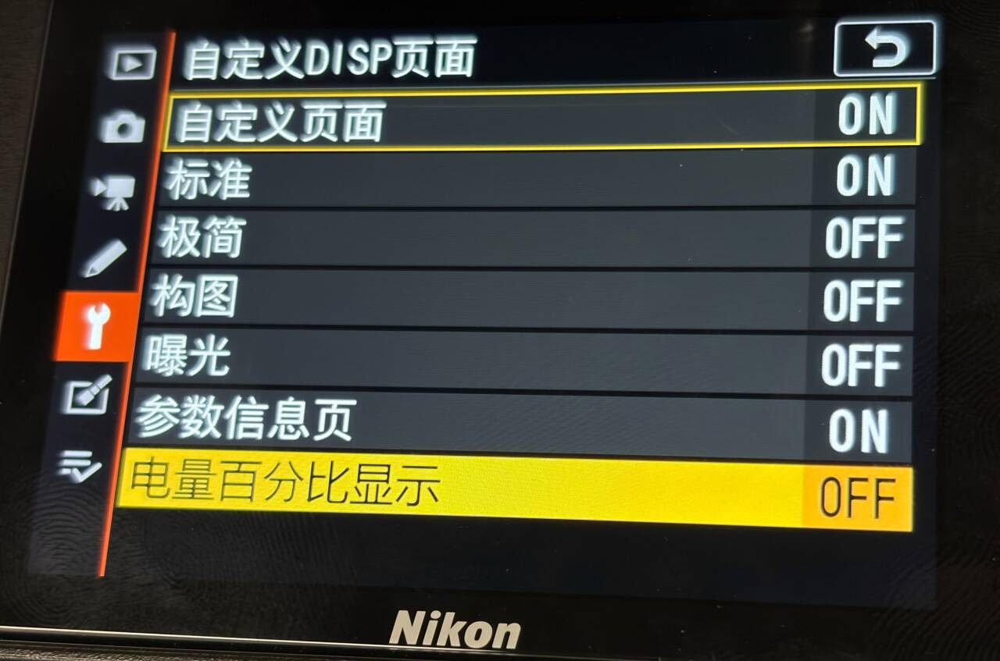
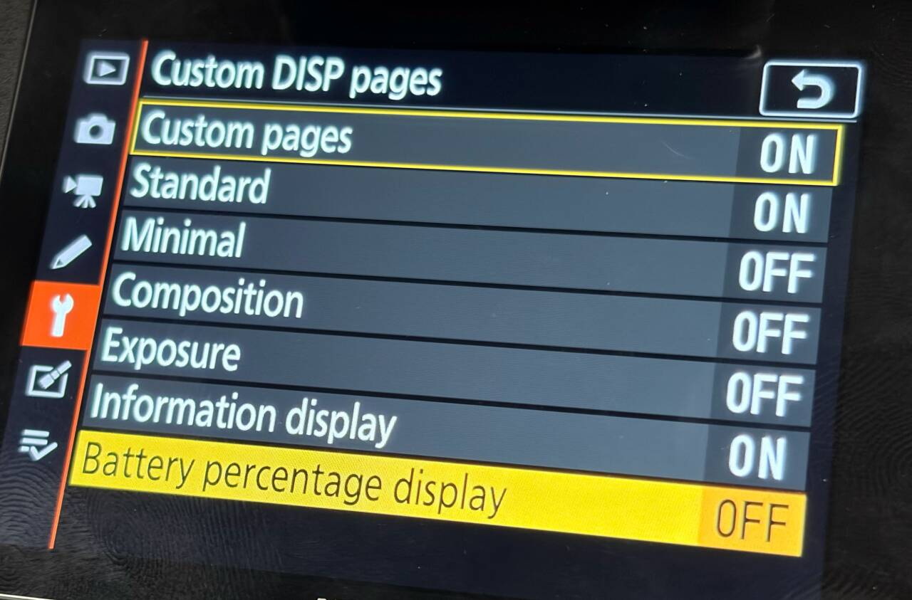
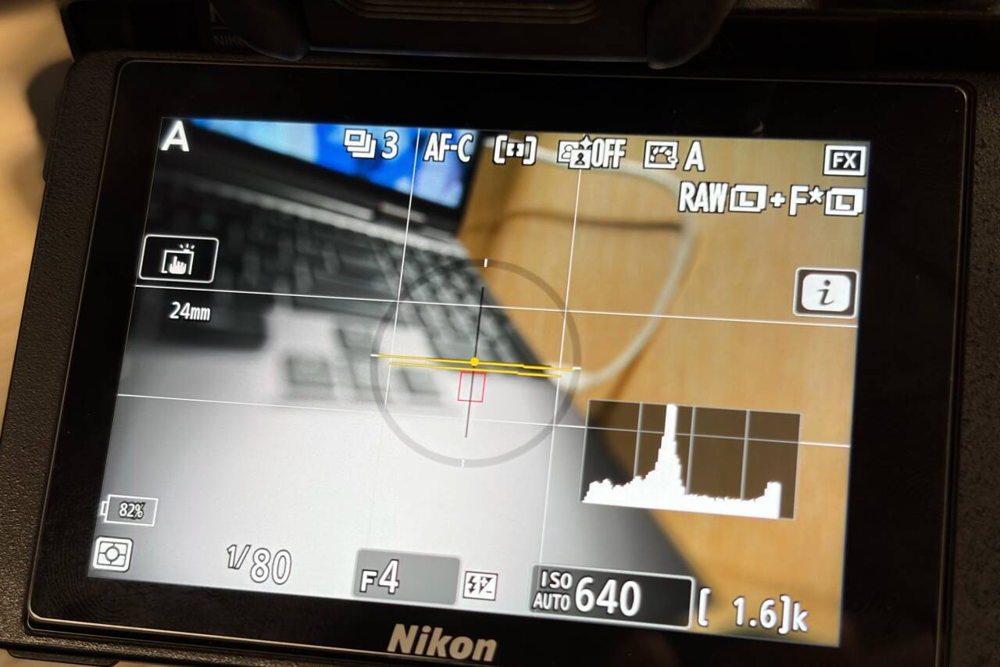

# Battery percentage display / 电量百分比显示

[English README](../README.md) · [中文说明](../README.zh-CN.md)

Show the camera-reported battery percentage inside the battery outline in photo live view on the rear LCD. Small centered digits replace the charge bars, with a transparent background that lets the live image show through. The value comes from the same native snapshot as Battery info, rather than an estimate based on the number of bars.

照片模式后屏 LCD 支持在电池框内显示机身报告的真实电量百分比。数字以小字号居中，替换原厂电量填充条，背景透明，可透出取景画面。读数来自原厂「电池信息」使用的同一电量快照，不按图标格数估算。

- **Custom DISP pages → Battery percentage display** is a global switch, placed immediately after **Information display**. It is **off by default**. The row shows ON/OFF and opens an Enable/Disable choice.
- The choice is independent of the four presets and the Custom pages master switch. It does not add a page to the DISP cycle. Turning it off restores the native battery icon.
- The percentage follows the native icon's visibility and the existing Auto rotate info layout. Native battery redraws, including focus-related redraws, refresh the percentage in the same pass. Old digits are cleared before painting; there is no solid background.
- Battery data is sampled once per second. Values outside 0–100 are hidden. Reporting depends on the battery supplying valid information to the camera.
- The native information display, menus, playback, movie mode, and viewfinder retain their existing battery presentation.

- 「自定义DISP页面」主菜单的「参数信息页」下方提供全局「电量百分比显示」，**默认关闭**。右侧显示 ON／OFF，点开选择启用／禁用。
- 此项独立于四套预设和「自定义页面」总开关，不参与 DISP 页面循环；关闭后恢复原厂电量图标。
- 随原厂电池图标显示或隐藏，并支持现有「自动旋转信息显示」布局。对焦等操作触发原厂电池重绘时，百分比在同一轮绘制中刷新。先清除旧数字再重画，保持透明底。
- 每秒检查一次读数，仅接受 0–100。能否获取有效读数取决于电池是否向机身报告电量。
- 原厂参数信息页、菜单、回放、视频及取景器保留各自的电量显示方式。

The setting is saved with the other preferences in `Z72APP.CFG`. Enabling it uses the 80-byte v9 format when no AF-area shortcut is assigned; shortcut assignments use v10 and preserve this setting. v1–v8 records remain readable and leave this option off. Other page and component selections are preserved. Labels are available in English, Simplified Chinese, and Traditional Chinese; a small supplemental font supplies missing Chinese glyphs.

设置与其他扩展共用 `Z72APP.CFG`。未分配 AF 区域快捷功能时，启用后采用 80 字节 v9；存在快捷分配时采用 v10，并保留本开关。兼容读取 v1–v8 旧配置，该选项默认关闭，原页面及组件选择保留。菜单支持简体中文、繁体中文和英文，缺少的中文字形由模块的小型补充字库提供。

## Verification / 验证

**Hardware verified.** On November 13, 2026, the user confirmed the 47,708-byte complete combined module passed camera testing. The photos show the Chinese and English global setting with its OFF indicator, and `82%` inside the transparent battery frame alongside the focal length, histogram, and virtual horizon.

**已实机验证。** 2026-11-13，用户确认 47,708 字节完整组合模块通过实机验证。照片展示中英文全局设置及 OFF 状态，以及透明电池框内的 `82%` 与焦距、直方图、水平仪同时显示。

Local checks cover default-off behavior, menu selection and cancellation, persistence and legacy configuration migration, independence from the DISP master, native icon restoration, transparent clearing, focus redraws, rotation geometry, and native glyph decoding. The public module is byte-for-byte identical to the hardware-tested build. Modeled file and display services do not establish every battery's compatibility, every orientation, sleep/wake behavior, or long-term stability.

本地检查覆盖默认关闭、菜单选择与取消、保存及旧配置迁移、独立于 DISP 总开关、恢复原厂图标、透明清除、对焦重绘、旋转位置及原厂字形解码。发布模块与实机测试版本逐字节一致。文件和最终显示服务中有替身；此次确认不代表所有电池兼容性、每种方向、休眠唤醒及长期稳定性均已验证。
