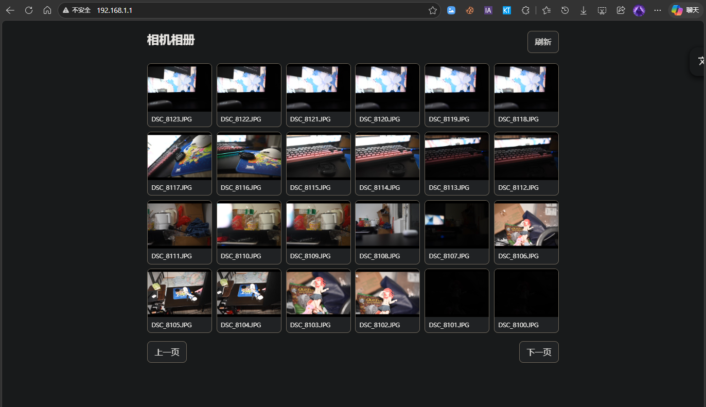
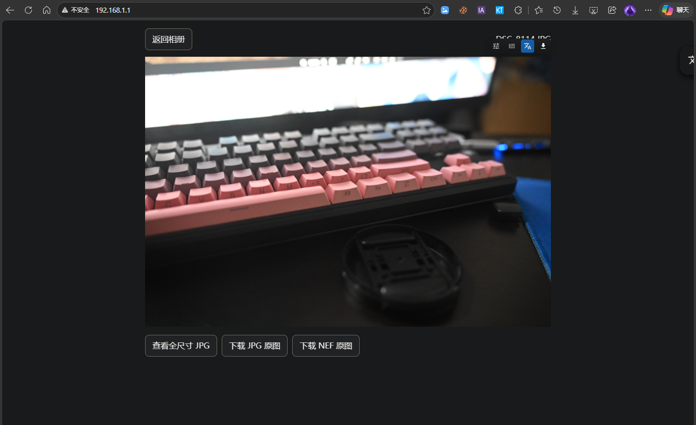
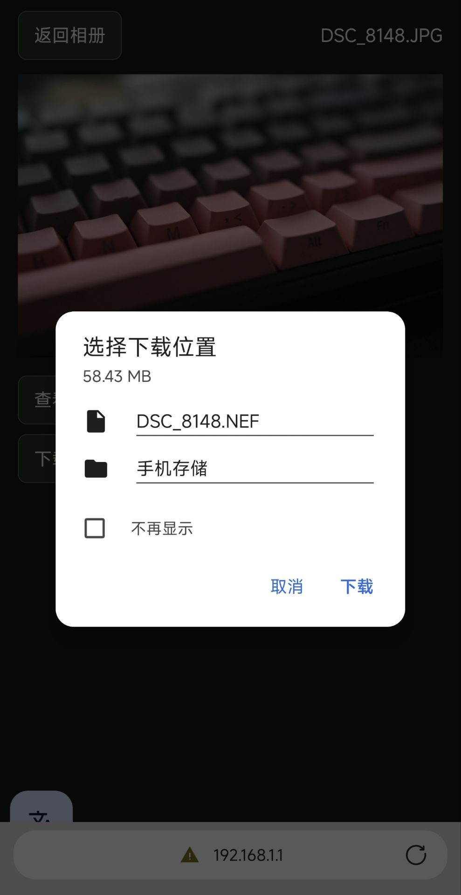

# 浏览器相册

在 Nikon Z 7II C 1.70 的「设定菜单 → 浏览器相册」中进入相册设置。选择「开启」，并让手机或电脑连上相机热点。浏览器访问相机 IP，AP 模式的默认地址为 [http://192.168.1.1/](http://192.168.1.1/)。

| 设置 | 操作 |
| --- | --- |
| 浏览器相册 | 进入「关闭／开启」。每次开机默认关闭 |
| 刷新当前状态 | 更新菜单下方的服务状态和最近一次原图下载的 TCP 发送缓冲 |

网页每页可浏览 24 张 SD 卡照片。点开照片后会先显示已加载的缩略图，再读取内嵌预览。JPG 可点「查看全尺寸 JPG」。同组 RAW+JPEG 共用一个相册条目，可分别下载 JPG 或 NEF 原文件。

下载至少 4 MiB 的原文件时，相册会尝试使用 4 MiB TCP 发送缓冲。内存不足时使用原厂缓冲。相册开启期间会延后 Wi‑Fi 空闲关闭。关闭相册后恢复原厂计时，也可机内手动关闭热点。

独立 SD 模块的相册浏览、翻页和预览已有实机反馈。组合版菜单、帮助文本和状态刷新通过本地执行检查，组合版待实机复测。

## 实机截图

**电脑端缩略图列表**

**手机端缩略图列表**

**单张预览与原图下载**

**手机端下载 NEF 原图**

## English

See the [hardware screenshots](#实机截图) for thumbnail browsing, photo preview, and the phone download dialog.

Open **Setup Menu → Browser gallery** on the Nikon Z 7II running C 1.70. Set **Browser gallery** to **On**, connect your phone or computer to the camera hotspot, then open the camera IP address in a browser. The default AP address is [http://192.168.1.1/](http://192.168.1.1/).

**Refresh status** updates the service status and the TCP send buffer used by the most recent original download. The gallery defaults to **Off** at power-up.

Browse thumbnails and previews from the SD card and download original JPG and NEF files individually. A RAW+JPEG pair appears as one entry with both download buttons. **View full-size JPG** loads the complete JPEG in the browser.

Original downloads of at least 4 MiB can use a 4 MiB TCP send buffer when memory is available. While the gallery is on, it defers the Wi-Fi idle timer. Choosing **Off** restores the camera's usual timer. You can also turn off the hotspot manually.

Gallery browsing, paging and previews were exercised on hardware with the standalone SD module. The integrated menu and status controls passed local execution checks and await a hardware retest in the combined build.
