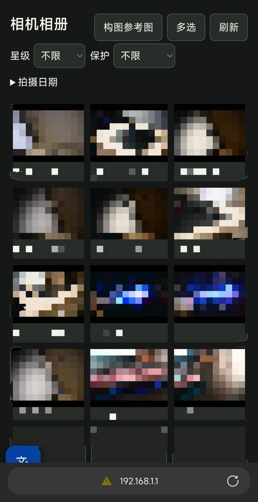
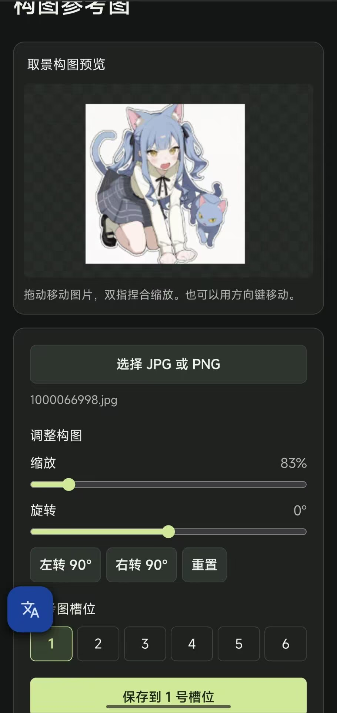
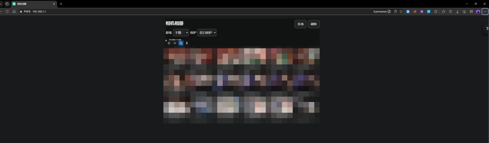
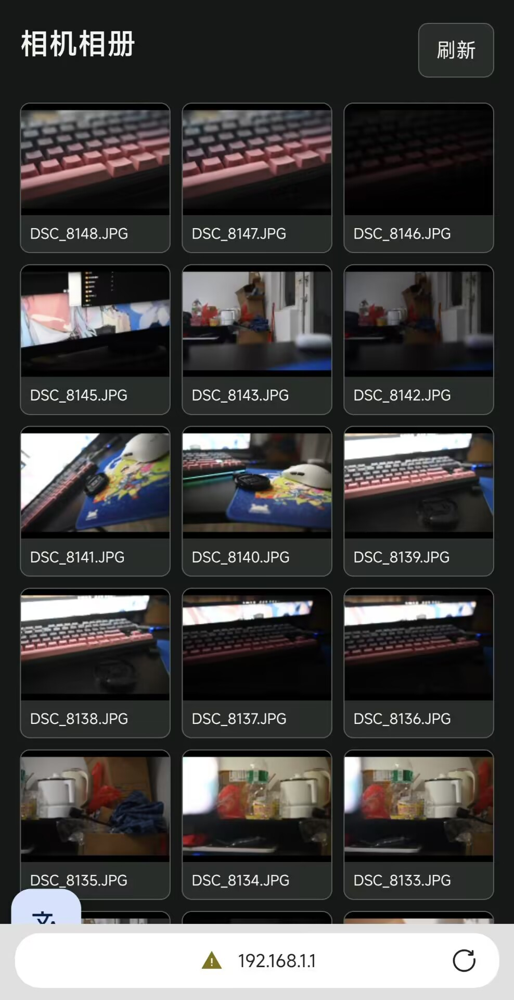
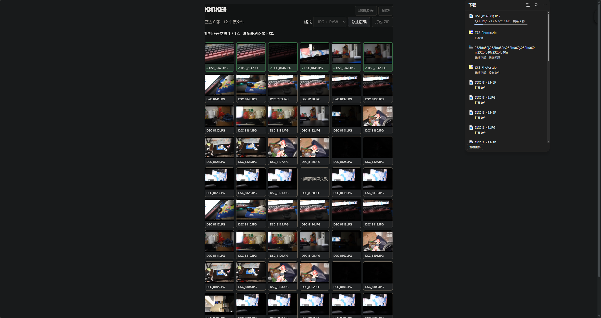
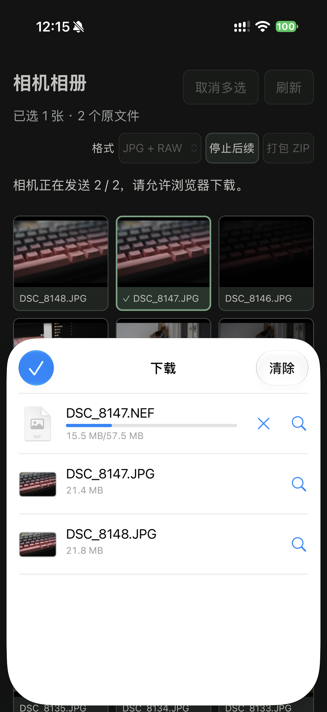
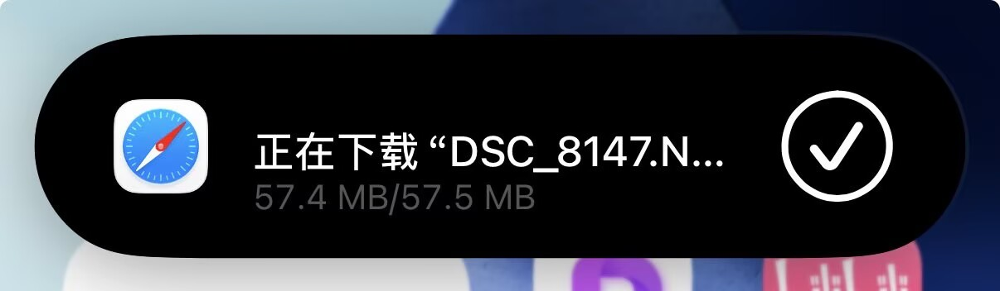

# 浏览器相册

在 Nikon Z 7II C 1.70 的「设定菜单 → 浏览器相册」中进入相册设置。选择「开启」，并让手机或电脑连上相机热点。浏览器访问相机 IP，AP 模式的默认地址为 [http://192.168.1.1/](http://192.168.1.1/)。

| 设置 | 操作 |
| --- | --- |
| 浏览器相册 | 首次使用默认为关闭。关闭或开启会保存到 SD 模块设置，重启后恢复 |
| 刷新当前状态 | 更新菜单下方的服务状态和最近一次原图下载的 TCP 发送缓冲 |

向下滑动时，相册会继续加载 SD 卡上的照片，每批最多 24 张。点开照片后会先显示已加载的缩略图，再读取内嵌预览。JPG 可点「查看全尺寸 JPG」。同组 RAW+JPEG 共用一个相册条目，可分别下载 JPG 或 NEF 原文件。

## 筛选照片

| 条件 | 可选项 |
| --- | --- |
| 星级 | 不限、无评级、1 至 5 星。选择某一星级会精确匹配该值 |
| 保护状态 | 不限、仅已保护、仅未保护 |
| 拍摄日期 | 可只填起始或结束日期，也可指定范围。起止当天都包含在内，两端填同一天可查看当天的照片 |

筛选依据相机记录的照片信息。照片需满足所有已设条件，向下滑动会继续加载匹配结果。「清除日期」保留星级和保护条件。更换筛选条件会清除当前多选勾选。

## 下载照片

点「多选」后可以边滑动边勾选。选择「JPG + RAW」（默认）、「只下载 JPG」或「只下载 RAW」，页面会更新符合格式的文件数。点「下载所选」会按顺序逐个下载原文件，浏览器可能会要求允许多文件下载。点「停止后续」可以停止发送剩余文件，当前下载可在浏览器中取消。「打包 ZIP」会将符合所选格式的原文件合为一个存档。单次最多 128 个原文件，ZIP 总大小须小于 4 GiB。

下载至少 4 MiB 的原文件或 ZIP 时，相册会尝试使用 4 MiB TCP 发送缓冲。内存不足时使用原厂缓冲。相册开启期间会延后 Wi‑Fi 空闲关闭。关闭相册后恢复原厂计时，也可机内手动关闭热点。

## 上传构图参考图

点相册首页的「构图参考图」选择手机或电脑上的 JPG 或 PNG，也可以在相机照片详情选择「用作构图参考」。在预览框拖动图片或双指缩放，用滑块调整缩放和角度。选 1 至 6 号槽位并保存，已有图片会被替换。上传后可在相机的「设定菜单 → 构图辅助 → 参考图片」查看缩略图。 [构图辅助用法](composition-reference.md)

独立 SD 模块已在实机验证滚动浏览、预览、多选逐个下载，以及星级、保护状态和拍摄日期的组合筛选。新版组合包已完成本地构建，待实机复测。

## 版本更新与实机截图

### v0.1.0-preview.33 版本更新

- 相册首页新增「构图参考图」入口，照片详情新增「用作构图参考」。支持拖动、缩放和旋转，并上传到 1 至 6 号槽位。
- 浏览器相册开关随 SD 设置保存，重启后恢复。从相册返回设定菜单后可直接进入构图辅助。

**手机端相册入口**

**手机端编辑和上传**

手机端编辑上传已在开发试用版上通过实机验证。机内选图和取景叠加见[构图辅助实机截图](composition-reference.md#版本更新与实机截图)。

### v0.1.0-preview.32 版本更新

新增星级、保护状态和拍摄日期筛选，支持同时使用三项条件。

### v0.1.0-preview.31 版本更新

首页改为滚动加载，新增多选逐个下载和 ZIP 打包。批量下载可选择 JPG + RAW、仅 JPG 或仅 RAW。

**手机端缩略图列表**

**电脑端多选下载**

**iPhone Safari 多选下载**

**iPhone 下载进度**

### v0.1.0-preview.30 版本更新

首次加入浏览器相册，支持缩略图、单张预览和 JPG、NEF 原文件下载。

## English

See the [release notes and hardware screenshots](#版本更新与实机截图) for composition reference uploads, gallery filters, thumbnail browsing, photo preview, and batch downloads.

Open **Setup Menu → Browser gallery** on the Nikon Z 7II running C 1.70. Set **Browser gallery** to **On**, connect your phone or computer to the camera hotspot, then open the camera IP address in a browser. The default AP address is [http://192.168.1.1/](http://192.168.1.1/).

**Refresh status** updates the service status and the TCP send buffer used by the most recent original download. The gallery starts **Off** on first use, then restores the saved setting from the SD card. Use the camera's Wi-Fi menu to start the hotspot.

Scroll to load more photos from the SD card, up to 24 per batch. A RAW+JPEG pair appears as one entry with separate JPG and NEF download buttons. **View full-size JPG** loads the complete JPEG in the browser.

Filter by exact star rating (unrated or 1–5 stars), protection (protected only or unprotected only), or capture date. The date filter accepts either bound on its own or both bounds, including both selected dates. Set both bounds to the same day to see photos taken that day. Photos must match all active filters. Clearing dates keeps the rating and protection filters. Changing a filter clears the current photo selection.

In multi-select mode, selected photos stay selected as you scroll. Choose **JPG + RAW** (default), **JPG only**, or **RAW only**. Download selected originals as separate files in sequence or as one ZIP archive. Your browser may ask to allow multiple downloads. You can stop the remaining files from the page and cancel the current download in your browser. Each batch supports up to 128 originals, with a ZIP size limit below 4 GiB.

Original and ZIP downloads of at least 4 MiB can use a 4 MiB TCP send buffer when memory is available. The gallery defers the Wi-Fi idle timer while it is on. Choosing **Off** restores the camera's usual timer. You can also turn off the hotspot manually.

Choose **构图参考图** on the gallery home page to edit and upload a JPG or PNG, or choose **用作构图参考** on a photo's detail page to use the camera preview. Drag or pinch in the preview, or use the zoom and rotation controls. Save to a slot from 1 to 6 and select its thumbnail on the camera. [Composition reference instructions](composition-reference.md#english)

Scrolling, previews, sequential batch downloads, and the combined rating, protection, and capture-date filters were tested on camera with the standalone SD module. The updated combined build awaits a hardware retest.
