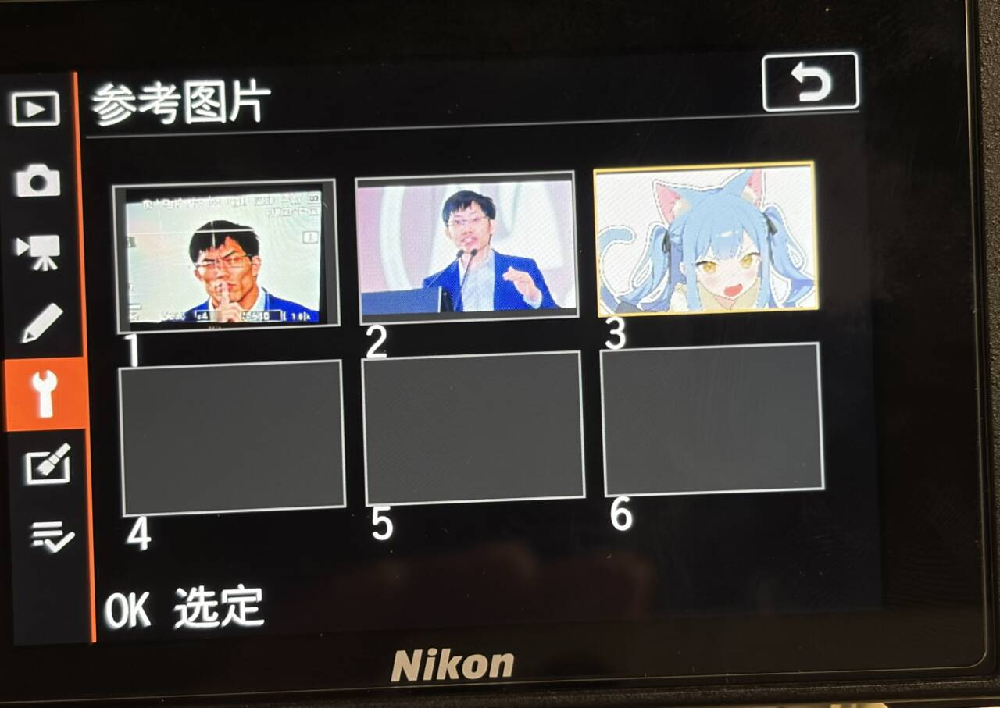
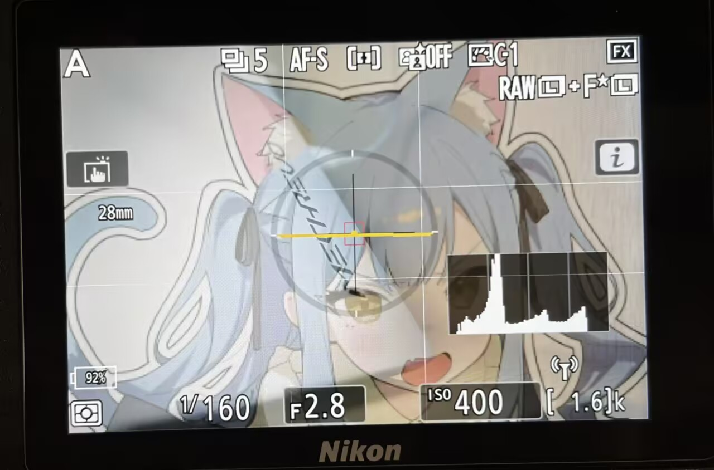

# 构图辅助

在 Nikon Z 7II C 1.70 的照片模式后屏实时取景中叠加参考图片。可调整不透明度，便于对齐主体和画面边缘。拍下的 JPG 和 NEF 保留原始画面。

1. 从相机的[浏览器相册](browser-gallery.md#上传构图参考图)编辑 JPG 或 PNG，并保存到 1 至 6 号槽位。也可打开[离线转换工具](../releases/composition_reference.html)，下载 `Z72REF1.RFG` 至 `Z72REF6.RFG` 中的任一文件，放到 SD 卡根目录。
2. 打开「设定菜单 → 构图辅助 → 参考图片」。有图的槽位直接显示缩略图。用方向键移动后按 OK，或触摸缩略图选定。空槽位留空。
3. 在「设定菜单 → 构图辅助 → 不透明度」选择 10%、25%、50%、75% 或 100%，默认为 50%。
4. 在照片模式的「自定义设定菜单 → f2 自定义控制」下选择 Fn1、Fn2、AF-ON、辅助选择器中央或录像键，进入「构图辅助」，选择「按一下切换」或「按住显示」。回到后屏取景后使用该按键。

构图辅助同一时间绑定一个按键，分配会替换该按键的原厂功能或 AF 区域快捷切换。选择「无」或为该按键选择其他功能即可取消。参考图片槽位、不透明度和快捷键保存在 SD 卡的 `Z72APP.CFG` 中。

## 版本更新与实机截图

### v0.1.0-preview.33 版本更新

- 首次在组合包中加入构图辅助。参考图片页以三列两行显示六个槽位，进入后可直接预览并选图。
- 照片模式的 f2 自定义控制支持绑定构图辅助，可按一下切换或按住显示。取景叠加可选 10%、25%、50%、75% 或 100% 不透明度。
- 浏览器相册可编辑并上传参考图，发布包也提供离线 RFG 转换工具。手机端界面见[浏览器相册实机截图](browser-gallery.md#v010-preview33-版本更新)。

**相机六格缩略图**

**后屏取景叠加**

已用开发试用版在实机验证浏览器编辑上传、机内缩略图和取景叠加。将功能合入组合版后已本地构建和检查，组合包待实机复测。

## English

See the [v0.1.0-preview.33 release notes and hardware screenshots](#版本更新与实机截图) for the six-slot picker and the live-view overlay.

Show a reference image over photo live view on the rear screen of the Nikon Z 7II running C 1.70. Adjust its opacity to align the subject or frame edges. The camera saves its original JPG and NEF images.

1. Edit a JPG or PNG in the [browser gallery](browser-gallery.md#english) and save it to slot 1–6. You can also use the [offline converter](../releases/composition_reference.html) to download a `Z72REFn.RFG` file and place it at the root of the SD card.
2. Open **Setup Menu → Composition reference → Reference image**. Use the direction buttons and **OK**, or tap a thumbnail. Empty slots are left blank.
3. Under **Composition reference → Opacity**, choose 10%, 25%, 50%, 75%, or 100%. The default is 50%.
4. In photo mode, open **Custom Settings Menu → f2 Custom controls**. Choose Fn1, Fn2, AF-ON, the sub-selector center, or the movie-record button. Select **Composition reference**, then **Press to toggle** or **Show while held**. Use the chosen button in rear-screen live view.

The reference shortcut uses one button at a time and replaces that button's native function or AF-area shortcut. Assign **None** or another function to clear it. The slot, opacity, and shortcut are saved in `Z72APP.CFG` on the SD card.

Browser editing and upload, camera thumbnails, and the live-view overlay passed camera testing in the development build. The combined bundle has been built and checked locally and awaits a camera retest.
