# Custom wide-area AF (C1/C2) / 自定义宽区域 AF（C1/C2）

## 中文

1. 打开「设定菜单 → 自定义宽区域 AF」，选择「宽区域 AF（C1）」或「宽区域 AF（C2）」。
2. 进入「对焦区域大小」，用左右键调宽度、上下键调高度。宽度和高度可各自调到取景画面的全宽、全高。预览框会即时更新，按 MENU 保存并返回。
3. 在「主体识别」中选择「人物」「动物」或「关闭」。C1 默认识别人，C2 默认识别动物。「关闭」停用主体识别，并保留宽区域自动对焦。

可在照片拍摄菜单或照片 i 菜单的「AF 区域模式」中选择 C1/C2。高亮 i 菜单里的 AF 区域模式后，也可以用波轮切换。开启「自动旋转信息显示」时，i 菜单和取景状态栏中的 C1/C2 图标会随竖拍界面转正。

在「f2 → 自定义控制」中，可以把 C1/C2 分配给 Fn1、Fn2、AF-ON、辅助选择器中央或照片模式下的录像键。按一下切换，松开后保持。通过快捷键切换到原厂区域时，相机会恢复该区域的对焦框和图标。[AF 区域快捷切换](af-area-shortcut.md)

预设和当前选择与其他扩展共用 `Z72APP.CFG`。更新模块时可保留原有配置。

## English

1. Open **Setup Menu → Custom wide-area AF** and select **Wide-area AF (C1)** or **Wide-area AF (C2)**.
2. Open **Focus area size**. Use Left or Right to change the width and Up or Down to change the height. Each dimension can extend to the corresponding edges of the live-view image. The preview updates as you adjust it. Press MENU to save and return.
3. Set **Subject detection** to **People**, **Animals**, or **Off**. C1 defaults to People and C2 to Animals. Off disables subject detection while keeping wide-area autofocus active.

Select C1/C2 under **AF-area mode** in the Photo Shooting Menu or the photo i menu. You can also turn a command dial while the i-menu AF-area tile is highlighted. With **Auto rotate info** enabled, the i-menu and live-view C1/C2 icons follow the portrait layout.

In **f2 → Custom controls**, assign C1/C2 to Fn1, Fn2, AF-ON, the sub-selector center, or the movie-record button in photo mode. Press once to select the preset. It stays selected after release. Selecting a native area with a shortcut restores that area's focus box and icon. [AF-area shortcuts](af-area-shortcut.md)

Preset settings and the active selection share `Z72APP.CFG` with the other extensions. You can keep your existing file when you update.

## 实机截图 / Camera screenshots

C1/C2 已随 SD 整包通过实机验证。The combined SD module passed on-camera verification with C1/C2.

| 简体中文 | English |
| --- | --- |
| 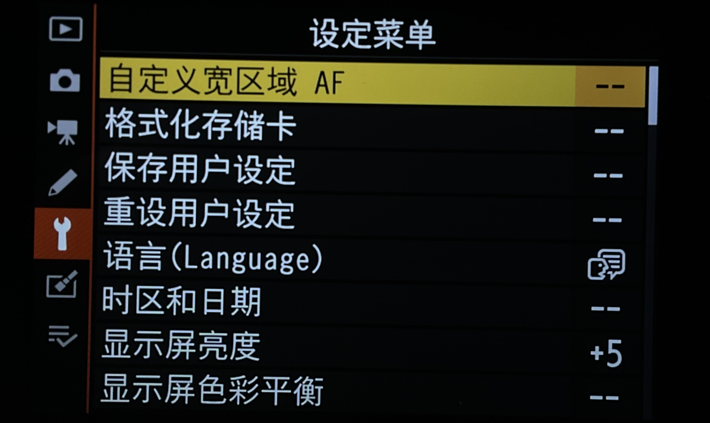 | 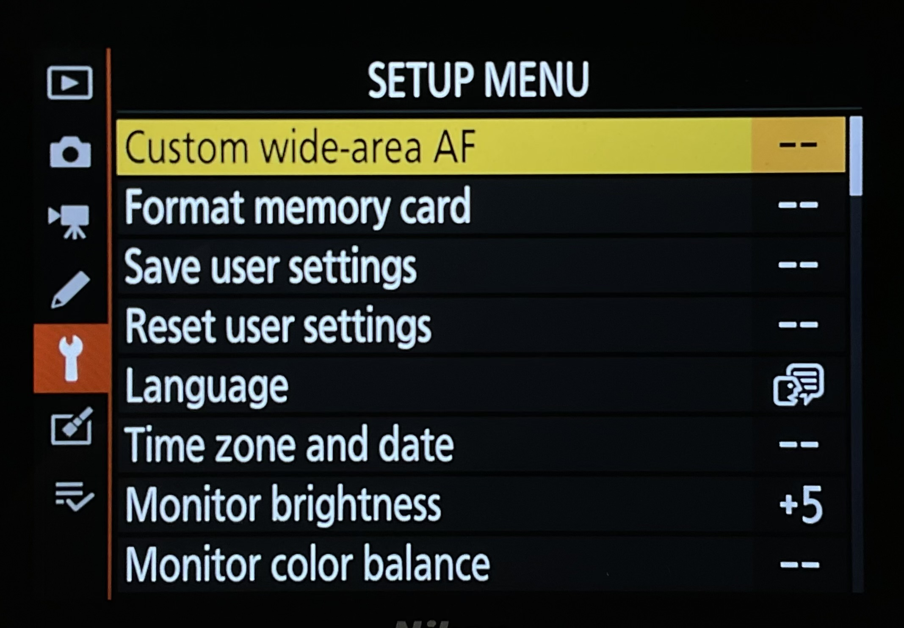 |
| 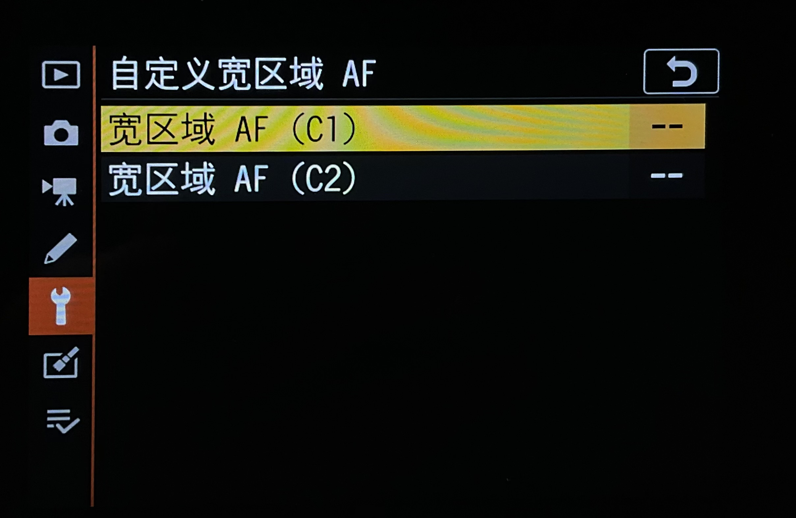 | 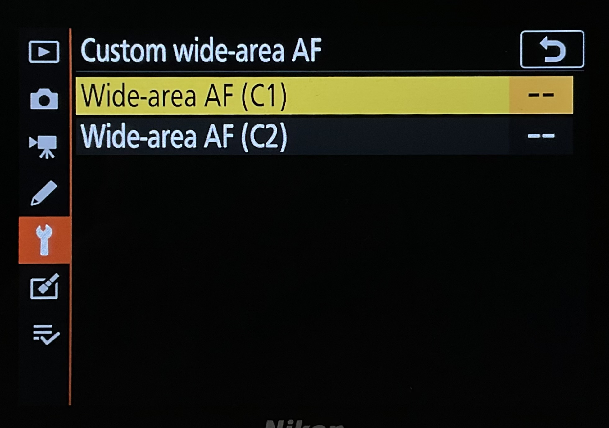 |
| 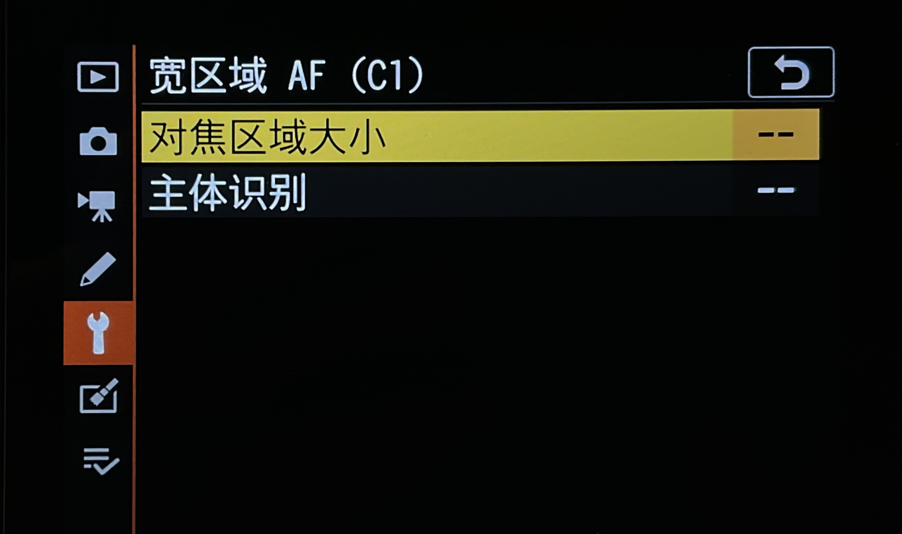 | 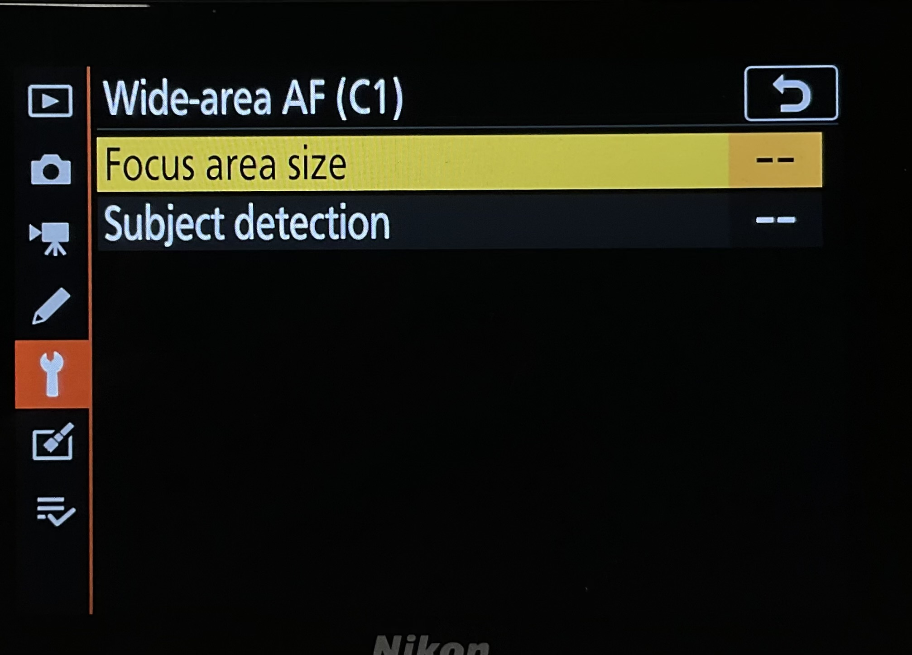 |
| 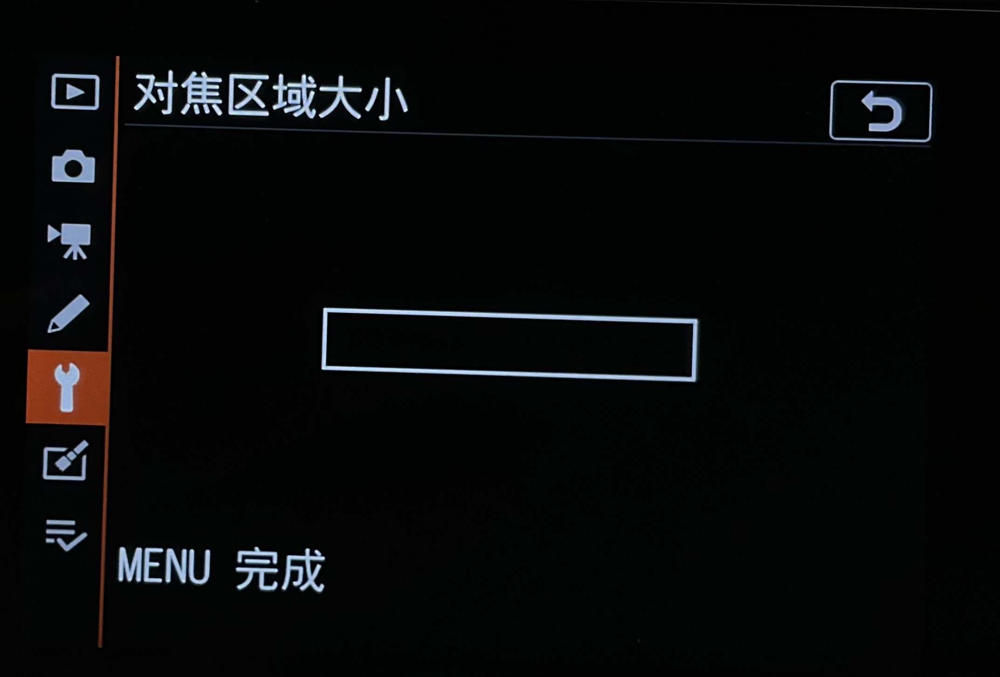 | 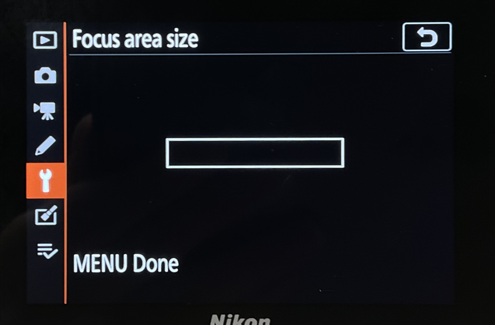 |
| 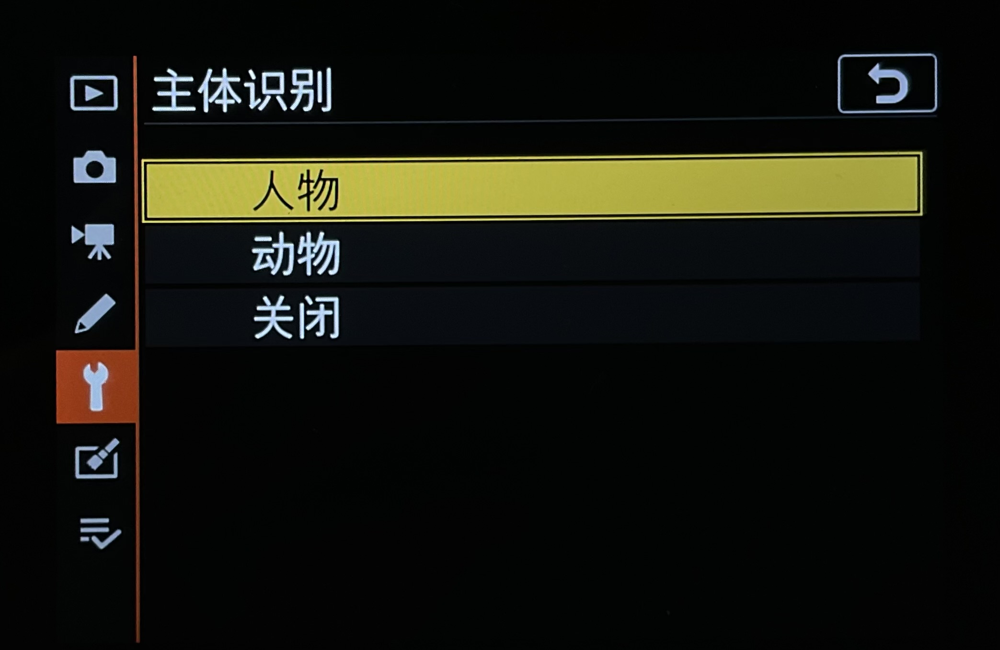 | 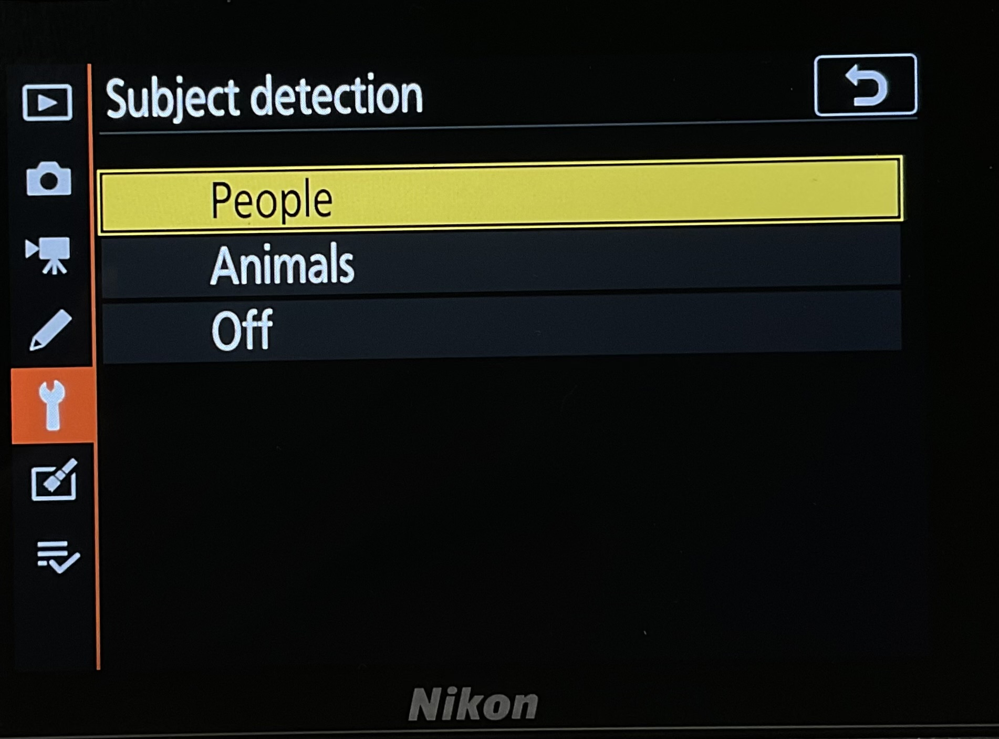 |
| 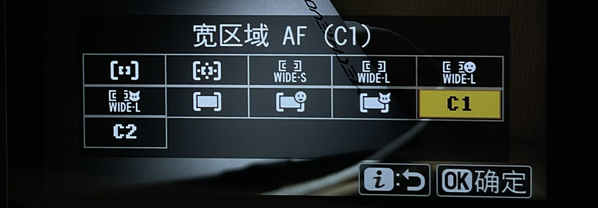 | 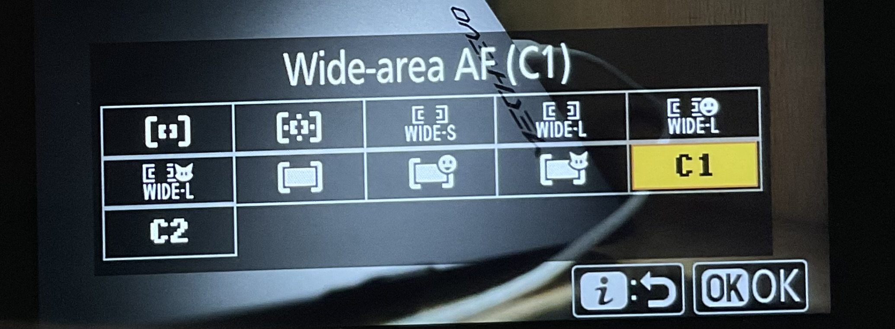 |
| 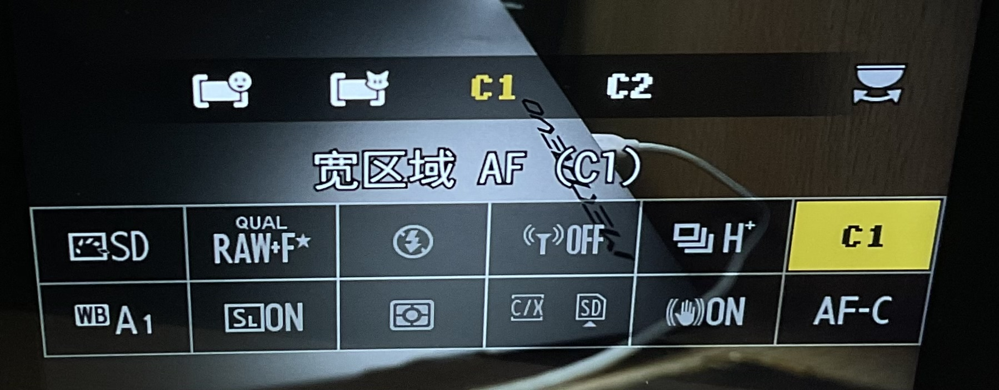 | 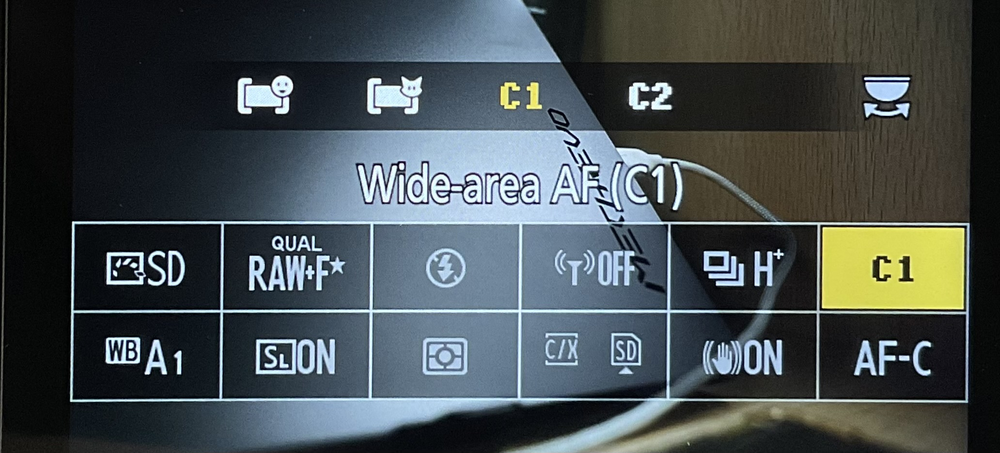 |

### 取景中的 C1 / C1 in live view

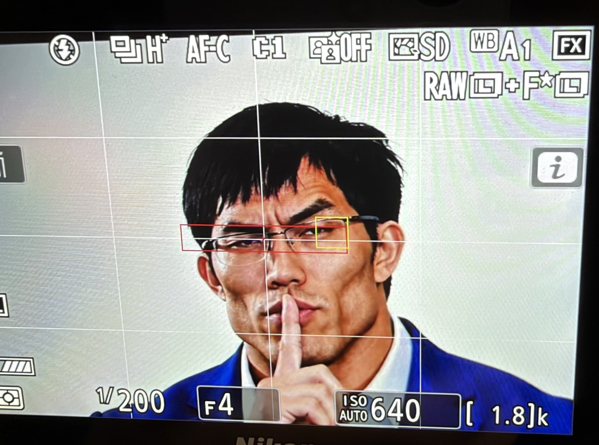

## 版本更新 / Version history

### v0.1.0-preview.42

- 先完成自定义宽区域 AF 绘制的初始化，再启用对应的显示回调。
- Completes initialization of custom wide-area AF drawing before activating its display callback.

### v0.1.0-preview.38

- 修复 C1/C2 宽高受原厂宽区域 AF（L）尺寸限制的问题。两个方向可分别调至全宽、全高，最大时覆盖整个取景画面。2026-11-25 在 Z 7 II 实机验证。
- Fixed the C1/C2 size cap inherited from Wide-area AF (L). Width and height can each reach the edges, covering the full frame at maximum size. Verified on a Z 7 II on November 25, 2026.
- 尺寸预览随宽高调整更新，取景中的对焦框在画面边缘内显示。
- Updated the size preview and keeps the live focus box within the frame edges.

### v0.1.0-preview.27

- 修复 AF-S 下打开 i 菜单 AF 区域选择页时可能卡死的问题。
- Fixed a freeze that could occur when opening the i-menu AF-area picker in AF-S.

### v0.1.0-preview.21

- 首次加入 C1/C2 自定义宽区域 AF。两个预设可独立设置区域宽高和主体识别，支持 i 菜单、波轮和 f2 快捷键切换。
- Added Wide-area AF (C1/C2) with independent width, height, and subject detection settings. The presets are accessible through the i menu, command dials, and f2 shortcuts.
- 尺寸预览随方向键调整，C1/C2 参数和当前选择在开机时从 SD 设置恢复。
- The size preview updates as the directional buttons are pressed. C1/C2 settings and the active selection are restored from the SD card at startup.
