# Filtered playback / 筛选的播放

[English README](../README.en.md) · [中文说明](../README.md)

On the Nikon Z 7II, open **Playback Menu → Filtered playback criteria** to set the criteria. While reviewing an image, press **i** and choose **Filtered playback → On**. The playback i menu also offers **Filtered playback criteria**, with the same settings as the Playback Menu.

在 Nikon Z 7II 的「**播放菜单 → 筛选的播放条件**」中设置条件。浏览照片时按 **i** 键，选择「**筛选的播放 → 开启**」。播放 i 菜单中的「筛选的播放条件」与播放菜单共用同一套设置。

| Criterion / 条件             | Options / 选项                                                   |
| ---------------------------- | ---------------------------------------------------------------- |
| Protection status / 保护状态 | Any, Protected only, Unprotected only / 不限、仅已保护、仅未保护 |
| Image type / 影像类型        | All, Photos only, Movies only / 全部、仅照片、仅视频             |
| Rating / 评级                | Any, Unrated, ★ to ★★★★★ / 不限、无评级、★ 至 ★★★★★  |
| Shooting date / 拍摄日期     | Any or Select date / 不限或选择日期                              |

Choose any combination of ratings. A file can match any of the selected ratings and must meet each of the other active criteria. For example, select **Photos only** and check **★★★★** and **★★★★★** to show photos with either rating. Use the year, month, and day controls under **Select date**, then press **OK** to confirm.

评级支持多选，符合任意一个所选评级即可，同一影像还须同时满足其他已启用的条件。例如将影像类型设为「仅照片」，再勾选「★★★★」和「★★★★★」，即可浏览这两类评级的照片。按日期筛选时，在「选择日期」里调整年、月、日，再按 **OK** 确认。

Filtering applies to both full-frame playback and the thumbnail grid. In full-frame playback, the counter shows the current position and total within the filtered results. Set **Filtered playback** to **Off** to restore normal playback. The switch defaults to **Off**, and the switch and criteria are saved together in `Z72APP.CFG` on the SD card. You can keep the existing configuration file when updating the module.

筛选同时应用于全屏播放和缩略图列表。全屏右上角显示当前影像在筛选结果中的位置和结果总数。将「筛选的播放」设为「关闭」即可恢复普通播放，已选条件会保留。筛选开关默认关闭，开关和条件一起保存在 SD 卡的 `Z72APP.CFG` 中。升级模块时可保留原有配置文件。

## Playback Menu / 播放菜单

| 简体中文                                                                | English                                                                                                  |
| ----------------------------------------------------------------------- | -------------------------------------------------------------------------------------------------------- |
| 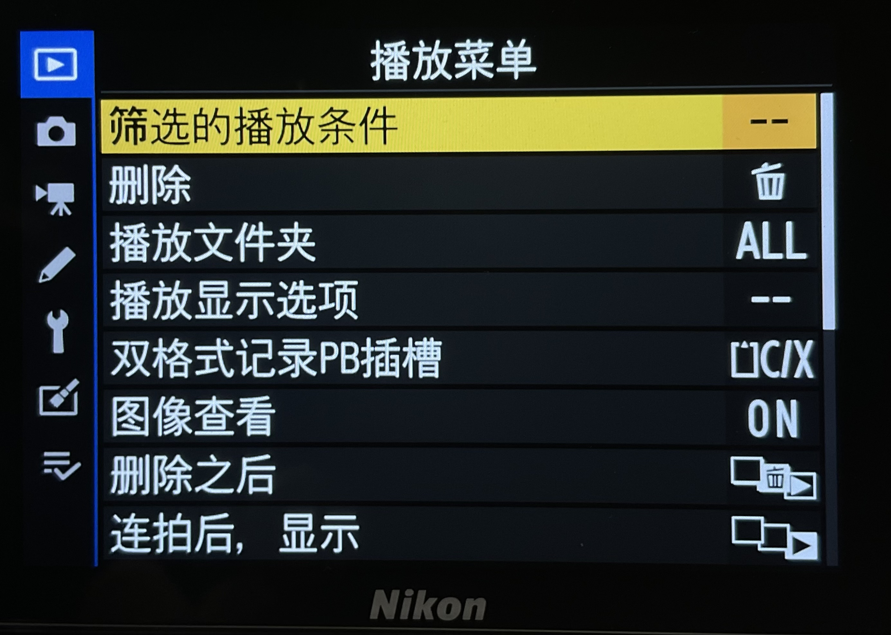 | 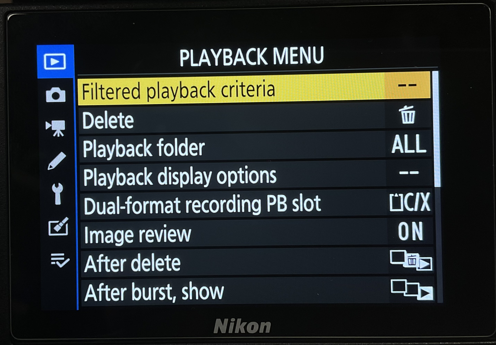 |
| 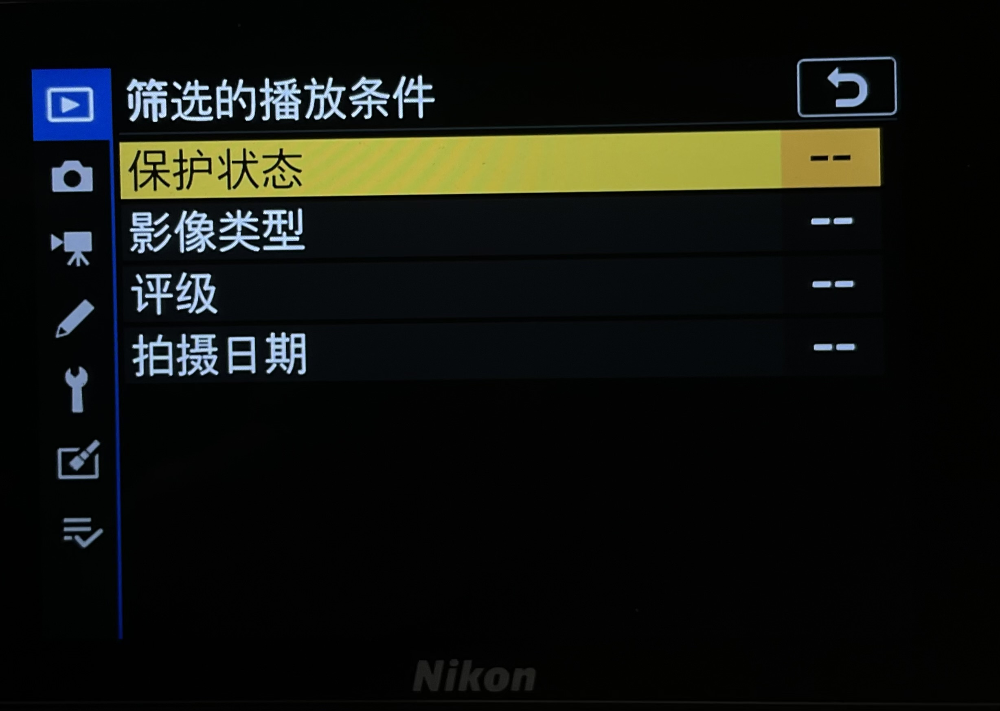            | 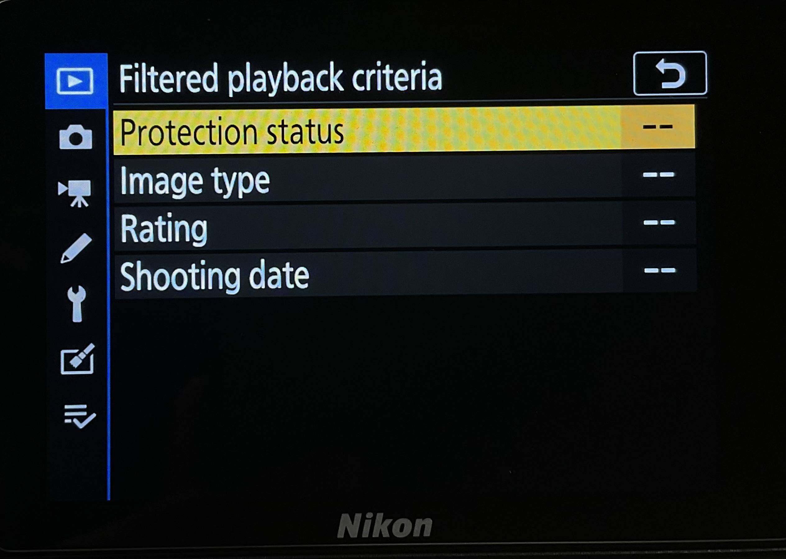                                 |
| 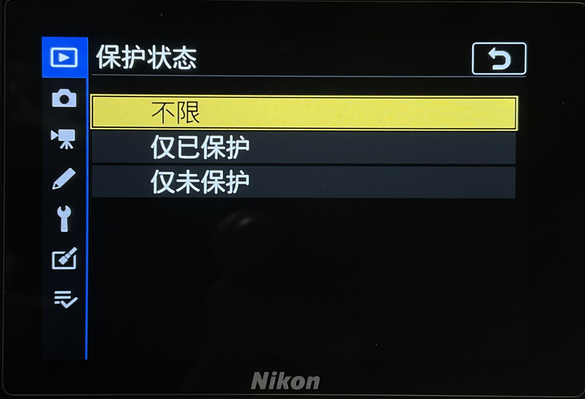                | 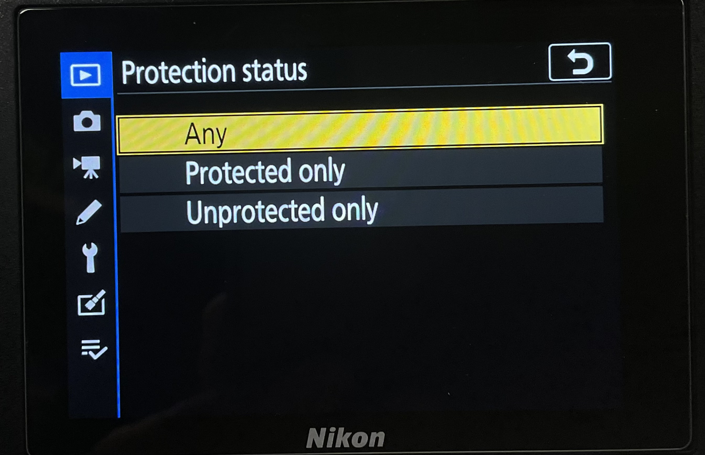                                        |
| 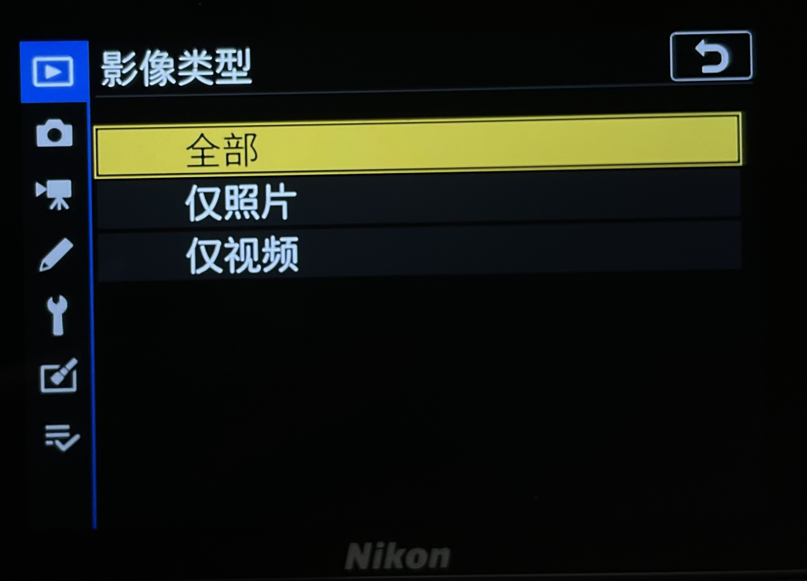                | 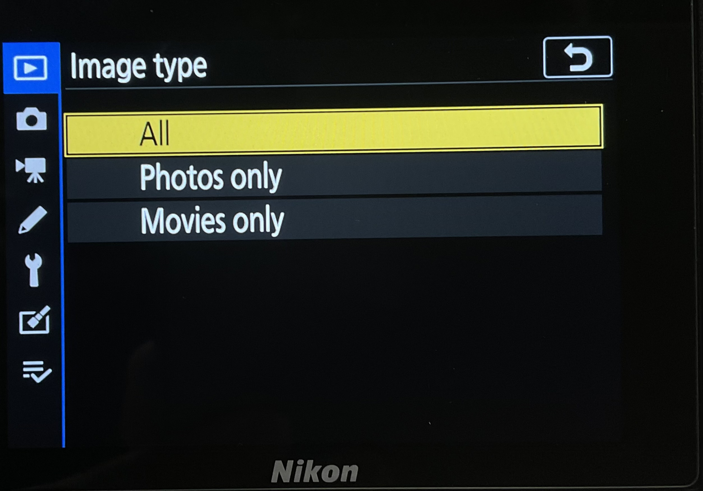                                               |
| 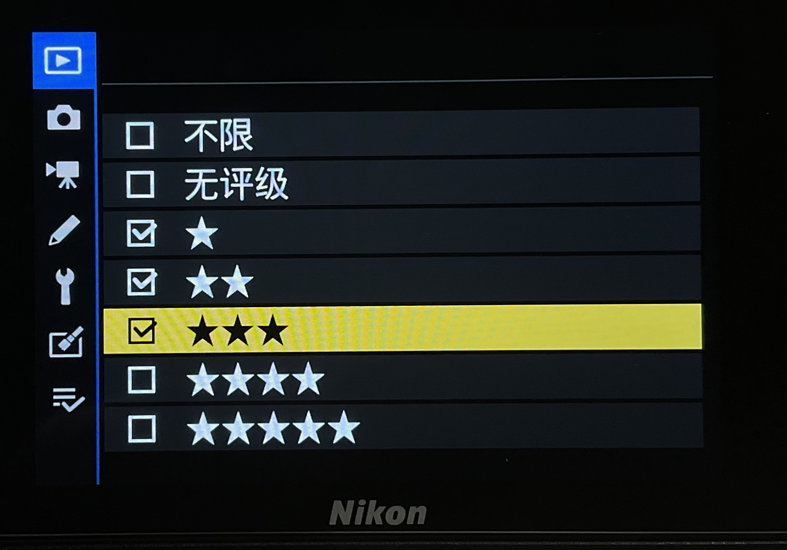                | 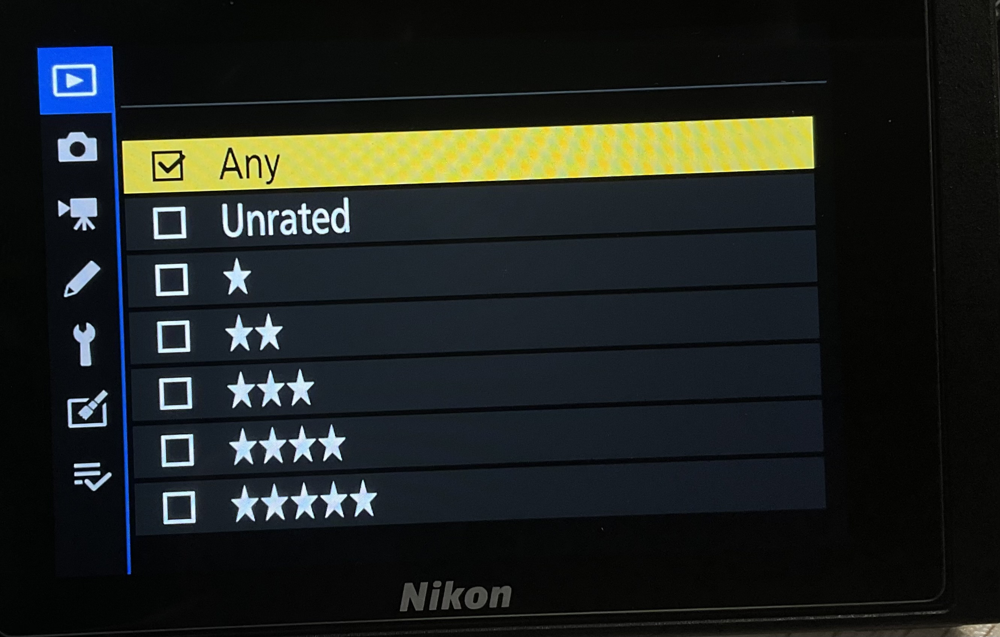                                               |
| 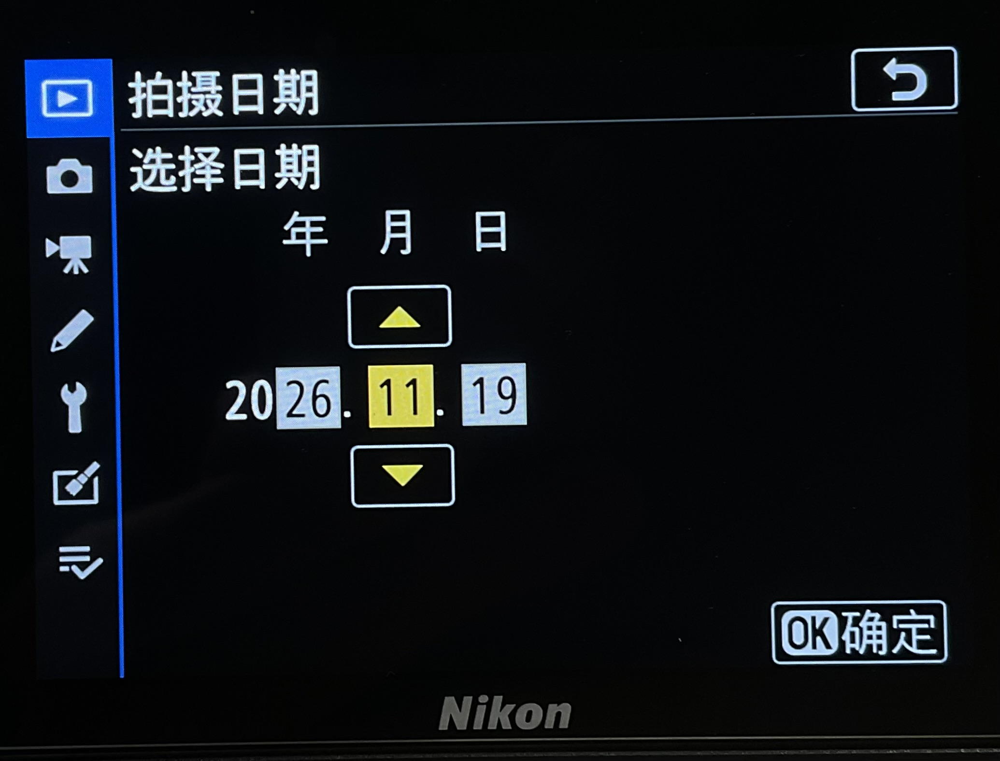                    | 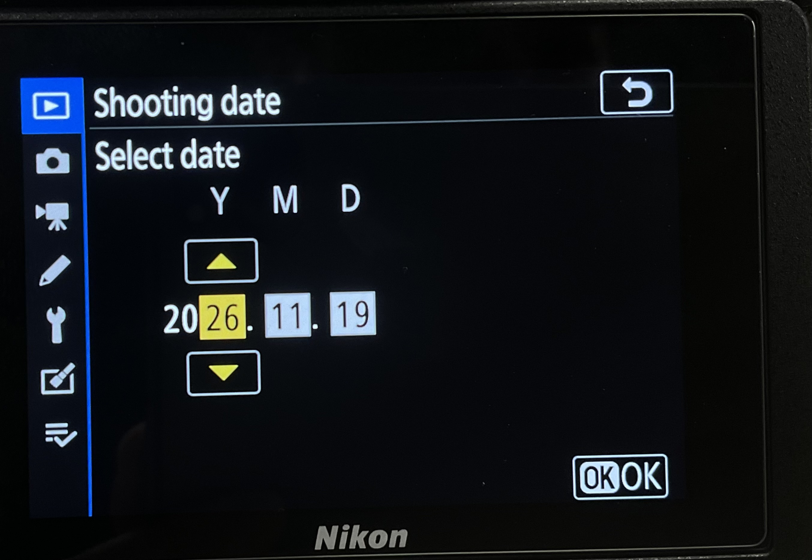                                   |

## Playback i menu / 播放 i 菜单

| 筛选入口 / Filter entries                                                         | 全屏播放 / Full-frame playback                                                                                 |
| --------------------------------------------------------------------------------- | -------------------------------------------------------------------------------------------------------------- |
| 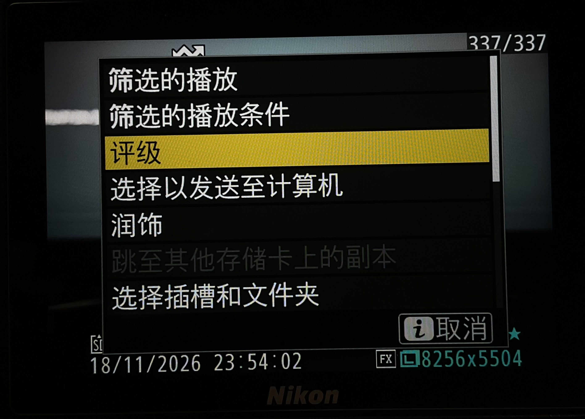 | 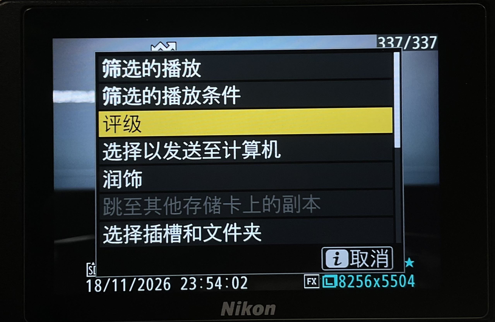 |

The supplemental Noto Sans SC glyph for the Simplified Chinese menu is distributed under the SIL Open Font License. 简体中文菜单的「筛」字补充字形取自 Noto Sans SC，采用 SIL 开放字体许可证。[Font license / 字体许可证](../releases/v0.1.0-preview.22/menu-font-license.txt)
