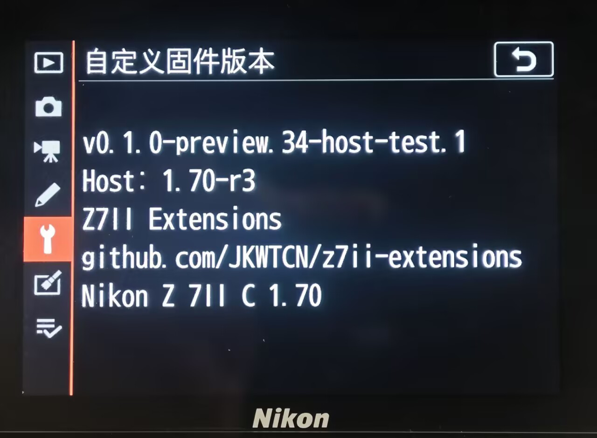

# 自定义固件版本 / Custom firmware version

在 Nikon Z 7II 的「设定菜单 → 自定义固件版本」查看 SD 模块版本和已安装的宿主固件版本。模块版本显示在第一行。宿主版本以 `Host: 1.70-r3` 的形式显示，无法识别时显示 `Host: unknown`。

Open **Setup Menu → Custom firmware version** on the Nikon Z 7II to see the SD module version and installed host firmware revision. The module version appears on the first line. The host line shows a revision such as `Host: 1.70-r3` or `Host: unknown` when the camera's host build cannot be identified.

## 版本更新 / Version history

### v0.1.0-preview.35

- 新增宿主固件版本显示，可识别 `1.70-r1`、`1.70-r2` 和 `1.70-r3`。同期发布的宿主 `1.70-r3` 修复了首次启动时等待读卡灯熄灭后开机可能出现的取景异常。
- Added the installed host firmware revision with support for `1.70-r1`, `1.70-r2`, and `1.70-r3`. The separately released `1.70-r3` host fixed a first-boot live-view issue that could occur after waiting for the card-access lamp to turn off.

### v0.1.0-preview.26

- 首次在设定菜单加入「自定义固件版本」，显示 SD 模块版本、项目名称和目标固件。
- Added Custom firmware version to the Setup Menu, showing the SD module version, project name, and target firmware.
