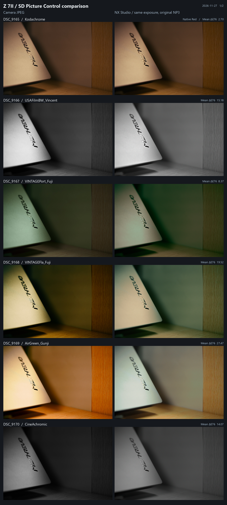
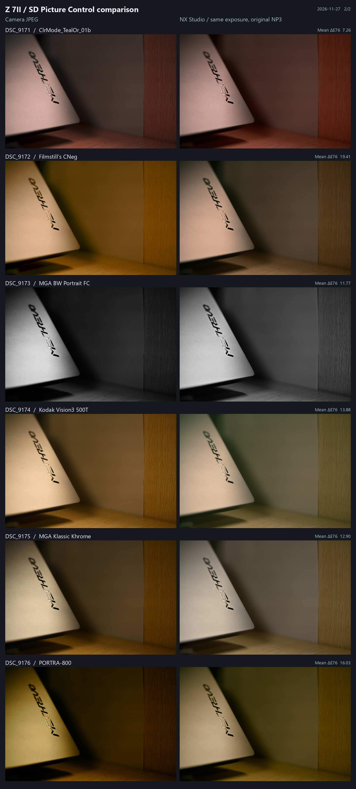
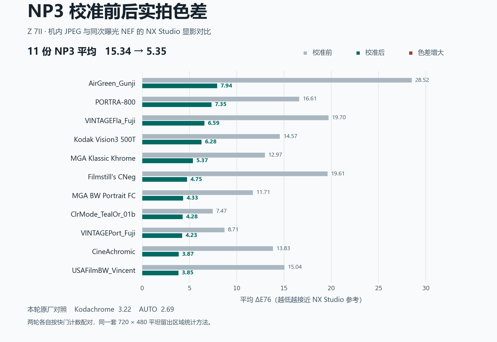
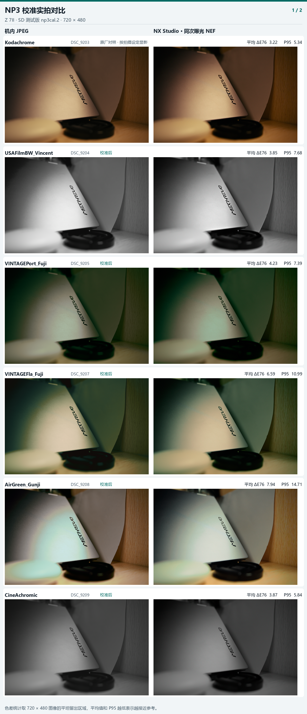
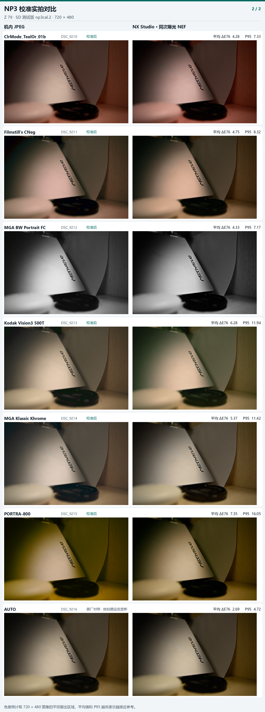

# 风味灵活颜色 / Flexible Color for the Z 7II

简体中文 | [English](#english)

在照片 i 菜单的「设定优化校准」中，可直接选用 SD 卡上的兼容 NP3。B 插槽从 B‑1 开始编号，与机内 C 插槽独立，最多显示 99 份预设。模块从 SD 卡根目录的 `CUSTOMPC` 读取预设，目录缺失时会自动创建。支持使用英文文件名和预设名称的 0310 灵活色彩配方，以及无自定义曲线的 0310 创意优化校准 Red 文件。Red 沿用相机的原厂处理路径。

用方向键、触摸或波轮浏览时可直接预览。确认后，照片 i 菜单显示当前 B 编号，选择保存在 `CUSTOMPC/Z72BSEL.CFG`。开机优先通过 `CUSTOMPC/Z72BSEL.IDX` 读取并核对上次的 NP3，在取景条件就绪时提前恢复。索引无法使用时重新扫描目录。

## 实拍对比

SD 卡根目录 `CUSTOMPC` 版已于 2026-11-27 通过 Z 7II 实机验证。以下是加入 SD 卡校准前的首轮对照。

2026-11-27 实机拍摄的 12 组照片覆盖本轮提供的全部 NP3。每行左侧为 Z 7II 直出 JPEG，右侧为 NX Studio 用同次曝光的 NEF 套用原始 NP3 后的显影结果。配对按机身曝光计数和优化校准名称核对。Kodachrome 一行使用原厂创意优化校准 Red，另外 11 行使用扩展的灵活色彩路径。

图中的平均 ΔE76 在 720×480 缩图的平坦区域计算。在这个场景里，AirGreen_Gunji 的直出偏橙最明显（27.47），USAFilmBW_Vincent 的直出暗部更深（15.18）。

ARM 模拟验证了启动直读、提前恢复和补发表的重试条件。六份配方的解析和色表生成指令数减少约 85%–87%，RGB 和色度表与优化前逐字节一致。

## SD 卡校准文件

将 `Z72NPCAL.BIN` 放到 SD 卡根目录，与 `Z72APP.BIN` 放在一起。原始 NP3 放在 `CUSTOMPC`，复制后完整关机再开机。相机按 NP3 的字节长度和内容指纹匹配校准，重命名文件或调整 B 槽顺序也能匹配。修改 NP3 内容后，使用新内容重新拟合对应记录。

[模块](../releases/latest/Z72APP.BIN) · [校准文件](../releases/latest/Z72NPCAL.BIN) · [SHA-256 校验](../releases/latest/SHA256SUMS)

每条记录在通用 RGB 曲线和配对色度表上叠加该预设的修正，应用于取景和机内 JPEG。校准文件缺失、校验失败或没有对应记录时，相机采用该预设的常规渲染。Kodachrome 继续使用原厂 Red。更新校准只需替换 `Z72NPCAL.BIN` 并重新开机。

`tools/np3_calibrate.py fit` 使用本地 NX Studio、NP3 研究工具和 Z 7II 模型样本，将同次曝光的 JPEG 与显影结果拟合为 JSON 和校准文件。`tools/np3_calibrate.py pack calibration.json Z72NPCAL.BIN` 可将调整后的 JSON 重新打包。JSON 中按原始文件内容记录校准，`rgb` 为三通道各九个 RGB 修正节点，`cpxs` 为六行各四个循环色度修正节点。

## 算法差异

表中的 NX Studio 指对同次曝光 NEF 应用完整灵活色彩配方的桌面显影路径。[尼康 NX Studio 灵活色彩说明](https://nikonimglib.com/nxstdo/onlinehelp/en/the_picture_controls_flexible_color_23.html)

| 环节 | 风味灵活颜色（Z 7II 扩展） | NX Studio 灵活色彩 |
| --- | --- | --- |
| 处理路径 | 以机身 Auto 优化校准为底色，按 NP3 生成 RGB 曲线和配对色度系数，交由原厂 ISP 处理取景和照片 JPEG。取景与成片的 RGB 曲线各用 65 点和 129 点。 | 用尼康桌面 RAW 显影管线处理 NEF，在同一显影流程内执行完整配方。 |
| 基础调整 | 用响应表近似反差、高光、阴影、白色、黑色和饱和度。锐化与清晰度沿用机内底色的设置。 | 原生执行配方的基础调整，锐化、中等锐化和清晰度分别参与显影。 |
| 八色混色 | 按像素色相近似八个色域的色相、饱和度和亮度调整。相邻色域共用色度表，强调整的作用范围和幅度可能偏离参考。 | 按八个色域执行原生的色相、色度和亮度映射，输出随像素颜色改变。 |
| 三段调色 | 把暗部、中间调、高光的色相、饱和度和亮度，以及混合与平衡，折算到早期 RGB 曲线。按亮度加权，低色度区域的强染色仍可能偏黄、偏红或偏蓝。 | 在原生调色阶段分配三个亮度区间的染色和亮度，混合控制区间重叠，平衡调整暗部和高光的占比。 |
| 自定义曲线 | 把配方的 257 个单调采样点映射到早期 RGB 表，保留配方黑位和高光端点，再用中性灰阶近似补偿亮度。强色偏时，亮度和饱和度仍可能一起变化。 | 对照实验显示，自定义曲线通过混色之后的亮度曲线作用于显影结果。 |
| 配方与输出 | 同一套通用算法处理兼容的灵活色彩配方。原始 NEF 传感器数据保留，软件效果随取景和 JPEG 输出，NX Studio 显影 NEF 时可手动套用原始 NP3。 | 可在显影时重新选择和编辑完整配方，并输出显影后的图像。 |

## English

Photo **i → Set Picture Control** displays compatible SD presets as B slots, numbered independently of the camera’s C slots. The module supports up to 99 presets. Use ASCII filenames and preset names under `CUSTOMPC` at the root of the SD card. The module creates the folder if it is missing. It accepts Flexible Color NP3 version 0310 and version 0310 Creative Picture Control Red files with no custom curve. Red uses the camera’s native processing.

Browse with the multi selector, touch screen, or command dial to preview presets. On startup the module uses `CUSTOMPC/Z72BSEL.IDX` to read and verify the last NP3 selected in `CUSTOMPC/Z72BSEL.CFG`. It restores the preset once live view is ready and scans the directory if it cannot use the index.

### Camera JPEG and NX Studio comparison

The SD-root `CUSTOMPC` build was verified on a Nikon Z 7II on November 27, 2026. The following comparisons are from the first round, before SD calibration was added.

The [two comparison sheets above](#实拍对比) show 12 matched exposures from November 27, 2026, covering every supplied preset. Each row shows the camera JPEG on the left and the same exposure's NEF developed in NX Studio with the original NP3 on the right. Matching was verified using the Nikon exposure count and Picture Control name. Kodachrome uses the camera's native Creative Picture Control Red. The other 11 presets use the extension's Flexible Color path.

Mean ΔE76 is calculated over flat areas in the 720×480 comparisons. In this scene, the AirGreen_Gunji JPEG has the strongest orange cast (27.47), and USAFilmBW_Vincent has darker shadows (15.18).

ARM emulation verified direct startup reads, early restoration, and retry conditions. Parsing and table generation executed 85%–87% fewer instructions across six presets and produced byte-identical RGB and chroma tables.

### SD calibration file

Put `Z72NPCAL.BIN` beside `Z72APP.BIN` at the root of the SD card and keep the original presets in `CUSTOMPC`. Fully power the camera off and on. The module matches each preset by file length and content fingerprint. Renaming or reordering the files preserves the match. If you edit a preset, fit a new record for its updated content.

[Module](../releases/latest/Z72APP.BIN) · [Calibration file](../releases/latest/Z72NPCAL.BIN) · [SHA-256 checksums](../releases/latest/SHA256SUMS)

Each record adjusts the preset's standard RGB and paired chroma tables for live view and camera JPEGs. The module uses the standard rendering if the calibration file is missing or fails validation or if the preset has no matching record. Kodachrome uses the camera's native Red processing. To update the calibration, replace `Z72NPCAL.BIN` and power-cycle the camera.

Use `tools/np3_calibrate.py fit` with a local NX Studio installation, the NP3 research tools, and Z 7II model fixtures to generate a JSON report and calibration file from matched captures. Use `tools/np3_calibrate.py pack calibration.json Z72NPCAL.BIN` to rebuild the calibration file from an edited report.

### Algorithm differences

| Stage | Z 7II Flexible Color extension | NX Studio Flexible Color |
| --- | --- | --- |
| Rendering | Generates RGB curves and paired chroma coefficients from each NP3 and applies them through the camera ISP over the Auto Picture Control base. Uses 65 RGB nodes for preview and 129 for JPEG. | Develops the NEF with Nikon’s desktop RAW pipeline and applies the complete preset during development. |
| Basic adjustments | Approximates contrast, highlights, shadows, whites, blacks, and saturation with response tables. Sharpening and clarity follow the camera base settings. | Applies the preset’s native basic adjustments, including separate sharpening, mid-range sharpening, and clarity. |
| Eight-color mixing | Approximates hue, saturation, and brightness by pixel hue using shared chroma tables. Strong changes may differ in range and strength. | Applies native hue, chroma, and brightness mapping across eight color ranges. |
| Three-way grading | Maps shadow, midtone, and highlight adjustments into luminance-weighted early RGB curves. Strong tints can differ, especially in low-chroma areas. | Grades shadows, midtones, and highlights in its native grading stage. Blending controls overlap, and balance shifts the ranges. |
| Custom curve | Maps 257 monotone samples into the early RGB tables, preserves the preset endpoints, and approximates brightness using a neutral ramp. | Controlled comparisons indicate that the custom curve operates on luminance after color mixing. |
| Output | Uses a shared algorithm for compatible presets. The effect appears in preview and camera JPEGs. The original NEF sensor data is retained. | Reapplies and permits editing the full preset when developing the NEF. |

## 版本更新 / Version history

### v0.1.0-preview.47

- 新增按 NP3 内容匹配的独立校准，应用于取景和机内 JPEG。发布包附带 11 份预设的校准数据。把 `Z72NPCAL.BIN` 和 `Z72APP.BIN` 一起放在 SD 卡根目录，原始 NP3 放在 `CUSTOMPC`。
- Added individual NP3 color calibration for live view and camera JPEGs. This release includes corrections for 11 presets matched by file content. Copy `Z72NPCAL.BIN` and `Z72APP.BIN` to the root of the SD card and keep the original presets in `CUSTOMPC`.

**Z 7II 实机验证 / Z 7II hardware verification**

2026-11-27 在 Z 7II 上复测通过。本场景下，11 份校准预设的色差均下降，平均 ΔE76 从 **15.34** 降至 **5.35**，降低约 **65%**。`AirGreen_Gunji` 改善最大，从 **28.52** 降至 **7.94**。原厂对照中，Kodachrome 为 **3.22**，AUTO 为 **2.69**。

The Z 7II camera test passed on November 27, 2026. All 11 calibrated presets showed lower color error in this scene. Their mean ΔE76 fell from **15.34** to **5.35**, about **65%**. `AirGreen_Gunji` improved the most, from **28.52** to **7.94**. The native controls measured **3.22** for Kodachrome and **2.69** for AUTO.

两轮均按机身快门计数和优化校准名称配对。左侧是机内 JPEG，右侧是 NX Studio 显影的同次曝光 NEF。色差取 720 × 480 图像中的平坦留出区域。两张实拍对照图共展示 13 组，含 11 份校准预设和 2 组原厂对照。

Both rounds were matched by shutter count and Picture Control name. The plates show camera JPEGs on the left and NX Studio renders of the same exposures' NEFs on the right. Color error was measured in flat held-out regions of the 720 × 480 images. The plates include 13 pairs covering 11 calibrated presets and two native controls.

### v0.1.0-preview.45

- 照片优化校准菜单加入 B 槽位，可从 SD 卡加载 Flexible Color 预设，关机后保存选择并在开机时恢复。机内 JPEG 与尼康工坊导出的实拍对比见上文。
- Added B slots to the photo Picture Control menu for Flexible Color presets loaded from SD. The module saves the selected preset and restores it at startup. The photos above compare camera JPEGs with NX Studio exports.
- B 槽最多显示 99 个预设，方向键、触屏和波轮支持实时预览。开机优先用索引恢复预设，也支持通过原厂处理路径使用兼容的 Red 配方。
- The B list supports up to 99 presets with live preview through the directional buttons, touch, or a command dial. Startup uses the saved index to restore the preset, and compatible Red recipes use the camera's native processing.
