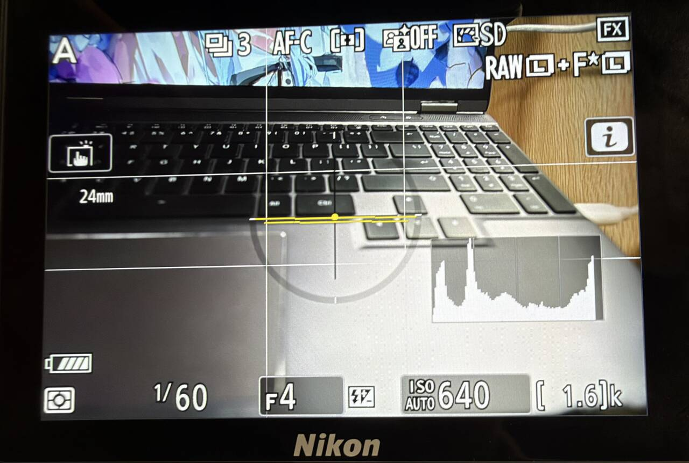

# Focal length display / 焦距显示

[English README](../README.md) · [中文说明](../README.zh-CN.md)

Show the current focal length in photo live view with an electronically reporting lens, including lenses whose zoom ring is turned manually. The value comes from the camera's live lens properties; taking a photo or reading an EXIF file is not required.

照片取景支持显示电子镜头报告的当前焦距，包括手动转动变焦环的普通变焦镜头。直接读取机身的实时镜头属性，无需先拍照或读取 EXIF 文件。

- Retains the native focal-length text widget, font, and `24mm` / `24.5mm` formatting. LCD text follows Auto rotate info; the viewfinder uses its native landscape layout.
- Each custom DISP preset has an independent **Shooting info → Focal length display** switch, separate from Other information. Minimal leaves it off by default.
- Native DISP pages retain their original focal-text visibility policy. Power-zoom lenses retain the native update path; this feature does not enable the W/T control bar.
- Missing, noncommunicating, or invalid lens data is hidden. The extension does not change the image or its EXIF metadata.

- 沿用原厂焦距文字控件、字体及 `24mm`／`24.5mm` 格式。LCD 文字遵循「自动旋转信息显示」，取景器使用原厂横向布局。
- 每套自定义 DISP 预设都有独立的「拍摄信息 → 焦距显示」开关，与「其他信息」分开控制；极简页默认关闭。
- 原厂 DISP 页面保留焦距文字的原有可见性规则。电动变焦镜头继续走原厂更新流程，不会额外开启 W/T 控制条。
- 无镜头、无电子通信或焦距无效时隐藏，不改变照片及 EXIF 信息。

## Verification / 验证

**Hardware verified.** On November 13, 2026, the user confirmed the 42,748-byte combined build passed camera testing. The supplied photo shows `24mm` alongside the histogram and virtual horizon. The same build includes the independent focal-length setting and corrected scrolling menu.

**已实机验证。** 2026-11-13，用户确认 42,748 字节完整组合版本通过实机验证。提供的照片显示 `24mm` 焦距与直方图、水平仪同时显示；同一版本包含独立焦距开关和修正后的菜单滚动布局。

Local checks execute the native visibility, layout, and formatting paths with modeled lens and paint services. They cover changing focal values, integer/fractional formatting, invalid lens data, context exclusions, both LCD mask banks, independent DISP selection, and the native EVF style. Hardware confirmation does not establish compatibility with every lens or separately verify every output, language, or long-term operating condition.

本地检查执行原厂可见性、布局和格式化流程，镜头和图形服务使用替身，覆盖焦距变化、整数／小数格式、无效镜头数据、显示上下文排除、两组 LCD 掩码、独立 DISP 选择及原厂取景器字体。此次实机确认不代表全部镜头兼容性，也未逐项独立覆盖每种输出、语言及长期运行条件。
