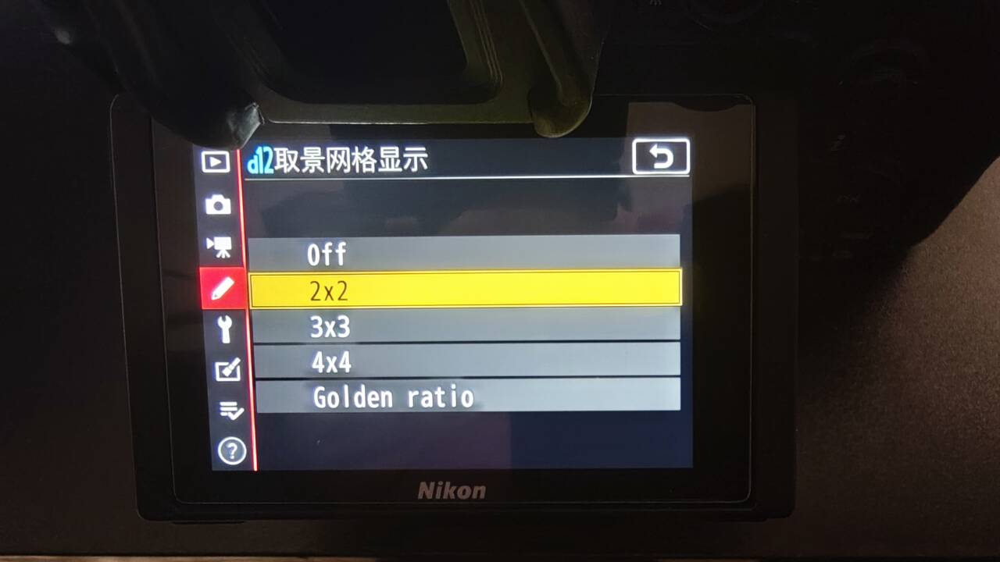
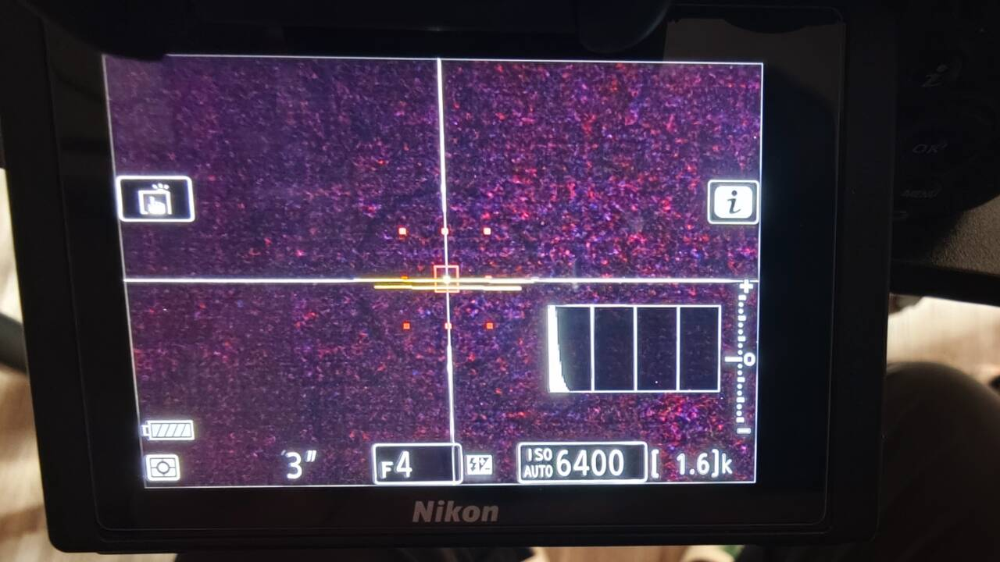
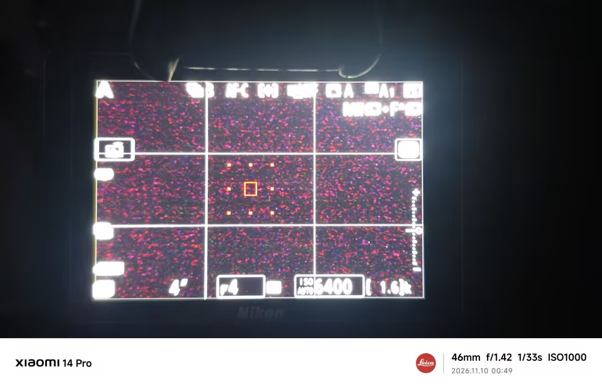
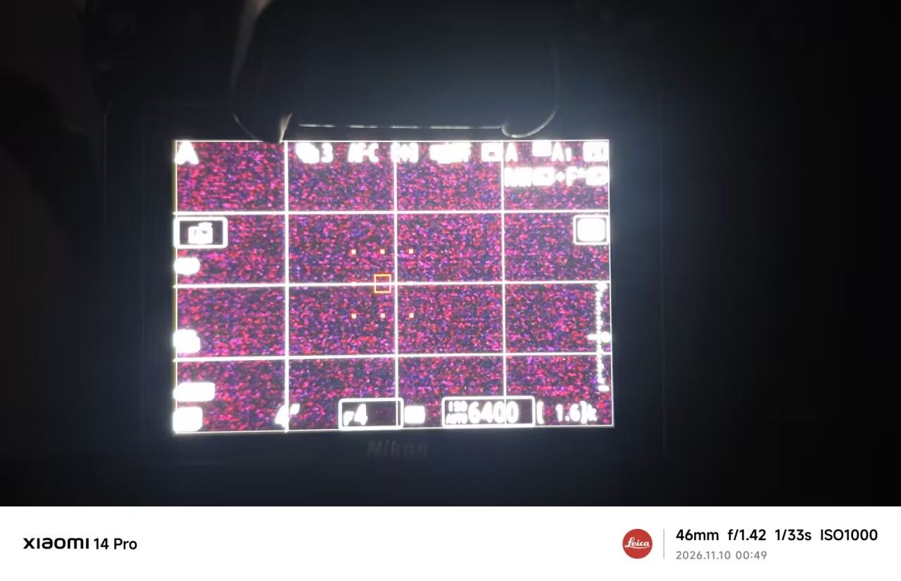
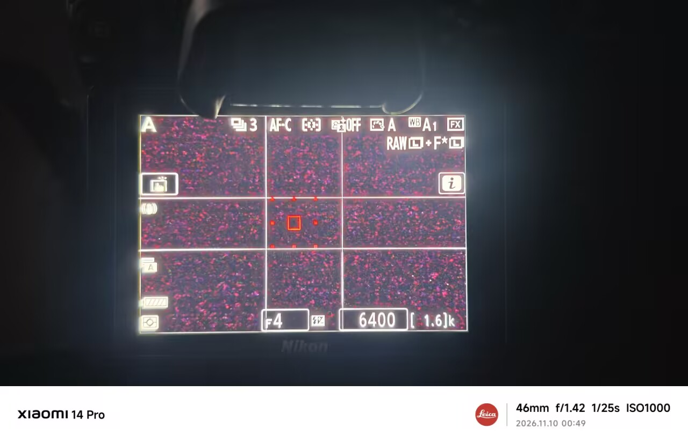
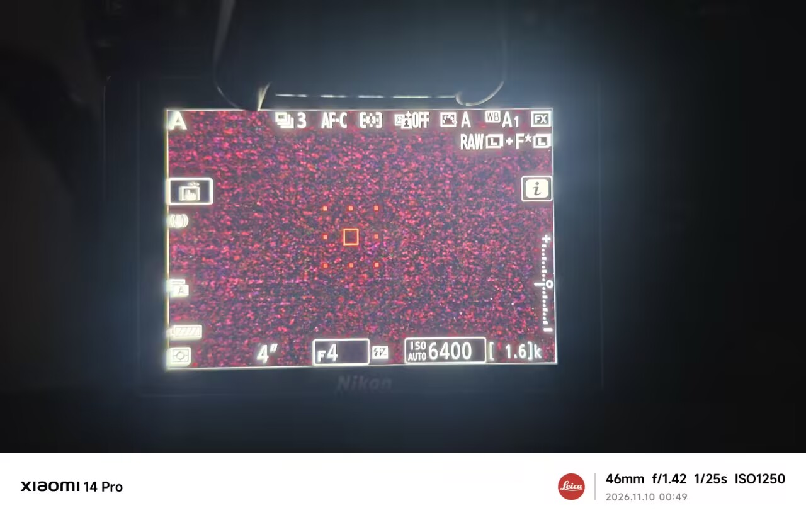

# Framing grid / 取景网格

Nikon Z 7II · 2026-11-10

Original camera-screen photos provided by the tester show the current five-option menu, the grid styles, and the view with the grid switched off.

以下为测试者提供的原始实机照片，展示当前五项菜单、各网格样式及关闭网格后的画面。

The tester confirmed the 2×2 grid and the five-option menu order on the combined module.

测试者已实机确认组合版的 2×2 显示和五项菜单顺序。

## Usage / 使用

In d12, choose Off, 2×2, 3×3, 4×4, or Golden ratio. The 2×2 option draws one horizontal and one vertical line through the center. The selected type is saved to `Z72APP.CFG` and restored after restart.

在原厂 d12「取景网格显示」中选择关闭、2×2、3×3、4×4 或黄金分割。2×2 在取景画面中央绘制一横一竖。所选类型保存到 `Z72APP.CFG`，重启后恢复。

## d12 menu / d12 五项菜单

## 2×2 grid / 2×2 网格

## 3×3 grid / 九宫格

## 4×4 grid / 4×4 网格

## Golden ratio / 黄金分割

## Off / 关闭网格

## 版本更新 / Version history

### v0.1.0-preview.42

- 修复切换自定义 DISP 页面时网格未立即刷新的问题，退出自定义页面后恢复所选网格。
- Refreshes the grid when switching Custom DISP pages and restores the selected grid when leaving those pages.

### v0.1.0-preview.6

- d12 的「黄金分割」随相机语言显示简体中文、繁体中文或英文。
- The d12 Golden ratio option follows the camera language in Simplified Chinese, Traditional Chinese, and English.

### v0.1.0-preview.5

- 取景网格随竖拍显示一起发布，停止导出测试用的 Z72TRACE.LOG。
- Bundled the framing grid with portrait display and removed the Z72TRACE.LOG diagnostic export.
- 网格改为使用组合模块的共用 SD 设置，重启时按已保存样式恢复。
- The framing grid uses the combined module's shared SD settings to restore the saved style at startup.

### v0.1.0-preview.3

- 加入 2×2 中心十字网格。d12 按关闭、2×2、3×3、4×4、黄金分割排列。
- Added a centered 2×2 crosshair and ordered d12 as Off, 2×2, 3×3, 4×4, and Golden ratio.

### v0.1.0-preview.1

- 首次发布 d12 扩展，提供关闭、3×3、4×4 和黄金分割，并保存所选样式。
- Added Off, 3×3, 4×4, and Golden ratio to d12. The selected style is restored at startup.
