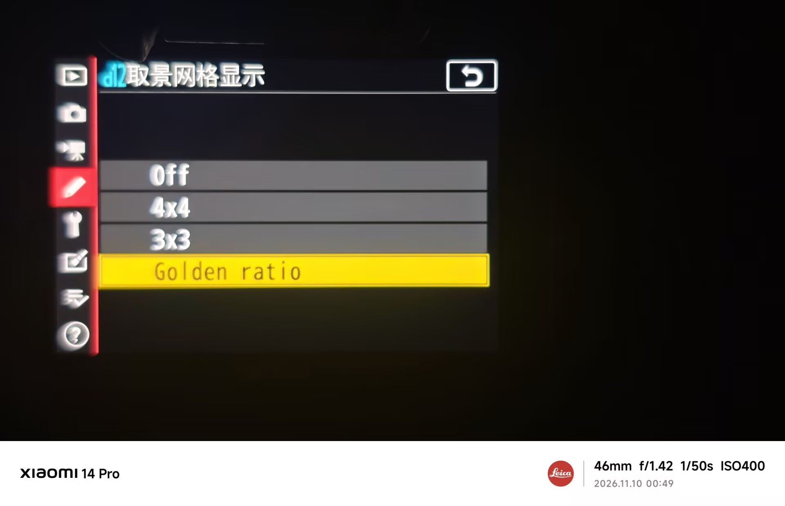

# Framing grid / 取景网格

Nikon Z 7II · 2026-11-10

Original camera-screen photos provided by the tester. The menu, all three grid styles, and the view with the grid switched off are shown below.

以下为测试者提供的原始实机照片，展示菜单、三种网格及关闭网格后的画面。

The tester also confirmed that the current rendering build restores the saved grid setting after restart.

测试者另已实机确认：当前绘制版重启后能正确恢复保存的网格设置。

[English README](../README.md) · [中文说明](../README.zh-CN.md)

## Usage / 使用

In d12, select Off, 4×4, 3×3, or Golden ratio. The selected type is saved to `Z72APP.CFG` and restored after restart. Diagnostic records are written to `Z72TRACE.LOG`.

在原厂 d12「取景网格显示」中选择关闭、4×4、3×3 或黄金分割。所选类型保存到 `Z72APP.CFG`，重启后恢复。诊断记录写入 `Z72TRACE.LOG`。

## Build / 构建

Run from the repository root with Python 3.12 and LLVM installed. The output file must not already exist.

安装 Python 3.12 和 LLVM 后，在项目根目录执行，输出文件必须不存在。

```powershell
New-Item -ItemType Directory -Force artifacts | Out-Null
python -B tools/module.py plugins/grid_live.c --output artifacts/Z72APP.BIN
```

`plugins/grid_live.c` is the entry point and uses the implementation in `grid_trace.c`.

`plugins/grid_live.c` 为入口，复用 `grid_trace.c` 中的实现。

## d12 menu / d12 菜单



## 4×4 grid / 4×4 网格


## 3×3 grid / 九宫格


## Golden ratio / 黄金分割


## Off / 关闭网格


