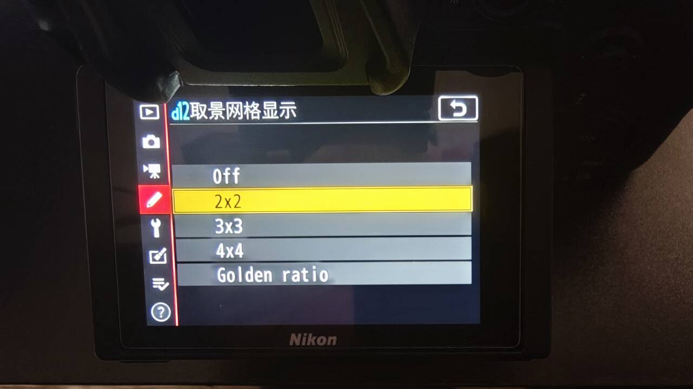
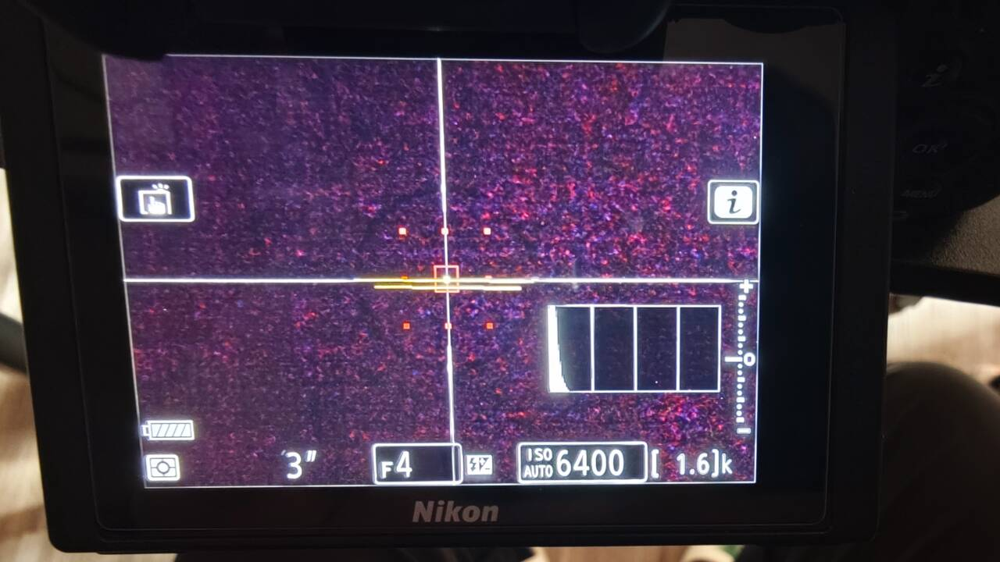
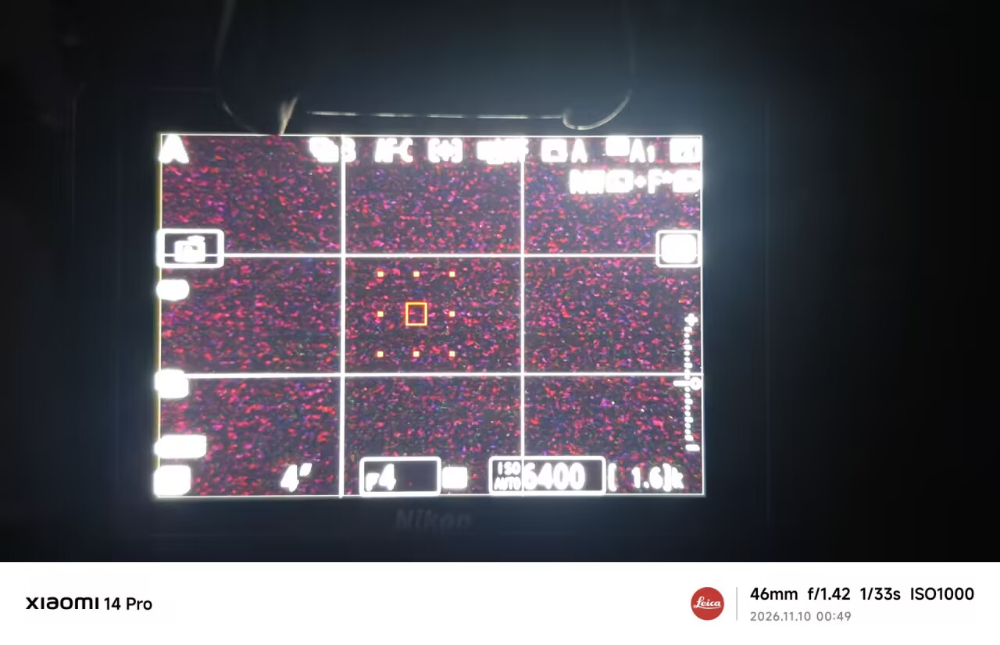
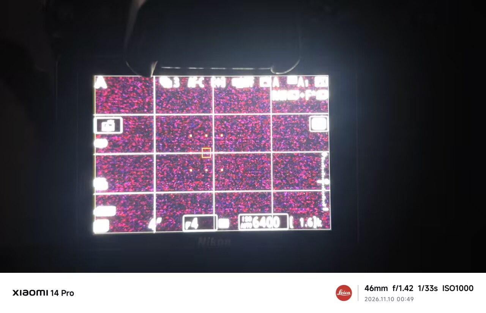
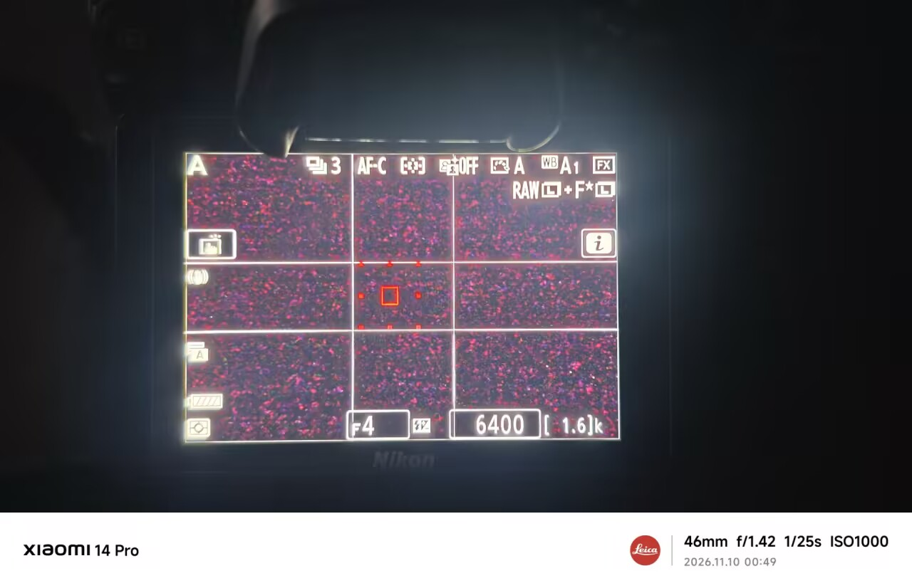
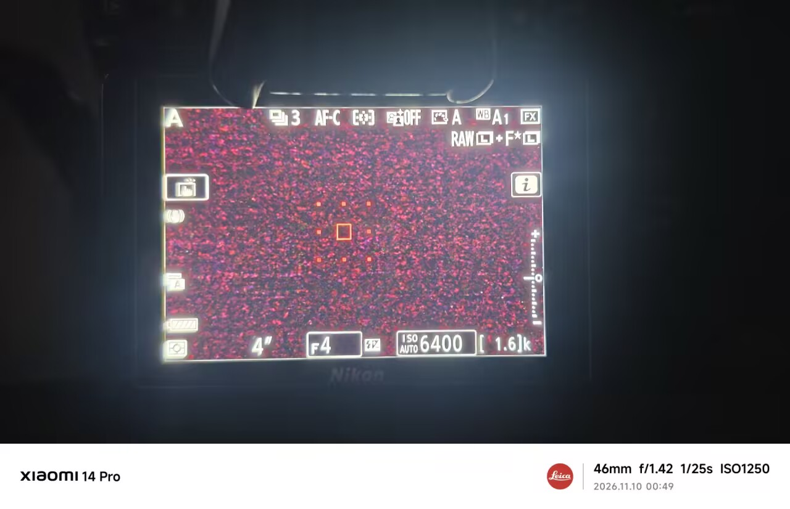

# Framing grid / 取景网格

Nikon Z 7II · 2026-11-10

Original camera-screen photos provided by the tester show the current five-option menu, the grid styles, and the view with the grid switched off.

以下为测试者提供的原始实机照片，展示当前五项菜单、各网格样式及关闭网格后的画面。

The tester confirmed the 2×2 grid and the five-option menu order on the combined module.

测试者已实机确认组合版的 2×2 显示和五项菜单顺序。

[English README](../README.md) · [中文说明](../README.zh-CN.md)

## Usage / 使用

In d12, choose Off, 2×2, 3×3, 4×4, or Golden ratio. The 2×2 option draws one horizontal and one vertical line through the center. The selected type is saved to `Z72APP.CFG` and restored after restart.

在原厂 d12「取景网格显示」中选择关闭、2×2、3×3、4×4 或黄金分割。2×2 在取景画面中央绘制一横一竖。所选类型保存到 `Z72APP.CFG`，重启后恢复。

## d12 menu / d12 五项菜单

## 2×2 grid / 2×2 网格

## 3×3 grid / 九宫格

## 4×4 grid / 4×4 网格

## Golden ratio / 黄金分割

## Off / 关闭网格

