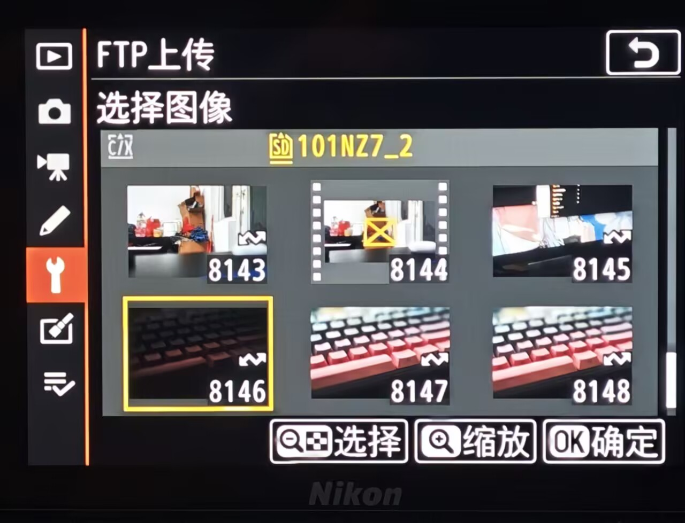
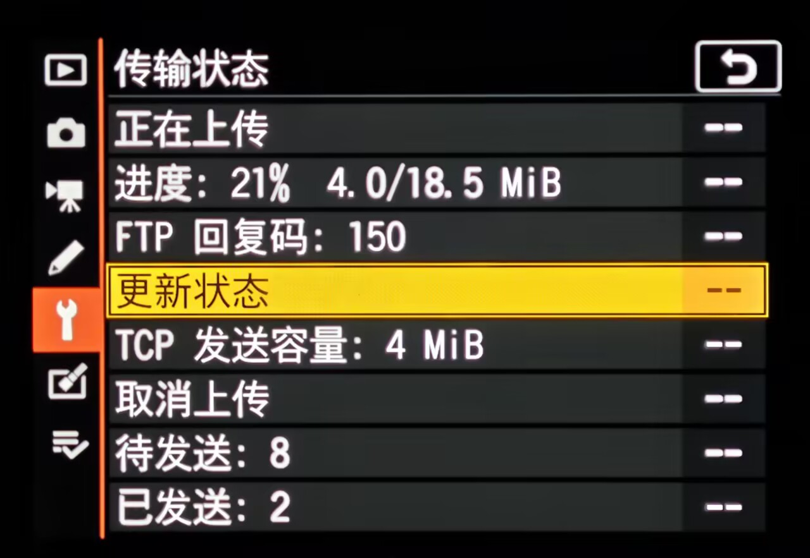
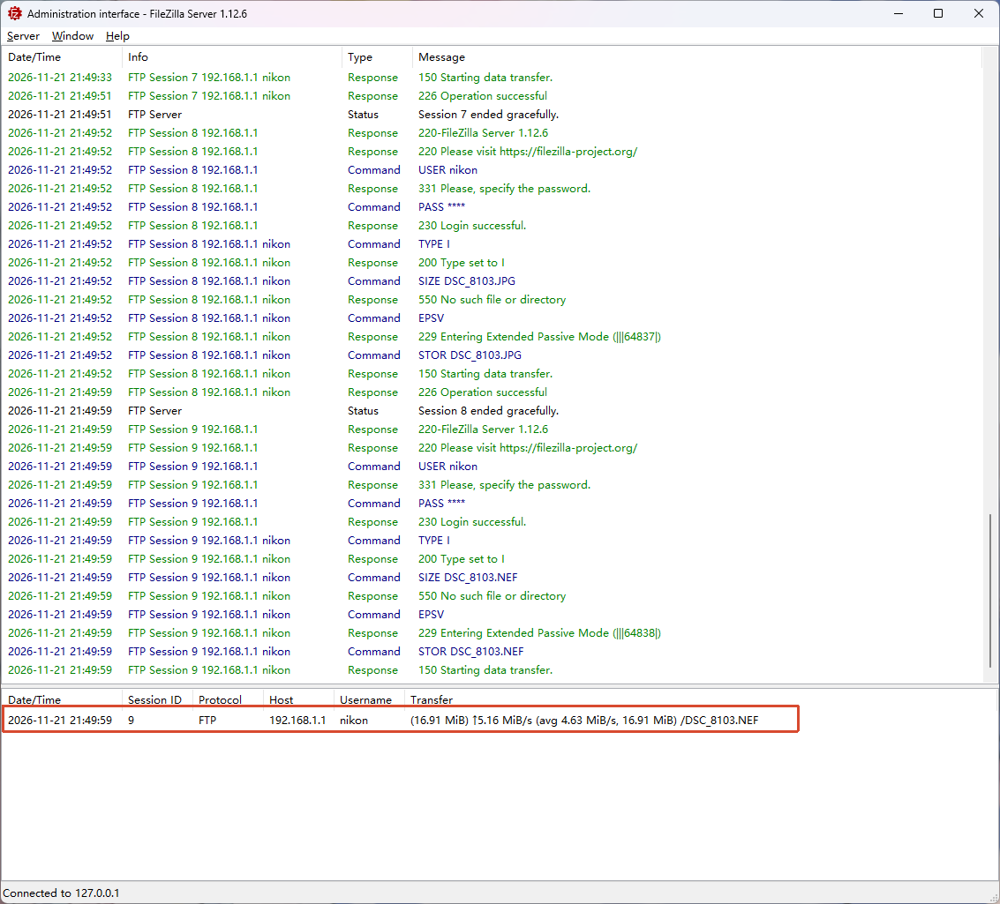
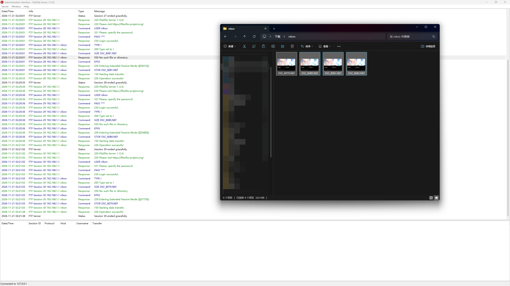
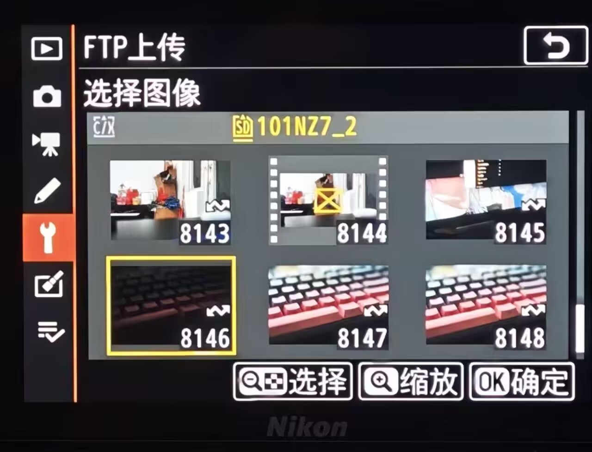

# FTP 上传 / FTP upload

简体中文 | [English](#english)

Nikon Z 7II C 1.70 安装 SD 加载宿主后，可通过设定菜单的「FTP 上传」将 CFexpress／XQD 或 SD 卡上的 JPEG、NEF、MOV 和 MP4 传到 FTP 服务器。更换组合模块时，SD 卡根目录已有的 `Z72APP.CFG` 和 FTP 配置可以保留。

FTP 上传、触屏双击选图和 4 MiB TCP 发送缓冲均已在 Z 7II C 1.70 上实机验证。

## 连接相机和电脑

- **相机热点（AP）**：在相机开启用于连接智能设备或 PC 的 Wi‑Fi 热点，让电脑连上它。运行 `ipconfig`，查看电脑 WLAN 在该网络中的 IPv4 地址。下文以电脑 `192.168.1.3`、相机 `192.168.1.1` 为例。
- **加入路由器（STA）**：通过相机「连接到 PC → 网络设定」让相机加入路由器。电脑接入同一局域网，可用 Wi‑Fi 或网线。FTP 配置填电脑在该网络中的 IPv4 地址，防火墙规则的远程地址填路由器给相机分配的 IPv4 地址。

可以先连接网络，也可以先从 FTP 菜单开始手动上传。相机显示「等待 Wi‑Fi 连接」时，可在等待期间完成网络连接。如果已经超时，连接后在「传输状态」选择「发送待传影像」。

打开 FTP 菜单、正在上传或启用自动发送时，模块会延后相机原厂的 Wi‑Fi 空闲断开。仍可手动关闭 Wi‑Fi。关闭自动发送、结束上传并退出 FTP 菜单后，原厂空闲计时继续生效。

## 配置 FileZilla Server

模块使用 IPv4 被动模式和明文 FTP，用户名、密码和照片通过未加密的连接发送。请在自己信任的局域网或相机热点上使用。

1. 打开 FileZilla Server 管理窗口，进入 **Server → Configure → Server listeners**。为电脑连接相机的 IPv4 地址设置 TCP `21` 监听，也可用 `0.0.0.0:21` 监听本机所有 IPv4 网卡。协议选择 **Explicit FTP over TLS and insecure plain FTP**。[FileZilla 监听设置](https://filezillapro.com/docs/server/advanced-options/setting-up-ftp-listeners-and-connection-security/)
2. 在 **Protocol settings → FTP and FTP over TLS (FTPS) → Passive mode** 勾选 **Use custom port range**，例如填写 `49160` 到 `49169`。防火墙使用同一范围。[FileZilla 被动模式](https://filezillapro.com/docs/server/advanced-options/filezilla-server-passive-mode/)
3. 在 **Rights management → Users** 启用一个带密码的账号。在 **Mount points** 将虚拟路径 `/` 映射到电脑上的接收目录，例如 `D:\Nikon-Uploads`，权限选择 **Read + Write**，并确保 FileZilla Server 服务可以写入该目录。

## 将 Windows 网络设为专用并放行端口

1. 在 Windows 11 打开「设置 → 网络和 Internet → Wi‑Fi」，选当前连接的网络，将「网络配置文件类型」设为「专用网络」。电脑用网线时，在「以太网」中选择相同的网络配置文件。
2. 在管理员 PowerShell 中添加入站规则，放行 **TCP 控制端口和被动数据端口**。下面以 FileZilla Server 的默认安装路径和相机热点为例。按实际情况修改程序路径、网卡名、两个 IPv4 地址及端口。[Microsoft 防火墙命令参考](https://learn.microsoft.com/en-us/powershell/module/netsecurity/new-netfirewallrule?view=windowsserver2025-ps)

```powershell
$adapter = 'WLAN'
$pcIp = '192.168.1.3'
$cameraIp = '192.168.1.1'
$server = 'C:\Program Files\FileZilla Server\filezilla-server.exe'

New-NetFirewallRule -DisplayName 'Nikon Z 7II FileZilla FTP' -Direction Inbound `
    -Action Allow -Profile Private -InterfaceAlias $adapter -Program $server `
    -Protocol TCP -LocalAddress $pcIp -RemoteAddress $cameraIp `
    -LocalPort @('21', '49160-49169')
```

也可通过「Windows Defender 防火墙（高级安全）→ 入站规则 → 新建规则 → 自定义」配置同一组条件。改用另一张网卡或更换网络后，检查规则中的地址和网卡名是否仍匹配。

## 在相机上设置和发送

1. 打开「设定菜单（扳手）→ FTP 上传 → 网络设定」，选配置 1、2 或 3。再次进入「网络设定 → 编辑当前配置」。
2. 在「地址」填写 `IPv4:端口`，例如 `192.168.1.3:21`，再填用户名和密码。目标文件夹留空时使用登录目录。需要子目录时，填写服务器的虚拟路径，例如 `/photos`，并先在服务器上建好目录。选「保存配置」。
3. 进入「选择影像」，在同一个六宫格中勾选两张卡的影像。**双击屏幕上的缩略图可快速勾选，再双击同一张可取消。** 也可用 W（Q）键勾选，用 X（＋）键放大预览。返回上一级再进入时，已勾选的影像会保留。按 OK 将勾选的影像加入待传队列。
4. 也可以在回放 i 菜单选择「选择以 FTP 发送／取消」标记当前影像。回到「FTP 上传」选择「开始上传」。通过「传输状态」查看进度、更新状态、取消当前传输或发送剩余影像。



配置文件保存在 SD 卡根目录，分别为 `Z72FTP.CFG`、`Z72FTP2.CFG`、`Z72FTP3.CFG`。密码以明文保存在卡上，分享 SD 卡内容前请留意这些配置文件。

| 选项 | 行为 |
| --- | --- |
| 自动发送 | 将开启后写入任一卡槽的新照片加入待传队列，使用开启时选定的配置。关闭后停止加入新照片，已经入队的照片仍会发送。 |
| 传送文件为 | 「NEF + JPEG」会同时发送同一卡同一文件夹内同名的一对照片。「仅 JPEG」在存在配对 JPEG 时省略对应 NEF，单独拍摄的 NEF 仍可上传。 |
| 发送文件夹 | 选择任一卡槽中的拍摄文件夹，将支持的影像加入队列并开始上传。 |
| 取消全部选择？ | 确认后清空尚待发送的影像，并取消正在进行的上传。 |
| 同名时重写 | 开启后允许覆盖服务器上的同名文件。关闭时，服务器有同名文件便尝试使用编号后缀。 |

FTP 上传使用存储卡中的 `DCIM` 拍摄目录，单个文件须小于 4 GiB。

## 4 MiB TCP 发送缓冲

在「设定菜单 → FTP 上传 → 选项 → 使用 4 MiB 内存」选择开启。此选项默认关闭，保存在 `Z72APP.CFG` 中。相机进入热点（AP）或接入路由器（STA）后会申请这块内存，多张影像连续上传时可以复用。关闭该选项或断开 Wi‑Fi 后，模块会在 TCP 连接释放缓冲后归还内存。内存不足时会使用普通缓冲继续上传，可在「传输状态」选择「更新状态」查看实际的「TCP 发送容量」。

在本次实机测试中，开启 4 MiB TCP 发送缓冲后，FTP 平均上传速度从约 **2.5 MiB/s** 提升到约 **4.5 MiB/s**，约为原来的 1.8 倍。下方 FileZilla Server 截图中，一次 NEF 传输的平均速度为 **4.63 MiB/s**。实际吞吐会随 Wi‑Fi 信号、存储卡和服务器环境变化。





## 确认传输

FileZilla Server 收到 `STOR` 并回复 `226` 表示上传完成。若先看到 `SIZE` 返回 `550`，随后仍有 `STOR` 和 `226`，这是新文件上传时的同名检查。若登录成功但只到 `EPSV`／`229`，请核对 Windows 的被动端口规则。若连会话记录都没有，先检查相机填写的地址和端口、FileZilla 的监听地址及控制端口规则。



实机连续上传 NEF 到 FileZilla Server 的记录。

## English

The SD extension adds **Setup menu → FTP upload** on the Nikon Z 7II C 1.70 with the SD loader installed. It uploads JPEG, NEF, MOV, and MP4 files from the `DCIM` folders on CFexpress/XQD and SD cards. Each file must be smaller than 4 GiB.

FTP upload, touchscreen double-tap selection, and the 4 MiB TCP send buffer were verified on a Z 7II running C 1.70.

1. Join the camera hotspot from the PC, or connect both devices to the same LAN using the camera's **Connect to PC → Network settings**. Run `ipconfig` on the PC and use the IPv4 address of the adapter on that LAN. You can connect before or after starting a manual upload. The camera waits for Wi‑Fi and lets you retry pending photos if the connection takes too long.
2. In FileZilla Server, allow plain FTP in **Server → Configure → Server listeners** on TCP port `21` or the port you choose. Under **Protocol settings → FTP and FTP over TLS (FTPS) → Passive mode**, set a custom range such as `49160–49169`. Enable a password-protected user and map the virtual path `/` to a local upload folder with **Read + Write** access. Use IPv4 on a trusted LAN because plain FTP sends credentials and files without encryption. [FileZilla listeners](https://filezillapro.com/docs/server/advanced-options/setting-up-ftp-listeners-and-connection-security/) · [Passive mode](https://filezillapro.com/docs/server/advanced-options/filezilla-server-passive-mode/) · [Mount points](https://filezillapro.com/docs/server/advanced-options/how-to-edit-mount-points-virtual-native-paths/)
3. In Windows **Settings → Network & internet → Wi‑Fi** (or **Ethernet**), set the connected network profile to **Private**. Run the [PowerShell example](#将-windows-网络设为专用并放行端口) as administrator. Set the adapter, local PC address, remote camera address, program path, control port and passive TCP range to match your setup. [Firewall rule reference](https://learn.microsoft.com/en-us/powershell/module/netsecurity/new-netfirewallrule?view=windowsserver2025-ps)
4. On the camera, choose one of the three profiles under **FTP upload → Network settings**, then **Edit active profile**. Enter the server as `IPv4:port`, the user name, password and optional virtual destination folder, then save. Profiles are stored on the SD card, including their passwords.
5. In **Select photos**, you can select images from both card slots in the same grid. **Double-tap a thumbnail to quickly select or deselect it**. Use W (Q) to mark a file with the buttons and X (+) to zoom in. Marks are retained when you leave and reopen the picker. Press OK to add the selection to the upload queue. The playback i menu also offers **Mark/unmark for FTP**.
6. Choose **Start upload**. **Transfer status** shows progress and lets you cancel or send queued files. **Options** lets you send an entire folder from either card, clear pending selections, choose whether to replace files with the same name, and send newly saved photos automatically. **JPEG only** omits the NEF from a RAW+JPEG pair and still allows standalone NEFs.

To use the larger TCP send buffer, open **FTP upload → Options → Use 4 MiB buffer**. The option defaults to off and is saved in `Z72APP.CFG`. The module reuses the allocation across uploads while Wi-Fi is active and falls back to the ordinary buffer when memory is unavailable. Check **TCP send capacity** in **Transfer status** for the capacity in use.

In the hardware test, average FTP upload speed rose from about **2.5 MiB/s** to **4.5 MiB/s** with the 4 MiB buffer. The [FileZilla screenshot](images/z7ii-ftp-filezilla-4mib-speed.png) shows one NEF transfer averaging **4.63 MiB/s**. Throughput varies with the Wi-Fi signal, SD card, and server setup.

The extension defers the camera's idle Wi‑Fi disconnect while the FTP menu is open, an upload is active, or auto send is enabled. Wi‑Fi can still be turned off manually. On the server, `STOR` followed by `226` confirms a completed upload. If the session stops after `229`, check the passive data port range and inbound rule.

## 版本更新 / Version history

### v0.1.0-preview.42

- FTP 自动发送与 JPEG 预拍摄、像素变化拍摄共用写卡完成通知，相应照片写卡后可加入上传队列。
- FTP auto send shares file-completion notifications with JPEG pre-capture and pixel shift shooting, allowing their photos to enter the upload queue after saving.

### v0.1.0-preview.34

- 「选择影像」在同一个六宫格内支持勾选 CFexpress／XQD 和 SD 的影像，并加入同一个发送队列。回放标记、自动发送和文件夹发送也支持两个卡槽。双卡组合测试版已通过实机验证。
- Added a shared six-thumbnail picker and upload queue for CFexpress/XQD and SD. Playback marking, auto send, and folder uploads work with both slots. The dual-card test build passed on-camera testing.



### v0.1.0-preview.29

- 加入六宫格选图、触屏双击勾选和 4 MiB TCP 发送缓冲。支持从 SD 卡发送 MOV、MP4，单个文件上限提高到小于 4 GiB。
- Added a six-thumbnail picker, touchscreen double-tap selection, and a 4 MiB TCP send buffer. MOV and MP4 uploads from SD are supported, and files can be just under 4 GiB.
- 缩略图选择在关闭并重开选图页后保留，可用 X（+）放大。实拍平均上传速度从约 2.5 MiB/s 提升到约 4.5 MiB/s。
- Thumbnail marks persist when reopening the picker, and X (+) opens zoom. In camera testing, the larger buffer increased average upload speed from about 2.5 MiB/s to 4.5 MiB/s.

### v0.1.0-preview.24

- 首次发布 FTP 上传。支持将 SD 卡上的 JPEG 和 NEF 手动发送或自动入队，也可从播放 i 菜单标记影像。
- Added manual FTP upload and automatic queuing of JPEG and NEF photos from SD, with an option to mark images from the playback i menu.
- 支持三个机内 FTP 配置、文件夹发送、同名文件处理、传输状态与取消。JPEG／NEF 的单文件上限为 256 MiB。相机热点和路由器连接都可上传。
- Added three on-camera FTP profiles, folder uploads, filename conflict handling, transfer status, and cancellation. JPEG and NEF uploads support files up to 256 MiB on both camera hotspots and router connections.
