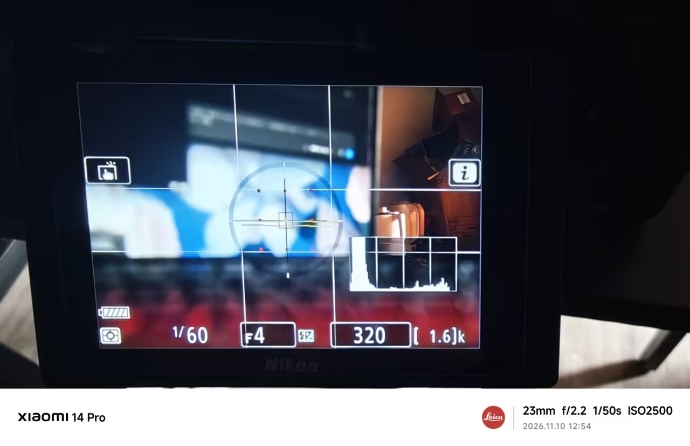
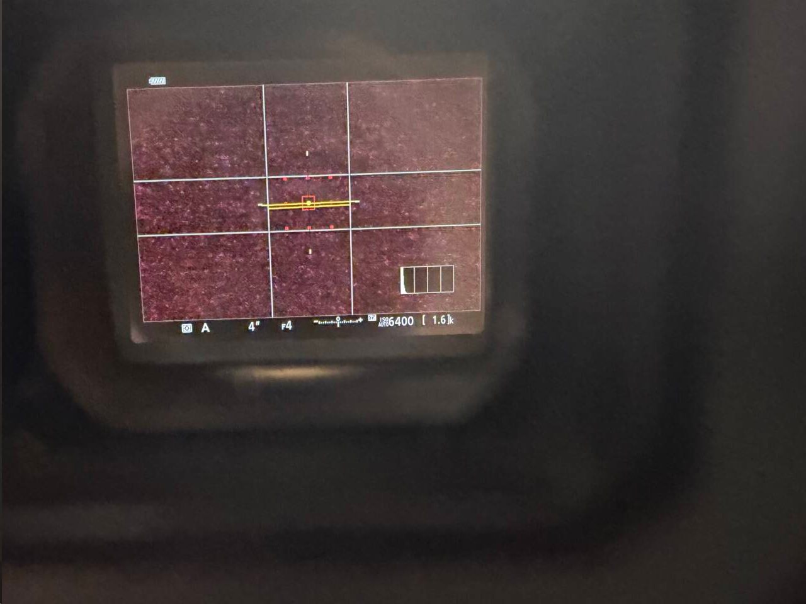

# Histogram and virtual horizon / 直方图与水平仪同显

In photo mode, press DISP to select the virtual horizon page on the rear screen or in the electronic viewfinder. The module adds the camera’s live histogram to that page and retains the framing grid and its saved settings.

在照片模式使用后屏或电子取景器，按 DISP 切到水平仪页即可同时查看原厂实时直方图。组合版保留取景网格和已保存的网格设置。

When [Custom DISP pages](custom-disp.md) is enabled, the rear LCD follows each preset's Histogram and Virtual horizon switches. The viewfinder keeps its native DISP cycle.

启用[自定义 DISP 页面](custom-disp.md)后，后屏按每套预设的「直方图」「水平仪」开关显示；取景器仍使用原厂 DISP 循环。

The module limits the histogram refresh rate and skips extra draws while a display switch is pending or the renderer is busy.

模块限制直方图的刷新频率，并在等待切换显示器或渲染繁忙时跳过追加绘制。

## Hardware verification / 实机验证

On November 10, 2026, the tester confirmed the overlay on the rear screen and in the viewfinder in photo mode. The tester also passed the follow-up test of automatic switching between the two displays with the overlay active.

2026-11-10，测试者确认照片模式下的后屏和电子取景器均可同显，开启同显后两者之间的自动切换也通过了实机复测。

## 版本更新 / Version history

### v0.1.0-preview.44

- 调整 ISO 或曝光补偿时，自定义 DISP 页面上的实时直方图继续显示。
- Keeps the live histogram visible on Custom DISP pages while adjusting ISO or exposure compensation.

### v0.1.0-preview.42

- 将照片直方图叠加和旋转限制在照片取景，切换到视频时停止额外刷新。
- Limits the photo histogram overlay and rotation to photo live view and stops extra refreshes in movie mode.

### v0.1.0-preview.10

- 优化竖拍直方图绘制，将相邻等高的柱形合并绘制。
- Draws adjacent columns of equal height together to reduce portrait histogram drawing operations.

### v0.1.0-preview.8

- 后屏直方图和水平仪可按自定义 DISP 预设独立显示。
- Added independent rear-screen histogram and virtual horizon switches to each Custom DISP preset.

### v0.1.0-preview.5

- 后屏实时直方图随竖拍界面转正。
- The rear-screen live histogram now rotates with the portrait display.
- 正式组合包停止导出水平仪和直方图的测试日志。
- Removed histogram and virtual horizon diagnostic log export from the combined package.

### v0.1.0-preview.4

- 电子取景器的水平仪页也可显示实时直方图，支持与后屏自动切换。
- Added the live histogram to the viewfinder’s virtual horizon page, including automatic switching between the viewfinder and rear screen.
- 限制额外绘制频率，在切换显示设备或渲染繁忙时跳过追加刷新。
- Limited the extra drawing rate and deferred refreshes while the display switches or the renderer is busy.

### v0.1.0-preview.2

- 首次在照片模式的后屏水平仪页叠加实时直方图。
- Added the live histogram to the rear-screen virtual horizon page in photo mode.
