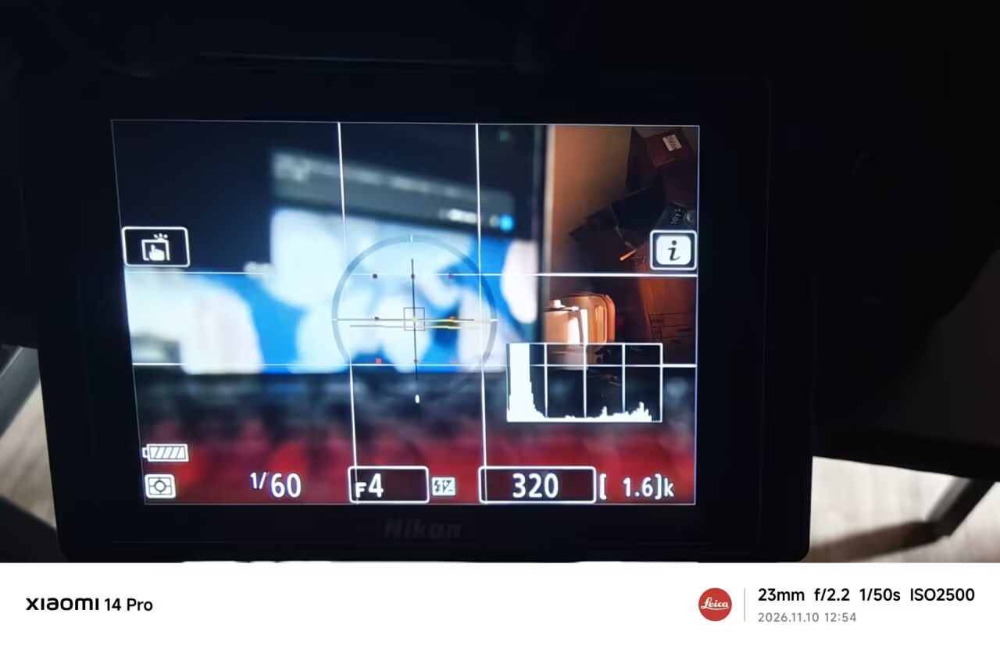
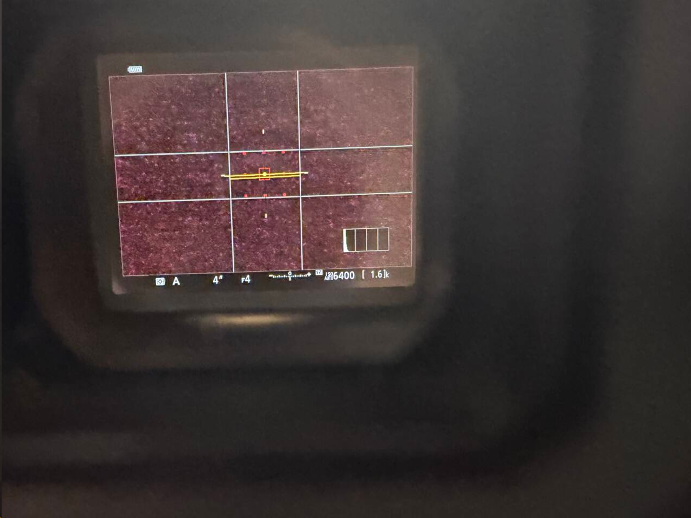

# Histogram and virtual horizon / 直方图与水平仪同显

In photo mode, press DISP to select the virtual horizon page on the rear screen or in the electronic viewfinder. The module adds the camera’s live histogram to that page and retains the framing grid and its saved settings.

在照片模式使用后屏或电子取景器，按 DISP 切到水平仪页即可同时查看原厂实时直方图。组合版保留取景网格和已保存的网格设置。

When [Custom DISP pages](custom-disp.md) is enabled, the rear LCD follows each preset's Histogram and Virtual horizon switches. The viewfinder keeps its native DISP cycle.

启用[自定义 DISP 页面](custom-disp.md)后，后屏按每套预设的「直方图」「水平仪」开关显示；取景器仍使用原厂 DISP 循环。

The module limits the histogram refresh rate and skips extra draws while a display switch is pending or the renderer is busy.

模块限制直方图的刷新频率，并在等待切换显示器或渲染繁忙时跳过追加绘制。

## Hardware verification / 实机验证

On November 10, 2026, the tester confirmed the overlay on the rear screen and in the viewfinder in photo mode. The tester also passed the follow-up test of automatic switching between the two displays with the overlay active.

2026-11-10，测试者确认照片模式下的后屏和电子取景器均可同显，开启同显后两者之间的自动切换也通过了实机复测。

