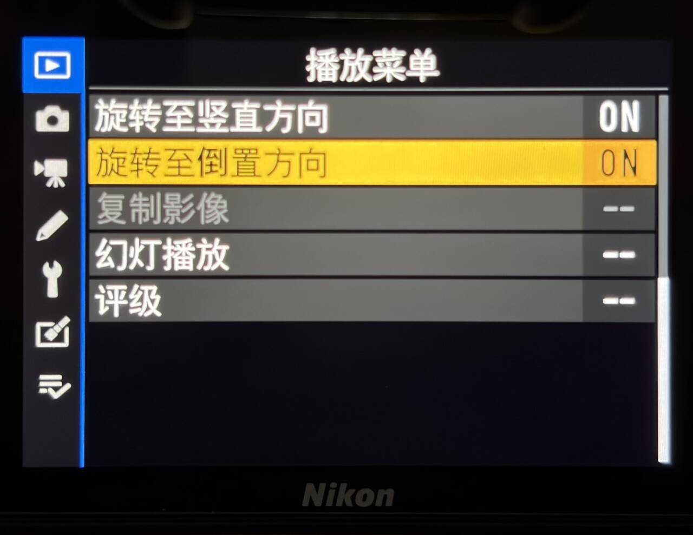

# 倒置照片回放 / Upside-down photo playback

从 `v0.1.0-preview.36` 开始，播放菜单在「旋转至竖直方向」下方提供「旋转至倒置方向」。该选项默认开启，与竖拍旋转独立设置，并保存到 SD 卡根目录的 `Z72APP.CFG`。按播放键进入回放后，倒置拍摄的 JPG 和 NEF 会在单张查看和放大时转正。

Starting with `v0.1.0-preview.36`, **Rotate inverted** appears just below **Rotate tall** in the Playback Menu. It defaults to **On**, works independently of **Rotate tall**, and is saved in `Z72APP.CFG` on the SD card. It corrects upside-down JPG and NEF photos in single-image playback and playback zoom.

## 实机验证 / Hardware verification

`v0.1.0-preview.36` 组合包已于 2026-11-25 通过 Z 7 II 实机验证。

The `v0.1.0-preview.36` combined module passed testing on a Nikon Z 7 II on November 25, 2026.

## v0.1.0-preview.37

修复了倒置拍摄的 JPG 和 NEF 在机内回放已转正、拷到电脑后仍然倒置的问题。受影响的照片原先写入 EXIF 方向 `1`。新版在写卡时为新拍的倒置照片写入标准方向 `3`，支持 EXIF 方向的电脑查看器可自动转正。此修复已于 2026-11-25 通过 Z 7 II 实机验证。

Fixed upside-down JPG and NEF photos that appeared upright in camera playback but upside down on a computer. Affected photos were written with EXIF Orientation `1`. The module now writes Orientation `3` when saving new upside-down photos, so desktop viewers that honor EXIF orientation can display them upright. This fix passed testing on a Nikon Z 7 II on November 25, 2026.
