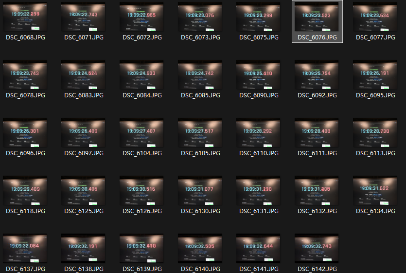

# JPEG pre-capture / JPEG 预拍摄

[English README](../README.md) · [中文说明](../README.zh-CN.md)

JPEG pre-capture for the Nikon Z 7II running C 1.70. In photo mode, enable silent photography and **Continuous H (extended)**, and configure a single recording destination. Open **Setup Menu → JPEG pre-capture** to enable the feature, select a pre-capture window, and choose how to start buffering.

Nikon Z 7II C 1.70 在照片模式下支持 JPEG 预拍摄。请开启静音拍摄，选择**高速连拍（延长，H+）**，并使用单一照片保存介质。在「**设定菜单 → JPEG 预拍摄**」中开启功能，选择预拍摄时间和启动方式。

| Setting / 设置                     | Options / 选项                                                        | Default / 默认            |
| ---------------------------------- | --------------------------------------------------------------------- | ------------------------- |
| Pre-capture switch / 预拍摄开关    | On, Off / 开启、关闭                                                  | Off / 关闭                |
| Pre-capture time / 预拍摄时间      | 0.3 s, 0.5 s, 0.7 s, 1.0 s                                            | 1.0 s                     |
| Start pre-capture / 预拍摄启动方式 | Half-press, AF-ON, or either / 仅半按快门、仅 AF-ON、半按快门或 AF-ON | Either / 半按快门或 AF-ON |

Hold the selected control to start buffering JPEGs in RAM. Fully pressing the shutter button retains the frames in the selected time window. Keep it fully pressed to continue the same H+ burst, then release it to let pending writes finish. With the feature enabled, the camera saves both pre-capture and subsequent frames as JPEGs in its DCIM directory while preserving the selected image-quality setting.

按住选定的启动按键后，相机会在内存中滚动缓存 JPEG。完全按下快门时保留窗口内的照片，保持全按即可延续同一次 H+ 连拍，松开后写完在途照片。启用此功能时，预拍帧和后续帧均以 JPEG 写入相机的 DCIM 目录。机身图像品质选项仍保留原有设置。

The number of frames retained depends on available buffer space, file size, and the memory card's write speed. During a long burst, a full write queue can cause dropped frames and gaps in file numbering. Once writing finishes, press the camera's playback button to review the saved photos.

实际保留张数取决于可用缓存、文件大小和存储卡写入速度。长时间连拍时，待写队列满载可能出现掉帧和编号空档。写卡完成后，可用机身播放按钮查看保存的照片。

## Hardware example / 实拍示例

The four saved pre-capture JPEGs in this example are **DSC_6068.JPG**, **DSC_6071.JPG**, **DSC_6072.JPG**, and **DSC_6076.JPG**. The module is still in testing, and the burst shooting speed can be improved.

这组实拍中，**预拍**的 4 张是 **DSC_6068.JPG**、**DSC_6071.JPG**、**DSC_6072.JPG** 和 **DSC_6076.JPG**。目前模块还处于测试阶段,连拍速度有待提高.

