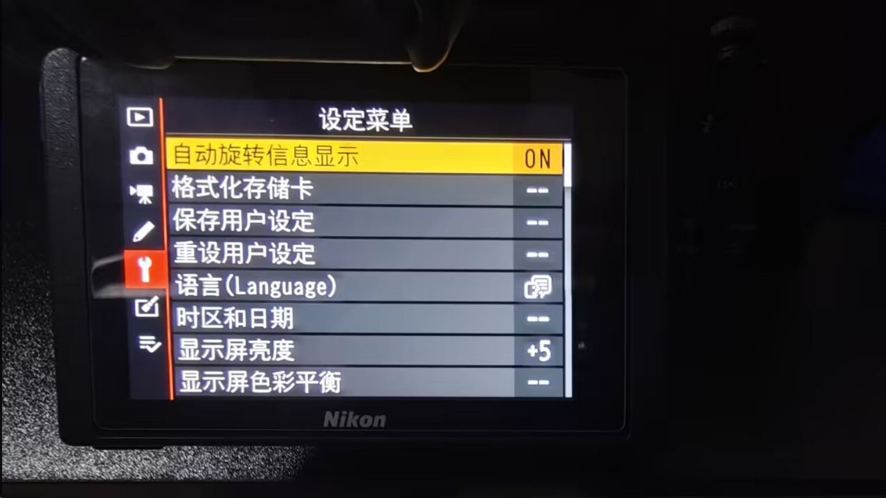
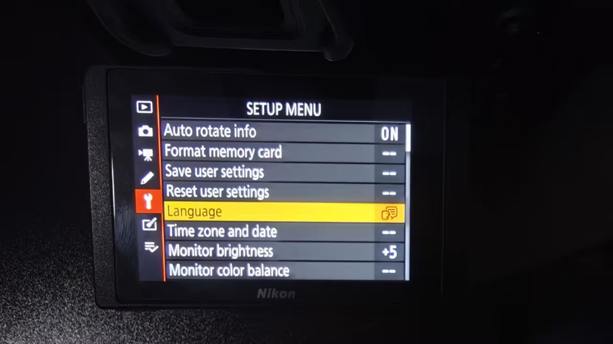
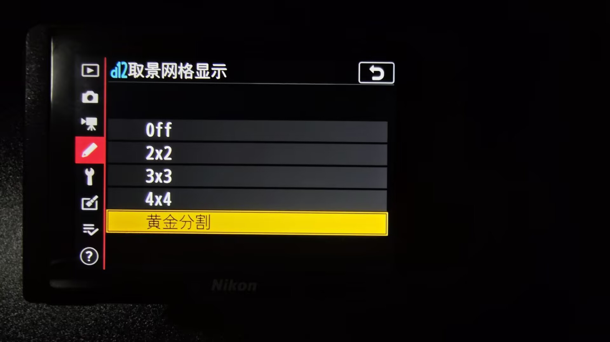
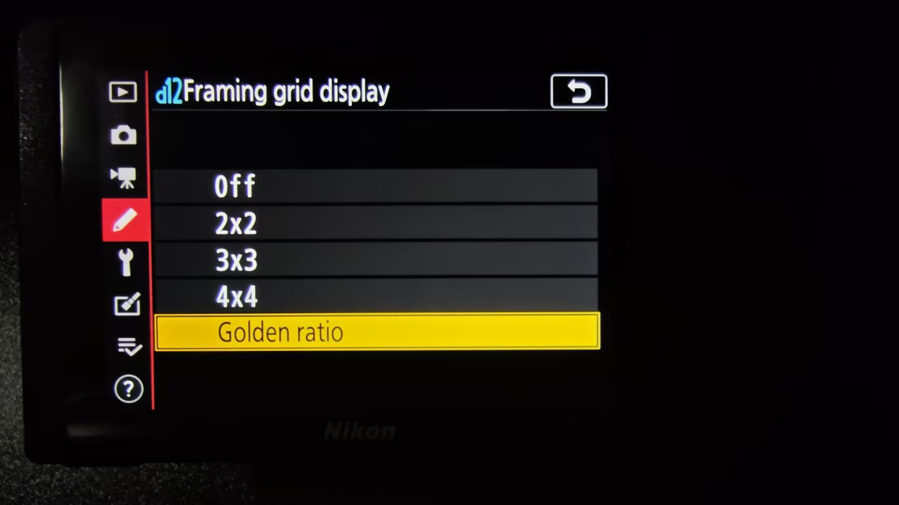

# Menu localization / 菜单本地化

[English README](../README.md) · [中文说明](../README.zh-CN.md)

**Auto rotate info** in the Setup Menu and **Golden ratio** in d12 follow the camera’s display language. The labels are available in Simplified Chinese, Traditional Chinese, and English. Other display languages use English for these two labels.

设定菜单中的「自动旋转信息显示」和 d12 中的「黄金分割」随相机语言切换。这两个标签支持简体中文、繁体中文和英文，其他相机语言使用英文标签。

Both labels were verified on a Z 7II in Simplified Chinese and English. The photos below are from that test.

两个标签均已在 Z 7II 实机上验证简体中文和英文。以下为本次实机照片。

## Setup Menu / 设定菜单

## d12 Framing grid display / d12 取景网格显示

