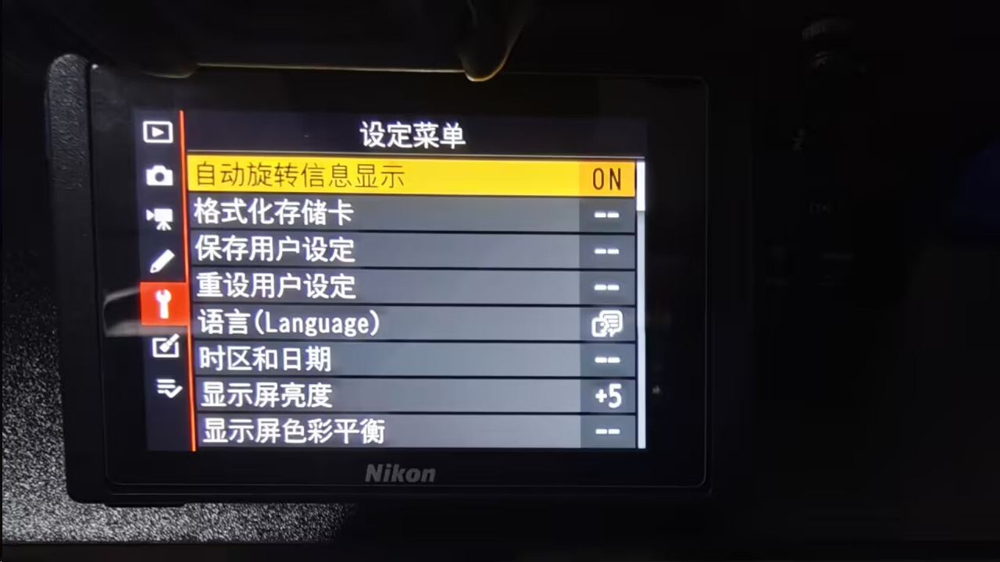
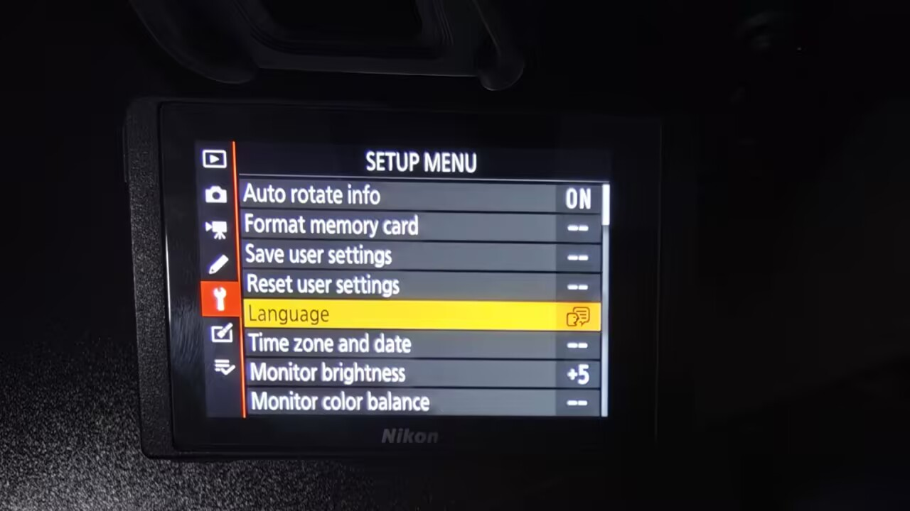
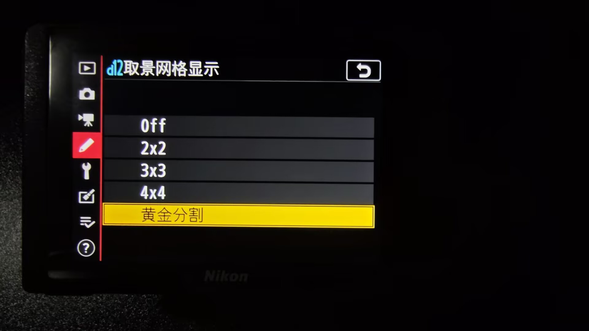
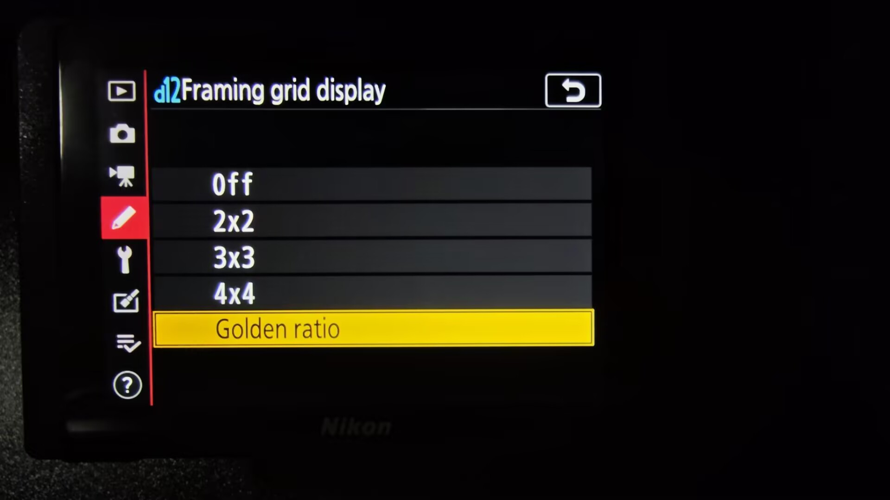

# Menu localization / 菜单本地化

**Auto rotate info** in the Setup Menu and **Golden ratio** in d12 follow the camera’s display language. The labels are available in Simplified Chinese, Traditional Chinese, and English. Other display languages use English for these two labels.

设定菜单中的「自动旋转信息显示」和 d12 中的「黄金分割」随相机语言切换。这两个标签支持简体中文、繁体中文和英文，其他相机语言使用英文标签。

**Photo shooting highlights**, **Display pattern**, and **Highlight threshold** also follow these language choices. Their Simplified Chinese and English menus are hardware verified.

「照片拍摄加亮显示」「显示图案」和「加亮阈值」也支持上述语言，简体中文和英文菜单已实机验证。

**Custom DISP pages** and its eight shooting-information controls also use localized labels, including **Focal length display／焦距显示／焦距顯示**. The horizon label is **水平仪／水平儀**, with supplemental glyphs for characters missing from the stock fonts. The combined update was hardware verified.

「自定义DISP页面」及八项细分拍摄信息也支持上述语言，包括「焦距显示／焦距顯示／Focal length display」。「水平仪／水平儀」补齐原厂字库缺少的字形。本次组合更新已实机验证。

The global **Battery percentage display／电量百分比显示／電量百分比顯示** label uses supplemental glyphs where the stock Chinese fonts are incomplete. Simplified Chinese and English menus are hardware verified. Local language checks cover 36 banks, 900 labels, and 187 decoded glyph outlines.

全局「电量百分比显示／電量百分比顯示／Battery percentage display」补齐原厂中文字库缺失的字形。简体中文和英文菜单已实机验证。本地语言检查覆盖 36 个语言表、900 条标签及 187 个解码后的字形轮廓。

Both labels were verified on a Z 7II in Simplified Chinese and English. The photos below are from that test.

两个标签均已在 Z 7II 实机上验证简体中文和英文。以下为本次实机照片。

## Setup Menu / 设定菜单

## d12 Framing grid display / d12 取景网格显示

## 版本更新 / Version history

### v0.1.0-preview.43

- 静音快门声的连拍菜单加入「每张从头播放」的中英文标签。
- Added English and Chinese labels for Restart on every shot in the silent shutter sound menu.

### v0.1.0-preview.40

- 加入像素变化拍摄的机内合成和半格位移校准菜单标签。
- Added menu labels for in-camera merging and half-step calibration in Pixel shift shooting.

### v0.1.0-preview.36

- 播放菜单加入「旋转至倒置方向」的中英文标签及补充中文字形。
- Added English and Chinese labels and supplemental Chinese glyphs for Rotate inverted in the Playback Menu.

### v0.1.0-preview.35

- 「自定义固件版本」页面加入宿主版本一行，按识别结果显示宿主版本号。
- Added a host version line to Custom firmware version, showing the detected host revision.

### v0.1.0-preview.33

- 加入构图辅助、参考图片、不透明度和两种按钮分配方式的中英文标签。
- Added English and Chinese labels for Composition reference, Reference image, Opacity, and the two button behaviors.

### v0.1.0-preview.30

- 加入浏览器相册、服务状态和 TCP 发送缓冲的中英文标签。
- Added English and Chinese labels for Browser gallery, its service status, and the TCP send buffer.

### v0.1.0-preview.29

- FTP 菜单加入 4 MiB 发送缓冲选项、传输容量和文件大小提示的中英文文本。
- Added English and Chinese text for the FTP 4 MiB send-buffer option, send capacity, and file size messages.

### v0.1.0-preview.28

- 加入「对焦改进」和「遮挡后找回主体」的中英文标签。
- Added English and Chinese labels for Focus improvements and Reacquire after occlusion.

### v0.1.0-preview.26

- 加入[「自定义固件版本」](firmware-version.md)入口。支持简体中文、繁体中文、英文和韩文菜单标题。
- Added [Custom firmware version](firmware-version.md) with menu titles in Simplified Chinese, Traditional Chinese, English, and Korean.

### v0.1.0-preview.24

- 加入 FTP 上传的机内菜单、配置项和传输状态的中英文文本。
- Added English and Chinese text for FTP upload menus, profile settings, and transfer status.

### v0.1.0-preview.23

- 加入像素变化拍摄、拍摄张数、启动延迟和拍摄间隔的中英文标签。
- Added English and Chinese labels for Pixel shift shooting, Number of shots, Start delay, and Shot interval.

### v0.1.0-preview.22

- 照片 AF 区域选项加入「主体跟踪」的中英文标签。
- Added English and Chinese labels for Subject tracking in the photo AF-area options.

### v0.1.0-preview.21

- 加入自定义宽区域 AF、C1／C2 预设、对焦区域大小及主体识别的中英文标签。
- Added English and Chinese labels for Custom wide-area AF, the C1/C2 presets, focus-area size, and subject detection.

### v0.1.0-preview.20

- 筛选回放的入口和条件加入简体中文与英文文本，简体中文菜单增加「筛」字字形。
- Added Simplified Chinese and English labels for filtered playback and its criteria. Added the Simplified Chinese glyph used by the filter labels.

### v0.1.0-preview.18

- 加入静音拍摄快门声音、连拍播放、音量和试听的中英文标签。
- Added English and Chinese labels for Silent shutter sound, continuous release, volume, and sound preview.

### v0.1.0-preview.17

- 加入 JPEG 预拍摄、预拍时间和启动方式的中英文标签。
- Added English and Chinese labels for JPEG pre-capture, the time window, and the start control.

### v0.1.0-preview.13

- 「Wi-Fi 设置」和「开启 80 MHz WiFi」使用英文、简体中文和繁体中文标签。
- Added English, Simplified Chinese, and Traditional Chinese labels for Wi-Fi settings and Enable 80 MHz WiFi.

### v0.1.0-preview.12

- 加入 Wi-Fi 地区、中国大陆、美国和跟随机身的中英文标签。
- Added English and Chinese labels for Wi-Fi region, Mainland China, United States, and Follow camera.

### v0.1.0-preview.10

- 加入「电量百分比显示」的中英文标签和中文字形补充。
- Added English and Chinese labels and supplemental Chinese glyphs for Battery percentage display.

### v0.1.0-preview.9

- 为独立的「焦距显示」开关加入简体中文、繁体中文和英文标签。
- Added Simplified Chinese, Traditional Chinese, and English labels for the separate Focal length display switch.

### v0.1.0-preview.8

- 加入「自定义DISP页面」的本地化标签，补齐「水平仪／水平儀」字形。
- Added localized Custom DISP pages labels and the missing Chinese glyphs for Virtual horizon.

### v0.1.0-preview.7

- 加入「照片拍摄加亮显示」「显示图案」和「加亮阈值」的本地化标签。
- Added localized labels for Photo shooting highlights, Display pattern, and Highlight threshold.

### v0.1.0-preview.6

- 「自动旋转信息显示」和 d12 的「黄金分割」随相机语言显示简体中文、繁体中文或英文。
- Added Simplified Chinese, Traditional Chinese, and English labels for Auto rotate info and the d12 Golden ratio option.
