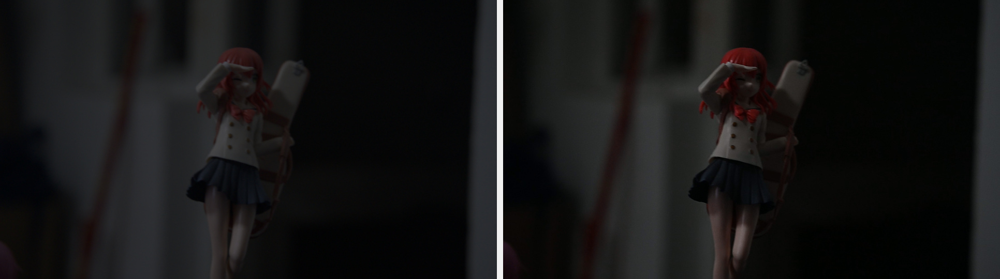
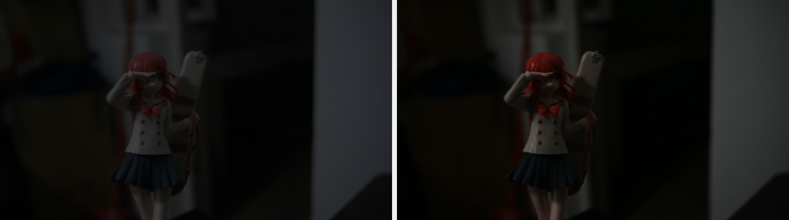
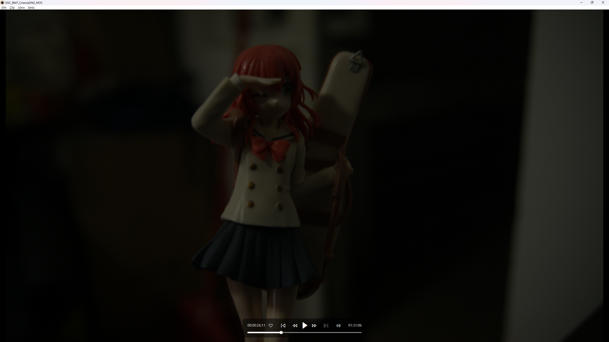
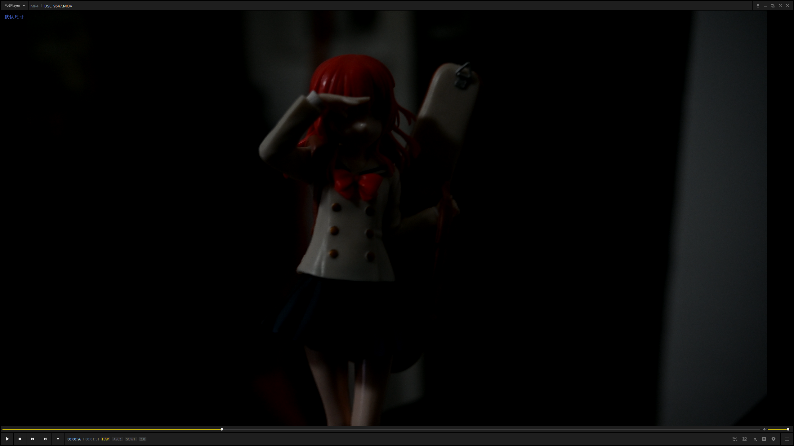
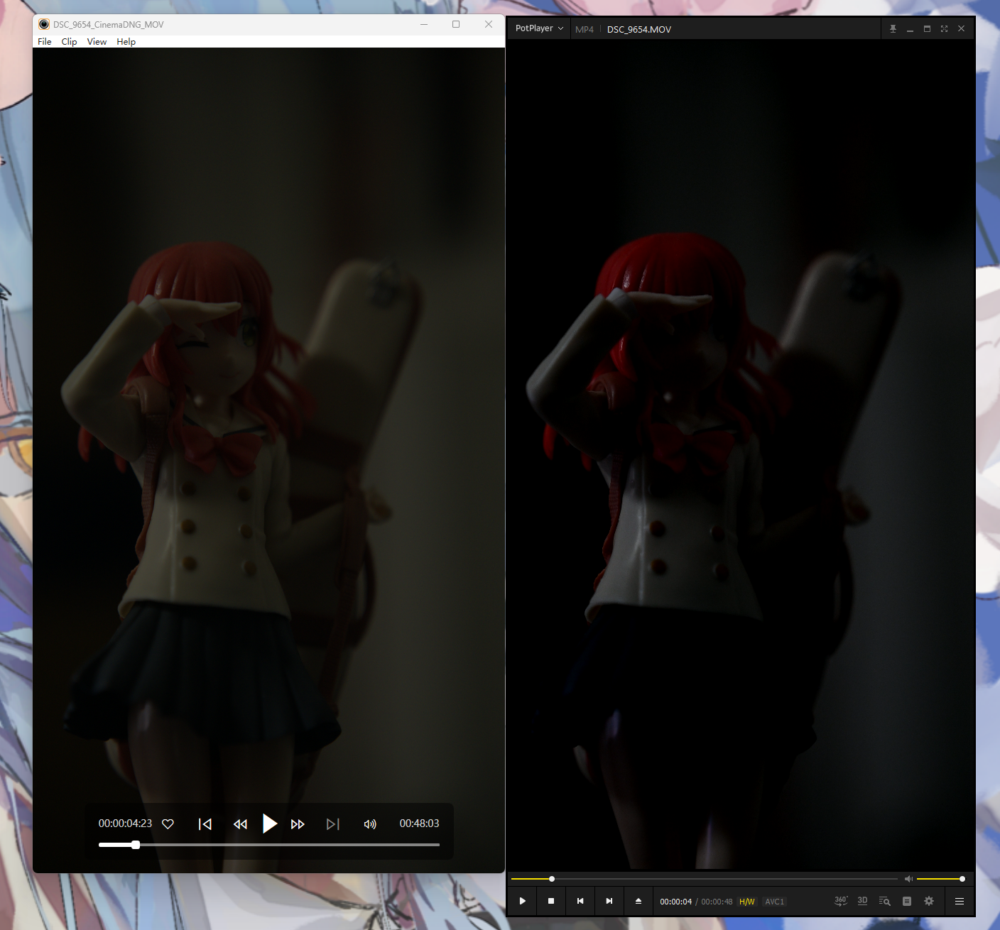
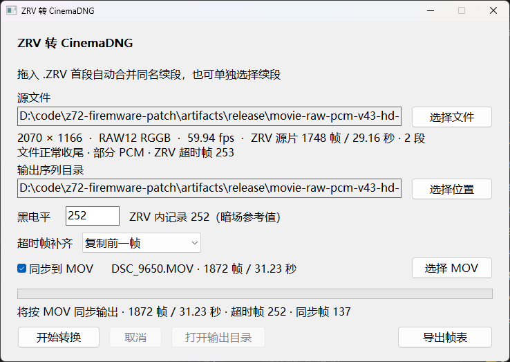
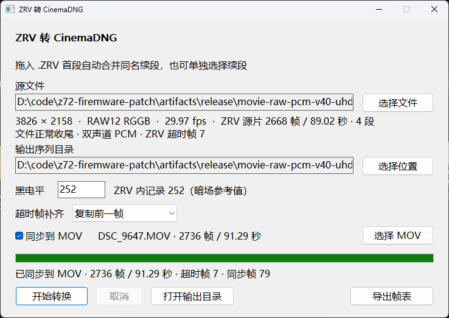

# RAW 视频录制 / RAW video recording

简体中文 | [English](#english)

在视频拍摄菜单的「视频文件类型」下一项打开「RAW 视频录制」。可单录 ZRV，也可同时保存普通视频。文件写入存储卡的原厂视频目录，双录文件使用相同的文件名。选择分段时，首段为 `.ZRV`，续段为 `.Z00`、`.Z01` 等。

| 机身选择 | RAW12 像素尺寸 | 支持帧率 |
| --- | --- | --- |
| FX 4K UHD | 3826 × 2158 | 23.976、25、29.97p |
| FX 1080p | 2070 × 1166 | 23.976、25、29.97、50、59.94p |

RAW 视频默认关闭。默认写 CFexpress／XQD，同时录制普通视频，普通视频目标跟随原厂设置。分段默认「不分段」，也可选 4、8、16、32 GiB。超时默认复制上一帧，可切换为黑帧或停止录制。4K 的无损压缩默认「全部」，1080p 保存打包 RAW12。启用麦克风时，ZRV 可保存 48 kHz 双声道 PCM。CFexpress 的实际持续速度和场景决定实拍帧的比例。

所有 RAW 菜单选项与其他扩展共用 SD 卡根目录的 `Z72APP.CFG`。已有扩展设置可保留。RAW 设置首次使用时从默认值开始。检测到不支持的录制规格时会在 RAW 目标卡根目录写入 `Z72FPnnn.LOG`。

[下载 Windows 转换器](../releases/ZRV-CinemaDNG.exe)。将 `.ZRV` 首段拖入转换器会自动合并续段。双录时，「MOV 黑帧同步」默认开启。转换器按机内记录的帧对应表对齐，片头缺少 RAW 的区间补黑，RAW 超时帧按所选方式补齐。可分别导出超时帧和同步帧报表。

## English

Open **RAW video recording** below **Video file type** in the video shooting menu. Record ZRV alone or alongside normal video. Files use the Nikon video folder, and paired recordings share a basename. When splitting is enabled, `.ZRV` is followed by `.Z00`, `.Z01`, and so on.

FX UHD records 3826 × 2158 RAW12 at 23.976, 25, or 29.97p. FX 1080p records 2070 × 1166 RAW12 at 23.976, 25, 29.97, 50, or 59.94p. RAW is off by default and shares `Z72APP.CFG` with the other extensions. An unsupported recording format is logged as `Z72FPnnn.LOG` in the root of the selected RAW card.

Open the first segment in the [Windows converter](../releases/ZRV-CinemaDNG.exe) to combine all segments. Paired recordings can use the camera's frame map to align CinemaDNG to the MOV. The converter fills the leading gap with black and applies the selected replacement to timed-out RAW frames. ZRV can contain 48 kHz stereo PCM and the starting camera orientation.

## 实拍对比 / Frame comparisons

下方两组横拍对比均先在转换器中启用「同步到 MOV」，再从 CinemaDNG 序列与原厂 MOV 取同一帧号。左侧 CinemaDNG 经去马赛克和独立白平衡渲染。两侧按共同取景范围对齐，分别显示为 960 × 540。

Each landscape pair uses the same frame number from the MOV-synced CinemaDNG sequence and the Nikon MOV. The CinemaDNG still on the left is rendered with demosaicing and independent white balance. Both panels show the shared field of view at 960 × 540.

### FX 1080p 59.94p

`DSC_9650` · ZRV 源第 284 帧 · CinemaDNG 和 MOV 均为同步后的第 421 帧（7.01 秒）

### FX 4K 29.97p

`DSC_9647` · ZRV 源第 457 帧 · CinemaDNG 和 MOV 均为同步后的第 536 帧（17.85 秒）

`DSC_9647` 第 791 帧的播放器截图对比 / Playback comparison at frame 791.

**同步导出的 CinemaDNG / MOV-synced CinemaDNG**

**原厂 MOV / Nikon MOV**

### 4K 30p 竖拍 ZRV / 4K 30p portrait ZRV

`DSC_9654`（29.97p）。左侧为 ZRV 导出的 CinemaDNG，右侧为原厂 MOV。转换器将开录方向写入每张 DNG 的 `Orientation` 标签，支持该标签的播放器会自动按竖拍方向显示。

`DSC_9654` (29.97p). The left pane shows CinemaDNG exported from ZRV, and the right pane shows the Nikon MOV. The converter writes the starting camera orientation to each DNG's `Orientation` tag so compatible players display it upright automatically.

### 转换器同步结果 / Converter sync results

`DSC_9650` · 1080p 59.94p · 1872 帧 / 31.23 s

`DSC_9647` · 4K 29.97p · 2736 帧 / 91.29 s

## 版本更新 / Version history

### v0.1.0-preview.49

- 新增 RAW 视频录制，录制选项统一保存到 `Z72APP.CFG`。ZRV 记录开录时的相机方向，续段沿用该方向。转换为 CinemaDNG 时，每帧 DNG 都会写入方向元数据。
- Added RAW video recording, with recording options saved in `Z72APP.CFG`. ZRV records the camera orientation at the start of each clip and carries it across segments. CinemaDNG export writes that orientation to every DNG frame.
