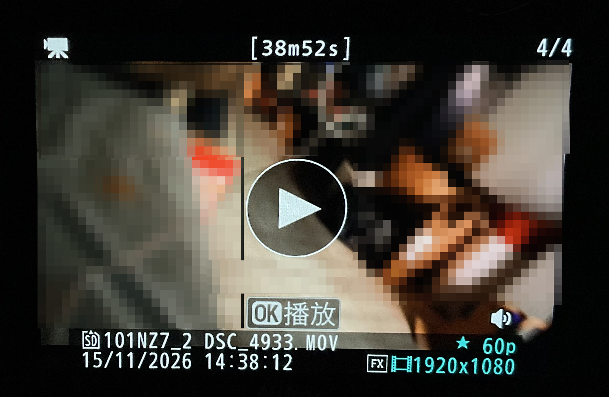
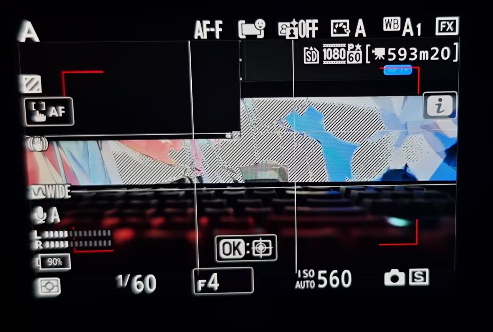

# Movie recording duration / 解除录像时长限制

[English README](../README.en.md) · [中文说明](../README.md)

Extend ordinary movie recording beyond the native 29-minute-59-second limit on the Nikon Z 7II running C 1.70. The complete combined SD module applies this automatically, with no additional setting. Both standby and active-recording countdowns use the extended duration.

Nikon Z 7II C 1.70 的普通视频录制可超过原厂 29 分 59 秒上限。完整组合 SD 模块加载后自动生效，无需额外设置；视频待机及实际录制时的剩余时间均随延长后的时限更新。

- Available recording time follows the native capacity and bitrate calculation. Reserved space, file-size and file-count constraints remain in effect. The implementation retains a numeric ceiling of 99:59:59; this is not a promise of unlimited recording.
- Native temperature, stop and error handling remain active. **The camera can still stop recording or shut down because of overheating.** Removing the single-take time limit does not remove thermal limits.
- Slow-motion, time-lapse and other special recording paths retain their existing behavior. The module does not automatically restart recording to join multiple takes.
- The feature replaces task callbacks in RAM. It requires no host firmware change and adds no persistent configuration field.

- 可录时长按原厂容量与码率换算，保留预留空间、文件大小及文件数量等限制。实现沿用 99:59:59 的数值上界，不代表可以无限录制。
- 保留原厂温度、停止和错误处理。**仍可能因过热停止录像或关机。** 解除单次录制时长上限不等于解除温度限制。
- 慢动作、延时等特殊录制路径保持原有行为；不通过自动重新开始录像拼接多次录制。
- 通过替换 RAM 中的任务回调实现，无需修改宿主固件，也不新增持久配置字段。

## Verification / 验证

**Hardware verified.** On November 15, 2026, the user confirmed a continuous recording beyond 29:59. Camera playback shows a **38-minute-52-second** clip at **1920 × 1080, 60p**. The user also confirmed that the exported video reports the correct duration on a computer and plays normally. Standby and active-recording photos show extended remaining-time countdowns. Release `v0.1.0-preview.16` contained the 59,220-byte module used for this test.

**已实机验证。** 2026-11-15，用户确认连续录像已超过 29:59。机身回放显示 **38 分 52 秒**、**1920 × 1080、60p** 的视频；用户同时确认导出的视频在电脑上显示的时长正常，播放也正常。待机及录制照片均展示延长后的剩余时间倒计时。本次实机测试所用的 59,220 字节模块随 `v0.1.0-preview.16` 发布。

Local instruction-level checks cover native startup parameter propagation, 128 capacity comparisons, ordinary duration and 4K 60/50p frame-budget stop conditions, and total-duration notifications during recording. Storage, encoder and scheduling services are modeled. The hardware result establishes the tested 1080/60p case; other formats, file-segment boundaries, maximum duration and long-term thermal behavior are not established by this test.

本地指令级检查覆盖原厂启动参数传递、128 组容量对照、普通时长及 4K 60/50p 帧组停止条件、录制期间总时长通知；存储、编码和调度服务使用替身。此次实机验证确认了所测 1080/60p 场景，不代表其他格式、文件分段边界、最长可录时长及长期温度表现均已验证。
