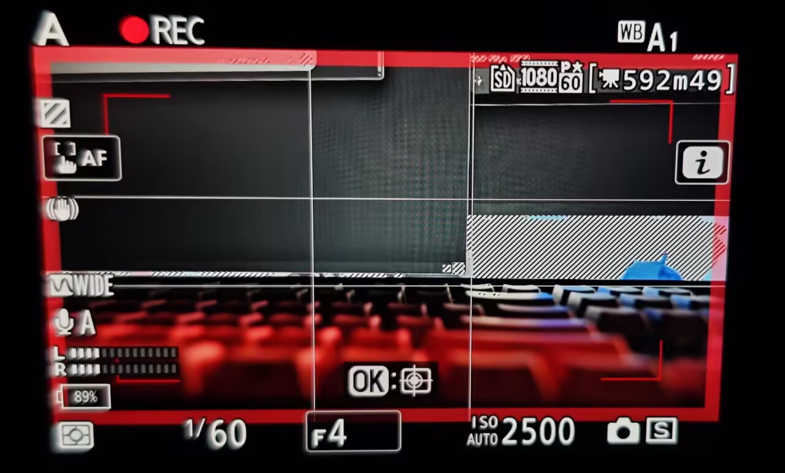

# Movie recording duration / 解除录像时长限制

Extend ordinary movie recording beyond the native 29-minute-59-second limit on the Nikon Z 7II running C 1.70. The complete combined SD module applies this automatically, with no additional setting. Both standby and active-recording countdowns use the extended duration.

Nikon Z 7II C 1.70 的普通视频录制可超过原厂 29 分 59 秒上限。完整组合 SD 模块加载后自动生效，无需额外设置；视频待机及实际录制时的剩余时间均随延长后的时限更新。

- Available recording time follows the native capacity and bitrate calculation. Reserved space, file-size and file-count constraints remain in effect. The duration counter has a ceiling of 99:59:59.
- Native temperature, stop and error handling remain active. **The camera can still stop recording or shut down because of overheating.**
- Slow-motion, time-lapse and other special recording paths retain their existing behavior.
- The feature replaces task callbacks in RAM. It requires no host firmware change and adds no persistent configuration field.

- 可录时长按原厂容量与码率换算，保留预留空间、文件大小及文件数量等限制。时长计数上限为 99:59:59。
- 保留原厂温度、停止和错误处理。**仍可能因过热停止录像或关机。**
- 慢动作、延时等特殊录制模式沿用原厂时限。
- 通过替换 RAM 中的任务回调实现，无需修改宿主固件，也不新增持久配置字段。

## 版本更新 / Version history

### v0.1.0-preview.16

- 首次延长普通视频单次录制时长，同步更新待机和录制中的剩余时间。2026-11-15 实机连续录制 1920 × 1080、60p 视频 38 分 52 秒，机内回放和电脑播放时长一致。
- Extended ordinary recording beyond 29:59 and updated the countdown in standby and during recording. A 1920 × 1080, 60p camera test on November 15, 2026 recorded 38:52, with the same duration in camera playback and on a computer.
- 可录时长按容量和码率计算。4K 60p／50p 的独立录制上限也随之延长。
- Recording time is calculated from storage capacity and bitrate. The separate limit for 4K 60p and 50p recording is also extended.

Local instruction-level checks cover native startup parameter propagation, 128 capacity comparisons, ordinary duration and 4K 60/50p frame-budget stop conditions, and total-duration notifications during recording. Storage, encoder and scheduling services are modeled.

本地指令级检查覆盖原厂启动参数传递、128 组容量对照、普通时长及 4K 60/50p 帧组停止条件、录制期间总时长通知；存储、编码和调度服务使用替身。
