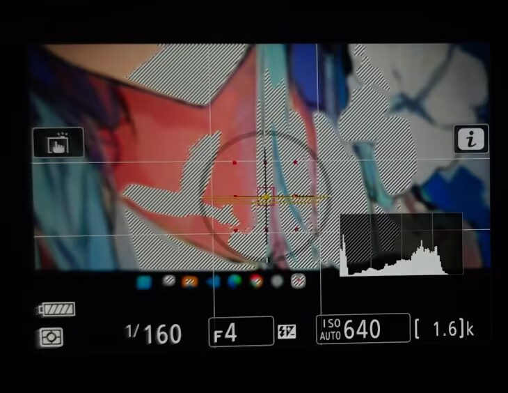
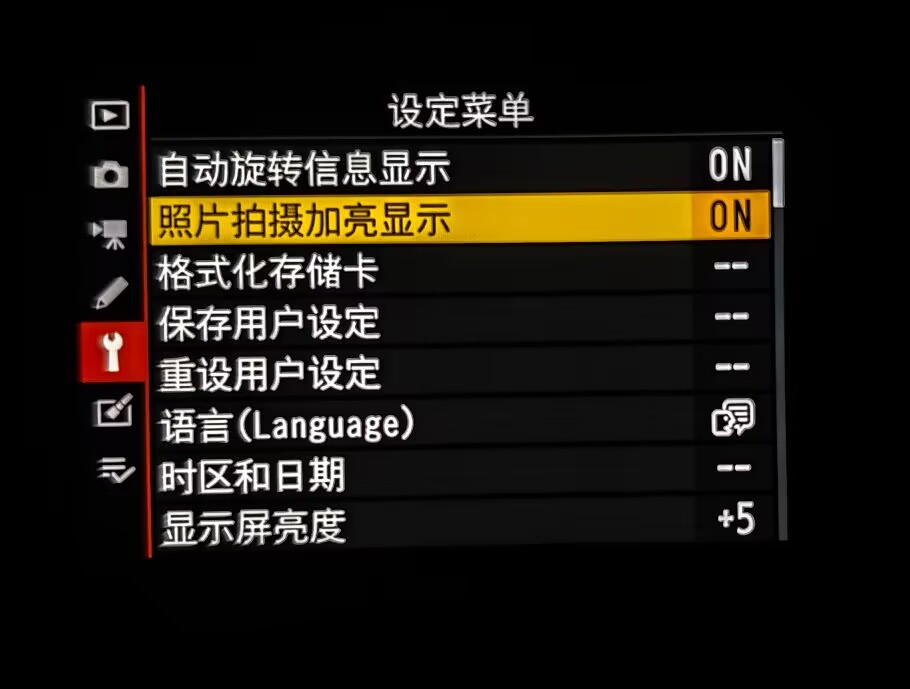
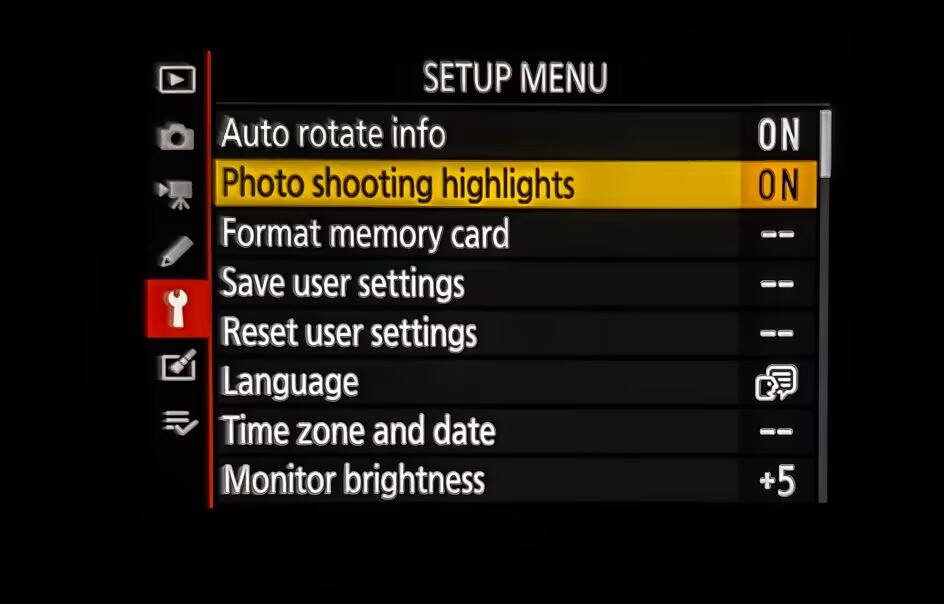
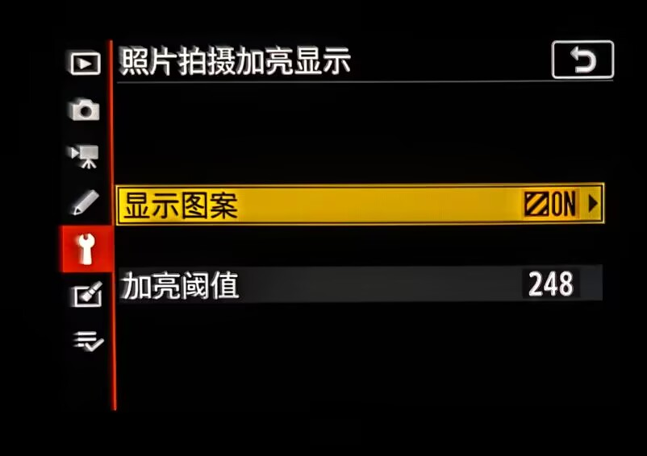
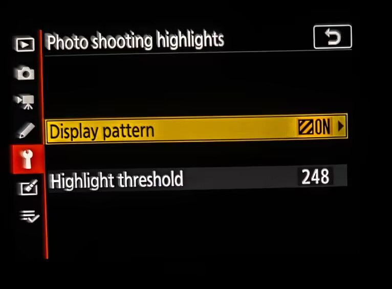

# Photo shooting highlights / 照片拍摄加亮显示

[English README](../README.md) · [中文说明](../README.zh-CN.md)

Highlight stripes mark bright areas during photo live view on both the rear LCD and electronic viewfinder. The photo settings are independent of the camera’s native movie highlight settings.

照片模式取景时，可在后屏 LCD 和电子取景器中以斑马纹标出高亮区域。照片设置与原厂视频加亮显示设置相互独立。

In the Setup Menu, **Photo shooting highlights** opens the display-pattern and highlight-threshold settings. The entry shows ON or OFF; the settings page shows the selected striped ON symbol or OFF and the numeric threshold. The labels follow the camera’s language in English, Simplified Chinese, and Traditional Chinese, with English for other languages.

「设定菜单 → 照片拍摄加亮显示」中可分别设置「显示图案」和「加亮阈值」。入口右侧显示 ON 或 OFF；功能页面显示当前斑马纹图案及 ON，或 OFF，以及具体阈值。标签支持简体中文、繁体中文和英文，其他相机语言使用英文。

| Setting / 设置 | Choices / 选项 | Default / 默认值 |
| --- | --- | --- |
| Display pattern / 显示图案 | Pattern 1, Pattern 2, Off / 图案 1、图案 2、关闭 | Off / 关闭 |
| Highlight threshold / 加亮阈值 | 255, 248, 235, 224, 213, 202, 191, 180 | 248 |

Preferences are saved alongside the framing-grid and automatic-rotation settings. LCD and EVF use the same photo preferences; switching displays restores the parameters for the selected output. Temporary diagnostic menu entries and log export have been removed.

设置与取景网格、自动旋转信息显示一同保存。LCD 与取景器共用照片加亮设置，切换显示设备时恢复对应参数。临时诊断菜单和日志导出已移除。

On the rear LCD, [Custom DISP pages](custom-disp.md) can additionally hide or allow photo highlights for each preset without changing the saved pattern or threshold.

后屏的[自定义 DISP 页面](custom-disp.md)还可逐页关闭或允许显示照片加亮，不改变已保存的图案和阈值。

## Verification / 验证

Photo highlight display on LCD and EVF has been verified on a Z 7II. The Simplified Chinese and English Setup Menu entries, pattern indicator and numeric threshold have also been hardware verified. This does not establish that every pattern/threshold combination or long-term stability has been tested.

照片加亮显示已在 Z 7II 的 LCD 和电子取景器上通过实机验证。简体中文、英文的设定菜单入口、图案状态和阈值数值也已实机验证；不代表所有图案与阈值组合及长期稳定性均已测试。

## Photo live view / 照片取景画面

## Setup Menu / 设定菜单

## Pattern and threshold / 图案与阈值

