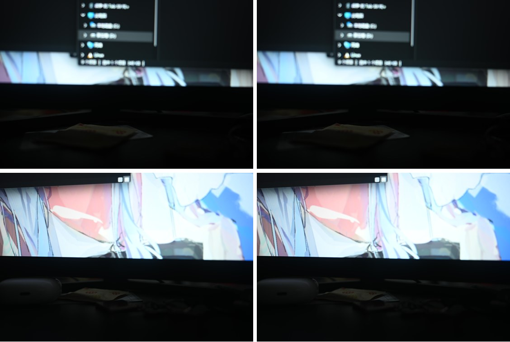
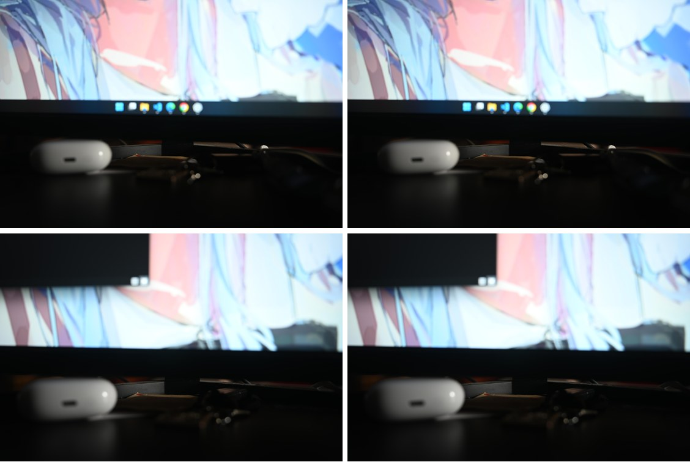

# 像素变化拍摄实测对比 / Pixel shift camera measurements

本页收录 14 组 16 张实拍，共 224 张 NEF。各组为 28 mm、1/8 秒、f/2.8、ISO 64、FX/L 14 位。步幅由同一 X 或同一 Y 的原片直接配准，单位为原图像素。局部 RAW 按未插值的绿色 Bayer 平面测量，范围来自两个空间频带。表中的步幅是四列或四行中位数，每个半格的目标为 0.5 px。

These tests cover 14 sixteen-shot series, or 224 FX/L 14-bit NEFs, taken at 28 mm, 1/8 s, f/2.8 and ISO 64. Step sizes are measured between originals with the same X or Y target, in original RAW pixels. The local measurements use undemosaiced green Bayer planes. Ranges come from two spatial frequency bands. Each step is reported as the median across four columns or rows, and the target is 0.5 px.

## 2 秒、10 秒交替 / Alternating 2 s and 10 s delays

原顺序连续拍了四组。延时来自实拍者记录。均方根误差以各组首张为原点，按实测位置到理想网格的距离计算。Parsek 全图配准提供独立参考。

Four series used the original order. Start delays are from the shooting record. RMS errors measure displacement from the ideal grid relative to frame 1 of each series. Parsek provides a separate full-image registration.

| 原片 / NEFs | 延时 / Delay | 局部 X RMS | 局部 Y RMS | 局部二维 / Local 2D RMS | Parsek 2D RMS | Y 0→9 | Y 9→18 | Y 18→27 |
| --- | ---: | ---: | ---: | ---: | ---: | ---: | ---: | ---: |
| `DSC_9290–9305` | 2 s | 0.095–0.096 | 0.042–0.046 | 0.10–0.11 | 0.16 | 0.435 | 0.540–0.555 | 0.437–0.451 |
| `DSC_9306–9321` | 10 s | 0.101–0.102 | 0.046–0.051 | 0.11 | 0.13 | 0.478–0.486 | 0.496–0.501 | 0.463–0.464 |
| `DSC_9322–9337` | 2 s | 0.145–0.166 | 0.030–0.036 | 0.15–0.17 | 0.18 | 0.496–0.500 | 0.507–0.516 | 0.456–0.457 |
| `DSC_9338–9353` | 10 s | 0.061–0.063 | 0.055–0.066 | 0.08–0.09 | 0.11 | 0.462–0.475 | 0.508–0.509 | 0.440–0.444 |

第二次从 2 秒换到 10 秒时，两种配准都测到二维误差下降，主要来自 X。第一次的结果取决于配准方法。Y 三段也随组次变化，单凭这四组还无法把差异归因于延时。较早的四张和八张数据见[组前延时实机对照](pixel-shift.md#组前延时实机对照--start-delay-camera-test)。

Both methods found lower 2D error in the second 10-second series than in the preceding 2-second series, mostly on X. The first comparison depended on the registration method. The Y steps also varied between runs, so the four series alone do not isolate the effect of start delay. [Earlier four- and eight-shot samples](pixel-shift.md#组前延时实机对照--start-delay-camera-test)

## X=11 与 X=10 / X=11 versus X=10

同一机位以 10 秒延时先拍 X=11，再拍 X=10，Y 沿用 9。下表为局部 RAW 实测。X 取向左为正，Y 向下为正。

Both series used the same camera position and a 10-second delay. The half-step setting changed from X=11 to X=10, with Y at 9. The table gives local RAW measurements, with X positive leftward and Y positive downward.

| 原片 / NEFs | X 设置 / Setting | X 第 1 段 / Step 1 | X 第 2 段 / Step 2 | X 第 3 段 / Step 3 | Y 0→9 | Y 9→18 | Y 18→27 |
| --- | ---: | ---: | ---: | ---: | ---: | ---: | ---: |
| `DSC_9389–9404` | 11 | 0.450–0.452 | 0.493–0.505 | 0.522–0.541 | 0.380–0.390 | 0.470–0.472 | 0.381–0.384 |
| `DSC_9405–9420` | 10 | 0.436–0.441 | 0.554–0.556 | 0.488–0.491 | 0.371–0.376 | 0.471–0.480 | 0.418–0.435 |

X=10 让尾段更接近半像素，首段更短，中段更长。四行共 12 个 X 半格的局部均方根误差从 0.049–0.053 px 升到 0.053–0.061 px。以三段综合误差为依据，默认值继续用 X=11。

X=10 brought the final step closer to half a pixel, shortened the first step and enlarged the middle step. Across all 12 X steps, local RMS error rose from 0.049–0.053 px to 0.053–0.061 px, supporting X=11 as the default for this camera.

上排为 2 秒 `DSC_9290`、10 秒 `DSC_9306`，下排为 X=11 `DSC_9389`、X=10 `DSC_9405`。Top row shows the 2 s and 10 s delay tests. Bottom row shows the X=11 and X=10 tests.

## 四组中间实拍 / Four intermediate series

四组均为原顺序、X=11、Y=9、10 秒延时。首段在这几组反复偏短，其余两段随组次变化。All four used the original order with X=11, Y=9 and a 10-second delay. The first Y step repeatedly came out short, with more variation in the other two steps.

| 原片 / NEFs | Y 0→9 | Y 9→18 | Y 18→27 |
| --- | ---: | ---: | ---: |
| `DSC_9429–9444` | 0.420–0.424 | 0.587–0.599 | 0.394–0.396 |
| `DSC_9446–9461` | 0.407–0.418 | 0.519–0.527 | 0.468–0.474 |
| `DSC_9463–9478` | 0.367–0.403 | 0.519–0.562 | 0.388–0.418 |
| `DSC_9482–9497` | 0.379–0.385 | 0.514–0.537 | 0.448–0.456 |

## 顺序对照 / Capture-order comparisons

两轮对照均固定 X=11、Y=9、10 秒延时。第一轮只交换原顺序的两个 Y 批次。第二轮依次拍 X=0、11、21、31，每列按 Y=0→9→27→18 拍四张。

Both comparisons used X=11, Y=9 and a 10-second delay. The first swapped the two Y batches. The second shot columns in order X=0, 11, 21, 31, taking Y=0→9→27→18 within each column.

| 原片 / NEFs | 顺序 / Order | Y 0→9 | Y 9→18 | Y 18→27 | 0→9 实拍间隔 / Time separation |
| --- | --- | ---: | ---: | ---: | ---: |
| `DSC_9501–9516` | 原顺序 / Original | 0.450–0.455 | 0.553–0.555 | 0.461 | 6.69–20.70 s |
| `DSC_9517–9532` | 交换 Y 两批 / Swapped Y batches | 0.528–0.532 | 0.468–0.487 | 0.534–0.540 | 6.54–20.37 s，Y=9 先拍 / Y=9 first |
| `DSC_9536–9551` | 原顺序 / Original | 0.431–0.442 | 0.600–0.605 | 0.428–0.434 | 6.54–20.42 s |
| `DSC_9552–9567` | 按 X 分列 / By X column | **0.514–0.515** | 0.483–0.489 | 0.527–0.531 | **1.57–1.81 s** |

交换两批后四列的首段都变长。在两组中，同一 Y 的 16 个对照帧对均为较晚拍的图像更靠上。根据同一 X 的实测时间差作线性插值，首段在零时间差处约为 0.490–0.491 px。该估计说明了跨帧漂移对步幅的影响，曝光内位移还无法确定。

Swapping the batches increased the first step in all four X columns. In all 16 same-Y comparison pairs, the later image was higher. Interpolation using the measured time differences puts the first step at about 0.490–0.491 px at zero separation. This estimates a between-frame drift effect. Within-exposure movement remains unresolved.

分列组任意相邻 Y 的最长间隔从 20.42 秒降至 3.74 秒，12 个 Y 半格距 0.5 px 的平均绝对误差从约 0.08 px 降至 0.019 px。三个 X 半格的中位数由 `0.410–0.412 / 0.621–0.630 / 0.493–0.496` px 变为 `0.392–0.394 / 0.569–0.577 / 0.478–0.484` px，水平首段仍短。

The column order reduced the longest interval between neighboring Y targets from 20.42 s to 3.74 s. Mean absolute error across all 12 Y steps fell from about 0.08 px to 0.019 px. Median X steps changed from `0.410–0.412 / 0.621–0.630 / 0.493–0.496` px to `0.392–0.394 / 0.569–0.577 / 0.478–0.484` px. The first X step remained short.

上排为原顺序 `DSC_9501` 和对调组的同一中心 `DSC_9525`。下排为原顺序 `DSC_9536` 和按 X 分列 `DSC_9552`。Top row shows the original and swapped Y batches. Bottom row shows the original and X-column orders. All four images show the same commanded center within their respective comparison.

尼康工坊从最后两组各导出一份 16512×11008 NEFX。留存的 Parsek NEFX 来自原顺序组，尺寸相同。这一轮未做 16 张机内合成。NX Studio exported a 16512×11008 NEFX from each of the final two series. The retained Parsek NEFX is from the original-order series and has the same dimensions. This round did not include a sixteen-shot in-camera merge.
