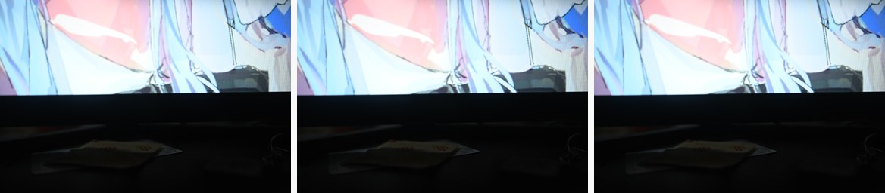
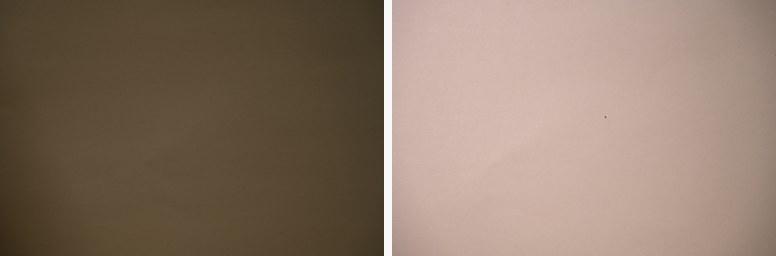
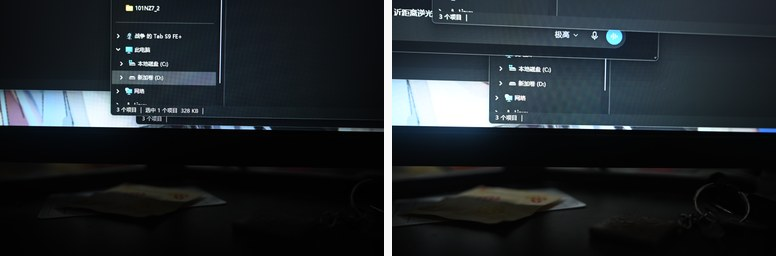
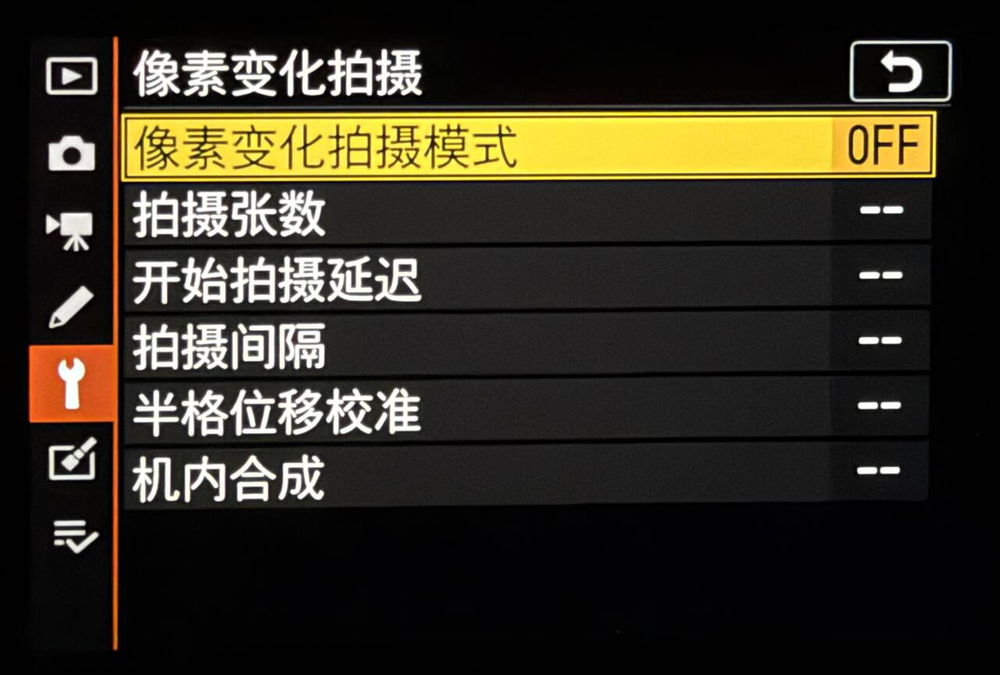
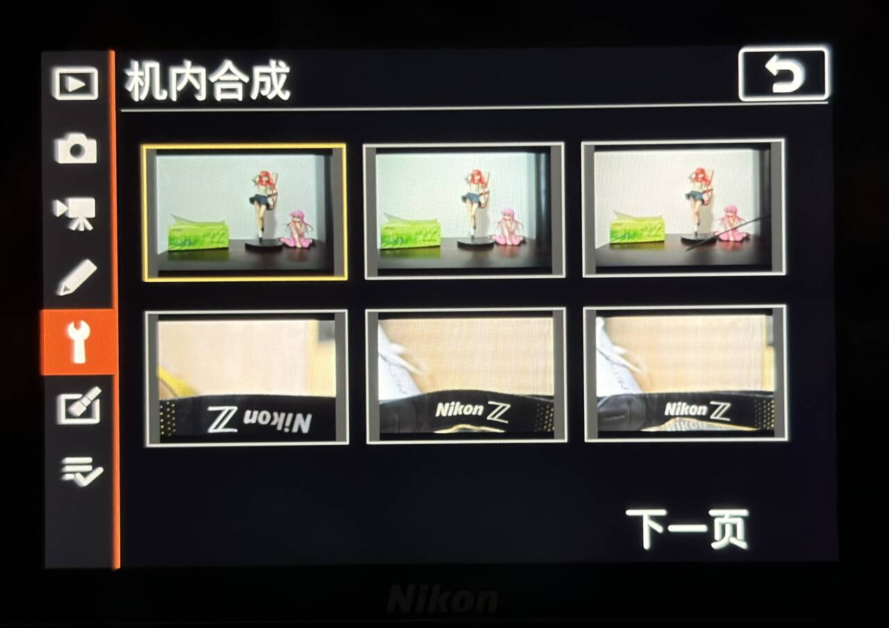
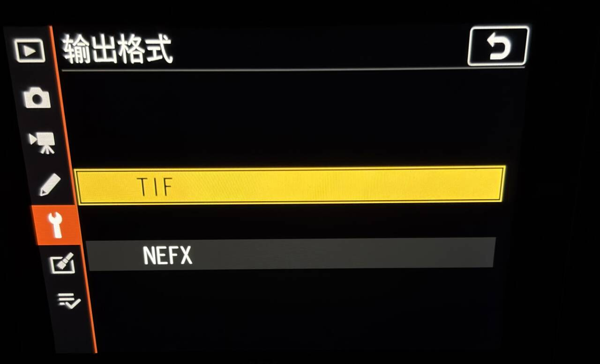
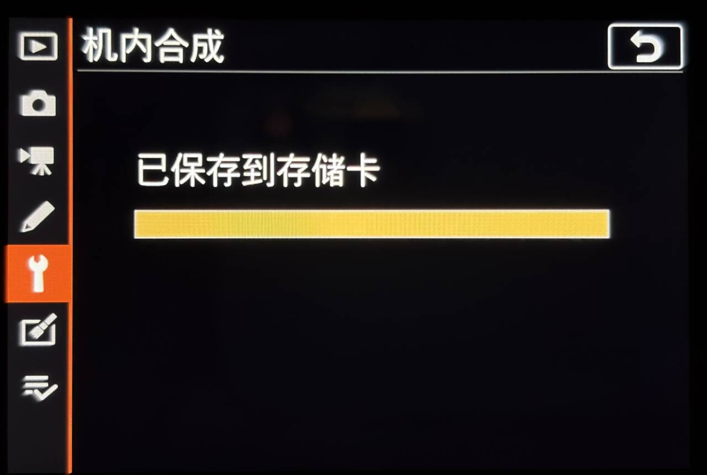
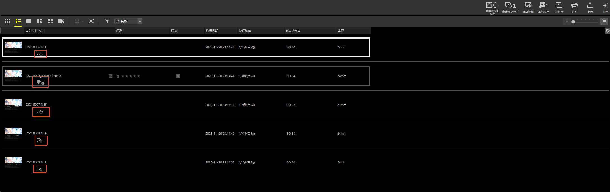
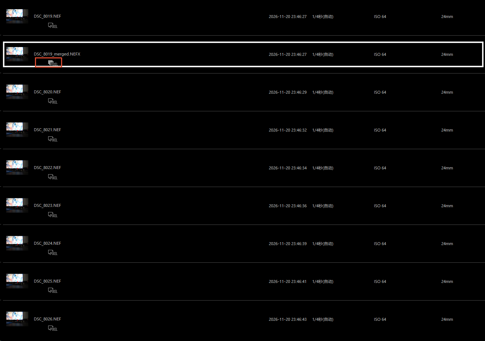

# 像素变化拍摄 / Pixel shift shooting

## 中文

在 Nikon Z 7II C 1.70 上，像素变化拍摄通过机身防抖机构逐张移动传感器。相机把一组 4、8、16 或 32 张 14 位未压缩 NEF 保存到 `DCIM`。可以在相机上合成，也可以直接用尼康工坊（NX Studio）合并为 NEFX。

### 相机设置

1. 使用三脚架和静止主体。开启机身防抖，选择单卡记录。
2. 将照片影像区域设为 FX，NEF（RAW）尺寸设为 L。每组拍摄期间，模块会启用静音拍摄并固定输出 14 位未压缩 NEF，拍摄结束后恢复原来的设置。
3. 在 **设定菜单 → 像素变化拍摄** 选择模式与张数，然后返回取景。全按一次快门后松开，等待相机完成整组拍摄、传感器回中和存卡。

| 设置             | 选项                                      | 默认 |
| ---------------- | ----------------------------------------- | ---- |
| 像素变化拍摄模式 | 开启（连续）、开启（单组）、关闭          | 关闭 |
| 拍摄张数         | 4 张、8 张、16 张、32 张                  | 4 张 |
| 开始拍摄延迟     | 关闭、1 秒、2 秒、3 秒、5 秒、10 秒       | 10 秒 |
| 拍摄间隔         | 0 秒、1 秒、2 秒、3 秒、5 秒、10 秒、关闭 | 0 秒 |

「开启（连续）」下，每次全按快门启动一组。「开启（单组）」仅启动一组，结束后自动关闭。拍摄间隔设为「0 秒」或「关闭」时，等上一张写卡完成并且传感器移到下一位置后立即拍摄。连续模式开关、张数、延迟和间隔保存在 SD 卡的 `Z72APP.CFG` 中，开机时恢复。单组模式每次开机后可重新启用。

### 机内合成

在 **设定菜单 → 像素变化拍摄 → 机内合成** 选择照片组。相机先扫描 SD 卡，再扫描 CFexpress Type B 卡槽，每页显示最多六组。每组的原片须完整存放在同一张卡上。按 OK 或点选缩略图，然后选择 **TIF** 或 **NEFX**。

| 输出格式 | 原片要求 | 结果 |
| --- | --- | --- |
| TIF | 14 位未压缩 NEF，也可读取早期的 14 位无损压缩照片组 | 16 位 RGB TIFF，写入可用的 EXIF，并在有适用镜头参数时校正横向色差 |
| NEFX | 14 位未压缩 NEF | 可在尼康工坊继续显影和导出的合成文件 |

机内合成会先对齐原片。4 张和 8 张输出 8256 × 5504，16 张和 32 张输出 16512 × 11008。完成后，文件保存在原片所在卡根目录的 `Synthesis` 文件夹。合成中按 MENU 或点右上角的返回键可以取消。

四张一组的实机合成耗时为 TIF **74.411 秒**、NEFX **75.011 秒**。

「半格位移校准」可单独设定 X 和 Y，默认值分别为 11 和 9，设置保存在 SD 卡的 `Z72APP.CFG` 中。16 张和 32 张模式会使用半格位移。[标定指南](IBIS-calibration.md)

### 用 Parsek NEFX 在电脑上合成

Windows 上可用 Parsek NEFX 的图形界面，或通过命令行把 4、8、16 或 32 张 FX 大尺寸 14 位 NEF 合成为 NEFX。支持未压缩和无损压缩原片，可选择参考原片并启用横向色差矫正。[下载 Windows x64 图形界面](../releases/parsek-nefx-gui.exe) · [SHA-256 校验](../releases/SHA256SUMS) · [使用说明、构建方法和截图](../tools/parsek_nefx/README.md)

### 在尼康工坊中合并

1. 在尼康工坊打开一组完整的 NEF，点击工具栏的 **像素变化合并**。选择「生成 1 个图像」时，4 张和 8 张合成输出 8256 × 5504，16 张和 32 张合成输出 16512 × 11008。
2. 在 **保存** 中选择目标位置并开始合并。合成后的 NEFX 可用于后续调整和导出。[尼康工坊像素变化合并说明](https://www.nikonimglib.com/nxstdo/onlinehelp/cn/merge_pixel_shift_pictures_53.html)

## English

Pixel shift shooting on the Nikon Z 7II C 1.70 moves the sensor between exposures using in-body vibration reduction. The camera saves a series of 4, 8, 16 or 32 uncompressed 14-bit NEFs in `DCIM`. You can merge them in-camera or open the series directly in NX Studio to create a NEFX.

### Camera setup

1. Use a tripod and a static subject. Enable in-body vibration reduction and select single-card recording.
2. Select FX image area and L NEF (RAW) size. The module enables silent photography and records uncompressed 14-bit NEFs during each series. It restores your settings after capture.
3. Choose the mode and number of shots under **Setup Menu → Pixel shift shooting**. Return to live view, press the shutter-release button fully once, and release it. Wait for the camera to finish the series, recenter the sensor and write the files.

| Setting          | Choices                               | Default |
| ---------------- | ------------------------------------- | ------- |
| Pixel shift mode | On (continuous), On (single set), Off | Off     |
| Number of shots  | 4, 8, 16, 32                          | 4       |
| Start delay      | Off, 1 s, 2 s, 3 s, 5 s, 10 s         | 10 s    |
| Shot interval    | 0 s, 1 s, 2 s, 3 s, 5 s, 10 s, Off    | 0 s     |

In continuous mode, each full press starts one series. Single-set mode turns itself off when the series ends. With the interval set to **0 s** or **Off**, the next shot starts as soon as the previous file write completes and the sensor settles at its next position. The continuous-mode switch, shot count, delay and interval are restored from `Z72APP.CFG` on the SD card. Single-set mode can be armed again after power-up.

### In-camera merge

Go to **Setup Menu → Pixel shift shooting → In-camera merge** and select a series. The camera scans the SD slot first, then the CFexpress Type B slot, and shows up to six series per page. All originals for one series must be on the same card. Press OK or tap a thumbnail, then select **TIF** or **NEFX**.

| Output | Source NEFs | Result |
| --- | --- | --- |
| TIF | 14-bit uncompressed or a 14-bit lossless compressed series from an earlier version | 16-bit RGB TIFF with available EXIF and lateral chromatic aberration correction when applicable lens data is available |
| NEFX | 14-bit uncompressed | A merged file that NX Studio can develop and export |

The camera aligns the originals before merging. With 4 or 8 shots it produces an 8256 × 5504 image, and with 16 or 32 shots it produces a 16512 × 11008 image. The result is saved in `Synthesis` at the root of the card holding the originals. Press MENU or tap the back button in the top-right corner to cancel a merge in progress.

On-camera merge of a four-shot series took **74.411 seconds** for TIF and **75.011 seconds** for NEFX.

**Half-step calibration** lets you set X and Y separately. The defaults are 11 and 9. The SD card's `Z72APP.CFG` stores both values, which are used for 16- and 32-shot series. [Calibration guide](IBIS-calibration.md#why-calibrate)

### Merge on a computer with Parsek NEFX

The Windows GUI and command-line tool accept 4, 8, 16 or 32 full-size, 14-bit FX NEFs in either uncompressed or lossless compressed format. You can choose a reference frame and enable lateral chromatic aberration correction. [Download the Windows x64 GUI](../releases/parsek-nefx-gui.exe) · [SHA-256](../releases/SHA256SUMS) · [Usage, build instructions, and screenshot](../tools/parsek_nefx/README.md)

### Merge in NX Studio

1. Open a complete NEF series in NX Studio and select **Pixel shift merge** in the toolbar. With **Generate one image** selected, 4- and 8-shot series produce 8256 × 5504 images, while 16- and 32-shot series produce 16512 × 11008 images.
2. Choose a destination and start the merge. The resulting NEFX is ready for editing and export. [NX Studio Pixel Shift Merge help](https://www.nikonimglib.com/nxstdo/onlinehelp/en/merge_pixel_shift_pictures_53.html)

## 组前延时实机对照 / Start-delay camera test

同一台 Z 7II 按 **2 秒 → 10 秒 → 2 秒**拍了三组。24 张原片都是 1/8 秒、28 mm、f/2.8、ISO 64、FX/L 14 位 NEF。每组把相同的四个位置拍两轮，位移通过原始 Bayer 绿色平面的多区域配准计算。

Three eight-shot series were recorded on the same Z 7II using **2 s → 10 s → 2 s** start delays. All 24 originals were FX/L 14-bit NEFs at 1/8 s, 28 mm, f/2.8 and ISO 64. Each series captured the same four sensor positions twice. Displacements came from registration across multiple regions of the RAW green planes.

| 延时 / Delay | 第 1、5 张相差 / Frames 1 and 5 | 前四张最大误差 / First four | 后四张最大误差 / Last four |
| --- | ---: | ---: | ---: |
| 2 秒，第一次 / 2 s, first run | 0.11–0.14 px | 0.17–0.21 px | 约 / about 0.08 px |
| **10 秒 / 10 s** | **约 / about 0.03 px** | **0.07–0.11 px** | 0.06–0.08 px |
| 2 秒，第三次 / 2 s, third run | 约 / about 0.07 px | 0.12–0.13 px | 0.07–0.09 px |

第 1、5 张使用同一个中心目标。最大误差是每个半组以自身首张为参考，三个角点测得的二维位移与理想位置之间的最大距离。10 秒组的两个中心最接近。拍摄顺序中也观察到小幅画面漂移，现有数据无法确定改善来自机身振动衰减还是其他位置变化。

Frames 1 and 5 shared the same center target. Maximum error is the largest distance between the measured and ideal corner shifts, using the first frame of each four-shot set as its reference. The 10-second series had the closest pair of center frames. The images also drifted slightly over the course of the test, leaving the physical cause of the difference unresolved.

从左至右依次为 2 秒（`DSC_9264`）、10 秒（`DSC_9272`）和 2 秒（`DSC_9280`）。From left to right, the frames show 2 s (`DSC_9264`), 10 s (`DSC_9272`), and 2 s (`DSC_9280`).

### 较早的 2 秒和 10 秒样本 / Earlier 2- and 10-second samples

较早的两组 2 秒样本为四合一原片，延时来自拍摄记录。另两组 10 秒样本分别取自早期八张测试的第 5–8 张，每组以所列第一张为参考。向右、向下为正，单位是原图像素。各组的焦距、快门或场景有差异，表中数值可作实拍参考。

The photographer recorded a 2-second delay for the two earlier four-shot sets. The additional 10-second samples use frames 5–8 from each of two earlier eight-shot tests. Shifts are relative to the first listed frame, in original image pixels, with right and down positive. Focal length, shutter speed, or scene varies across these samples.

| 延时 / Delay | 原片 / NEFs | 焦距与快门 / Focal length and shutter | 第 2 张 / Frame 2 | 第 3 张 / Frame 3 | 第 4 张 / Frame 4 | 最大误差 / Max. error |
| --- | --- | --- | ---: | ---: | ---: | ---: |
| 2 s | `DSC_9220–9223` | 68 mm · 1/25 s | (−1.15, −0.06) | (−1.18, +0.90) | (−0.13, +0.91) | 约 / about 0.21 px |
| 2 s | `DSC_9224–9227` | 75 mm · 1/20 s | (−1.05, −0.03) | (−1.01, +0.93) | (+0.03, +0.93) | 约 / about 0.08 px |
| 10 s | `DSC_9250–9253` | 28 mm · 1/25 s | (−1.03, +0.01) | (−0.99, +0.98) | (+0.08, +0.99) | 0.08–0.09 px |
| 10 s | `DSC_9259–9262` | 28 mm · 1/4 s | (−1.08, 0.00) | (−1.08, +1.06) | (+0.01, +1.08) | 0.10–0.12 px |

左为 `DSC_9220`，右为 `DSC_9224`。`DSC_9220` is on the left and `DSC_9224` is on the right.

左为 `DSC_9250`，右为 `DSC_9259`。`DSC_9250` is on the left and `DSC_9259` is on the right.

后续的四组交替延时、X=11／10、时序实拍和两轮拍摄顺序对照，见[16 张实拍数据](pixel-shift-measurements.md)。[Sixteen-shot measurements](pixel-shift-measurements.md) cover the subsequent delay, X calibration, timing and capture-order comparisons.

## 机内合成界面 / In-camera merge screens

## 尼康工坊示例 / NX Studio examples

### 4 张 / 4 shots

尼康工坊识别 DSC_8006 至 DSC_8009 为一组，合并结果为 8256 × 5504。NX Studio groups DSC_8006 through DSC_8009 and merges them into an 8256 × 5504 image.

### 8 张 / 8 shots

DSC_8019 至 DSC_8026 合成为 8256 × 5504 的 NEFX。DSC_8019 through DSC_8026 merge into an 8256 × 5504 NEFX.

## 版本更新 / Version history

### v0.1.0-preview.48

- 像素变化拍摄的默认组前延时从 2 秒改为 10 秒。已保存在 `Z72APP.CFG` 中的延时继续使用原值。
- The default pixel shift start delay is now 10 seconds. The module continues to use any delay already saved in `Z72APP.CFG`.
- 16 张模式按 X 分列拍摄，同一列相邻 Y 位置的拍摄间隔更短。NEF 和机内合成使用标准网格帧号。[实拍对照](pixel-shift-measurements.md)
- Sixteen-shot series now capture by X column, bringing neighboring Y positions closer together in time. NEFs and in-camera merging use the standard grid frame numbers. [Camera measurements](pixel-shift-measurements.md)

### v0.1.0-preview.46

- 每组像素变化拍摄开拍前自动切换到单张释放，组末恢复原释放模式。使用旧版时，请在拍摄前手动选择单张释放。
- The module switches to single-frame release before each series and restores the previous release mode afterward. On earlier versions, select single-frame release before shooting.
- 开拍前退出自拍释放，并保留原连拍子模式，拍摄结束后恢复原设置。
- Clears self-timer mode before a series and preserves the selected continuous-release subtype for restoration afterward.

### v0.1.0-preview.42

- 开启 FTP 自动发送后，像素变化拍摄的照片可在写卡完成时加入发送队列。
- With FTP auto send enabled, pixel shift photos can enter the upload queue after saving.

### v0.1.0-preview.41

- 机内合成期间刷新菜单待机计时。显示「已保存到存储卡」和返回照片组时都会重新计时。返回后按相机设定的菜单待机时长计时。
- The module keeps the menu awake during a merge. The menu standby timer restarts when the camera shows **Saved to memory card** and again when you return to the series picker. The picker follows the configured menu standby delay.

### v0.1.0-preview.40

- 加入机内 TIF／NEFX 合成、X／Y 半格位移校准和 Parsek NEFX 桌面工具。每组拍摄自动开启静音拍摄并固定输出 14 位未压缩 NEF。
- Added in-camera TIF and NEFX merging, X and Y half-step calibration, and the Parsek NEFX desktop tool. Each series automatically uses silent photography and records uncompressed 14-bit NEFs.
- 机内可从 SD 或 CFexpress Type B 选组并对齐原片，输出到原卡的 Synthesis 目录。4／8 张输出 8256 × 5504，16／32 张输出 16512 × 11008。TIF 为 16 位 RGB，支持读取早期的 14 位无损压缩照片组。
- The camera can select a series from SD or CFexpress Type B, align the frames, and save the merge to Synthesis on the source card. Four- and eight-shot series produce 8256 × 5504. Sixteen- and 32-shot series produce 16512 × 11008. TIF output is 16-bit RGB and supports earlier lossless-compressed 14-bit series.

### v0.1.0-preview.32

- 发布 Windows 图形版 NEFX 修复工具，可批量修复尼康工坊从早期无损压缩原片合成时沿用的压缩标记。
- Released a Windows GUI for batch repair of compression tags inherited by NX Studio merges from earlier lossless-compressed originals.
- 可多选或拖入已合成的 NEFX 和文件夹，输出带 _NX_compatible 后缀的副本。
- Select or drag in merged NEFX files and folders to create repaired copies with an _NX_compatible suffix.

### v0.1.0-preview.23

- 首次发布像素变化拍摄，支持 4、8、16 或 32 张一组，在 NEF 中记录分组信息供尼康工坊合并。
- Added pixel shift shooting in 4-, 8-, 16-, and 32-shot series, with grouping information written to the NEFs for merging in NX Studio.
- 拍摄支持单组与连续组、启动延迟和拍摄间隔。原片支持 14 位未压缩和无损压缩。Windows 启动器和 Python 脚本可修复尼康工坊合成时沿用的压缩标记。
- Added single-set and continuous modes, start delays, and shot intervals. Originals support uncompressed and lossless-compressed 14-bit NEF. A Windows launcher and Python script can repair compression tags carried over by NX Studio.
