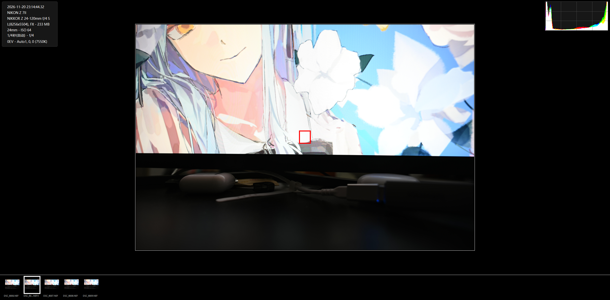
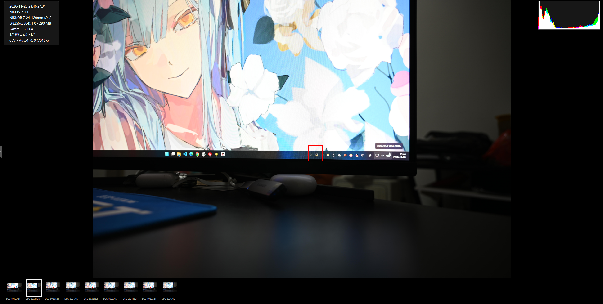
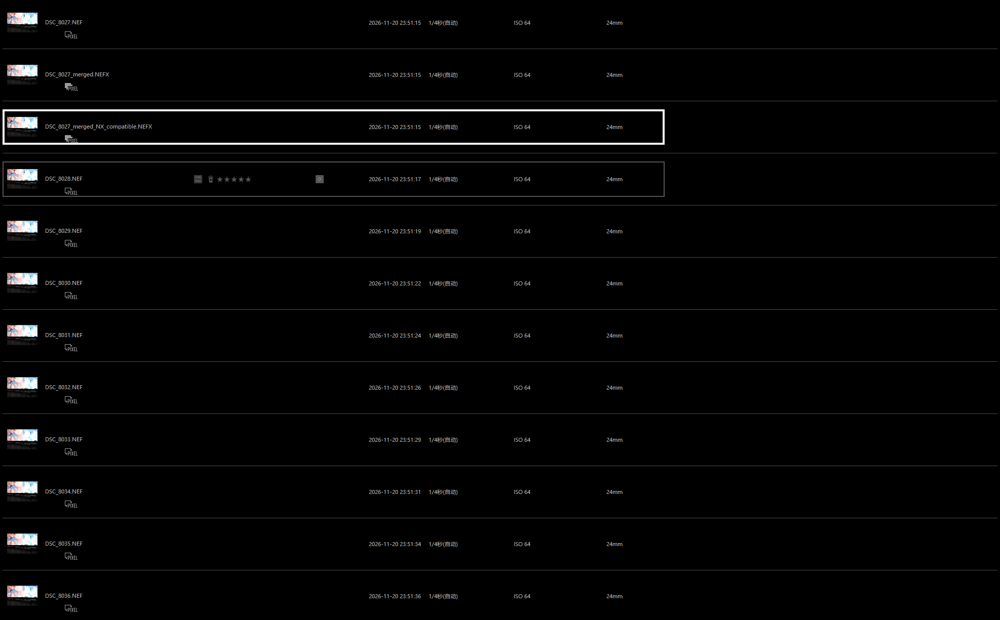
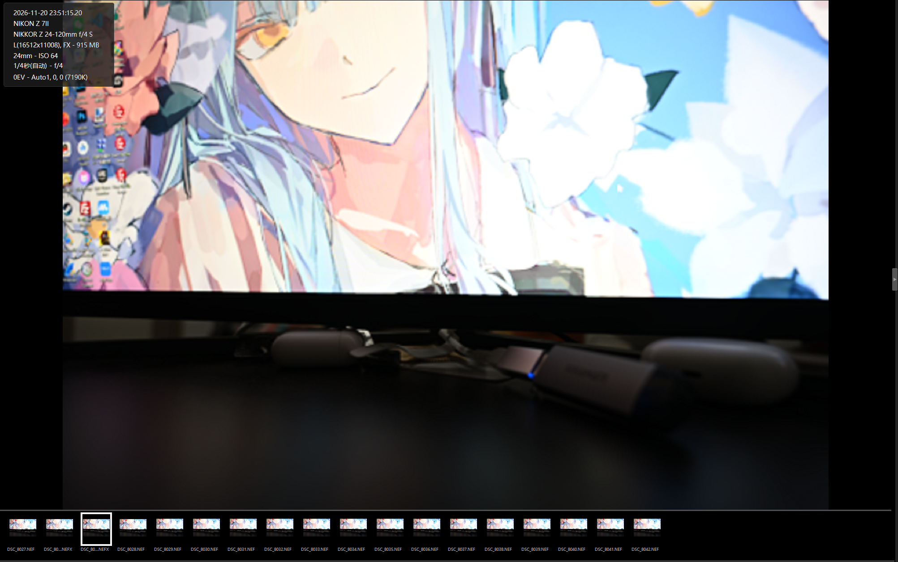

# 像素变化拍摄 / Pixel shift shooting

## 中文

在 Nikon Z 7II C 1.70 上，像素变化拍摄通过机身防抖机构逐张移动传感器。相机把一组 4、8、16 或 32 张 NEF 保存到 `DCIM`，尼康工坊（NX Studio）可读取照片中的分组信息并合成为 NEFX。

### 相机设置

1. 使用三脚架和静止主体。开启机身防抖，选择静音拍摄、单张释放和单卡记录。
2. 将照片影像区域设为 FX，NEF（RAW）尺寸设为 L，位深设为 14 位。压缩方式支持未压缩和无损压缩。
3. 在 **设定菜单 → 像素变化拍摄** 选择模式与张数，然后返回取景。全按一次快门后松开，等待相机完成整组拍摄、传感器回中和存卡。

| 设置             | 选项                                      | 默认 |
| ---------------- | ----------------------------------------- | ---- |
| 像素变化拍摄模式 | 开启（连续）、开启（单组）、关闭          | 关闭 |
| 拍摄张数         | 4 张、8 张、16 张、32 张                  | 4 张 |
| 开始拍摄延迟     | 关闭、1 秒、2 秒、3 秒、5 秒、10 秒       | 2 秒 |
| 拍摄间隔         | 0 秒、1 秒、2 秒、3 秒、5 秒、10 秒、关闭 | 0 秒 |

「开启（连续）」下，每次全按快门启动一组。「开启（单组）」仅启动一组，结束后自动关闭。拍摄间隔设为「0 秒」或「关闭」时，等上一张写卡完成并且传感器移到下一位置后立即拍摄。连续模式开关、张数、延迟和间隔保存在 SD 卡的 `Z72APP.CFG` 中，开机时恢复。单组模式每次开机后可重新启用。

### 在尼康工坊中合并

1. 在尼康工坊打开一组完整的 NEF，点击工具栏的 **像素变化合并**。选择「生成 1 个图像」时，4 张和 8 张合成输出 8256 × 5504，16 张和 32 张合成输出 16512 × 11008。
2. 在 **保存** 中选择目标位置并开始合并。合成后的 NEFX 可用于后续调整和导出。[尼康工坊像素变化合并说明](https://www.nikonimglib.com/nxstdo/onlinehelp/cn/merge_pixel_shift_pictures_53.html)

| NEF 记录格式  | 合成后的处理                                                                                                                                                                                     |
| ------------- | ------------------------------------------------------------------------------------------------------------------------------------------------------------------------------------------------ |
| 14 位未压缩   | 尼康工坊可直接打开合成的 NEFX，并导出 JPEG 或 16 位 TIFF。                                                                                                                                       |
| 14 位无损压缩 | 尼康工坊 1.10.1 合成时可能沿用源 NEF 的压缩标记，导致生成的 NEFX 无法打开或导出。遇到此问题时，用下方工具修复合成后的 NEFX，再用尼康工坊打开生成的副本。 |

在 Windows x64 上双击修复工具。点击 **选择 NEFX 文件** 可多选合成文件，点击 **选择文件夹** 可批量处理该目录中的合成文件。也可以将文件或文件夹拖入窗口。运行无需安装 Python。[下载 NEFX 修复工具](../releases/ibis-nefx-repair.exe) · [SHA-256 校验](../releases/SHA256SUMS) · [Rust 源码](../tools/ibis_nefx_repair)

工具在原目录生成 `*_NX_compatible.NEFX`，只修正副本的压缩标记，并保留源 NEF、原合成文件和已有输出。处理记录会显示每个文件的结果。

## English

Pixel shift shooting on the Nikon Z 7II C 1.70 moves the sensor between exposures using in-body vibration reduction. The camera saves a series of 4, 8, 16 or 32 NEFs in `DCIM`. NX Studio reads the series information from the photos and merges them into a NEFX.

### Camera setup

1. Use a tripod and a static subject. Enable in-body vibration reduction and silent photography, and select single-frame release and single-card recording.
2. Select FX image area, L NEF (RAW) size, and 14-bit depth. Both uncompressed and lossless compressed NEF are supported.
3. Choose the mode and number of shots under **Setup Menu → Pixel shift shooting**. Return to live view, press the shutter-release button fully once, and release it. Wait for the camera to finish the series, recenter the sensor and write the files.

| Setting          | Choices                               | Default |
| ---------------- | ------------------------------------- | ------- |
| Pixel shift mode | On (continuous), On (single set), Off | Off     |
| Number of shots  | 4, 8, 16, 32                          | 4       |
| Start delay      | Off, 1 s, 2 s, 3 s, 5 s, 10 s         | 2 s     |
| Shot interval    | 0 s, 1 s, 2 s, 3 s, 5 s, 10 s, Off    | 0 s     |

In continuous mode, each full press starts one series. Single-set mode turns itself off when the series ends. With the interval set to **0 s** or **Off**, the next shot starts as soon as the previous file write completes and the sensor settles at its next position. The continuous-mode switch, shot count, delay and interval are restored from `Z72APP.CFG` on the SD card. Single-set mode can be armed again after power-up.

### Merge in NX Studio

1. Open a complete NEF series in NX Studio and select **Pixel shift merge** in the toolbar. With **Generate one image** selected, 4- and 8-shot series produce 8256 × 5504 images, while 16- and 32-shot series produce 16512 × 11008 images.
2. Choose a destination and start the merge. The resulting NEFX is ready for editing and export. [NX Studio Pixel Shift Merge help](https://www.nikonimglib.com/nxstdo/onlinehelp/en/merge_pixel_shift_pictures_53.html)

| NEF recording format       | After merging                                                                                                                                                                                                                                     |
| -------------------------- | ------------------------------------------------------------------------------------------------------------------------------------------------------------------------------------------------------------------------------------------------- |
| 14-bit uncompressed        | NX Studio can open the merged NEFX directly and export JPEG or 16-bit TIFF.                                                                                                                                                                       |
| 14-bit lossless compressed | NX Studio 1.10.1 may carry over the source compression marker, which can prevent the merged NEFX from opening or exporting. If this happens, use the repair tool below on the merged NEFX, then open the new copy in NX Studio. |

Double-click the repair tool on Windows x64. Use **选择 NEFX 文件** to select one or more merged NEFX files, or **选择文件夹** to process the merged files in a folder. You can also drag files or folders into the window. The tool runs without Python. [Download the NEFX repair tool](../releases/ibis-nefx-repair.exe) · [SHA-256](../releases/SHA256SUMS) · [Rust source](../tools/ibis_nefx_repair)

The tool saves a `*_NX_compatible.NEFX` copy next to each original and corrects the compression marker in the copy. It preserves source NEFs, original merges and existing outputs. The log shows the result for each file.

## 尼康工坊示例 / NX Studio examples

### 4 张 / 4 shots

尼康工坊识别 DSC_8006 至 DSC_8009 为一组，合并结果为 8256 × 5504。NX Studio groups DSC_8006 through DSC_8009 and merges them into an 8256 × 5504 image.

### 8 张 / 8 shots

DSC_8019 至 DSC_8026 合成为 8256 × 5504 的 NEFX。DSC_8019 through DSC_8026 merge into an 8256 × 5504 NEFX.

### 16 张 / 16 shots

16 张无损压缩 NEF 的合成示例。选中的 `DSC_8027_merged_NX_compatible.NEFX` 是经工具修正后可在尼康工坊打开的 16512 × 11008 副本。This 16-shot lossless compressed example shows the repaired 16512 × 11008 NEFX open in NX Studio.

