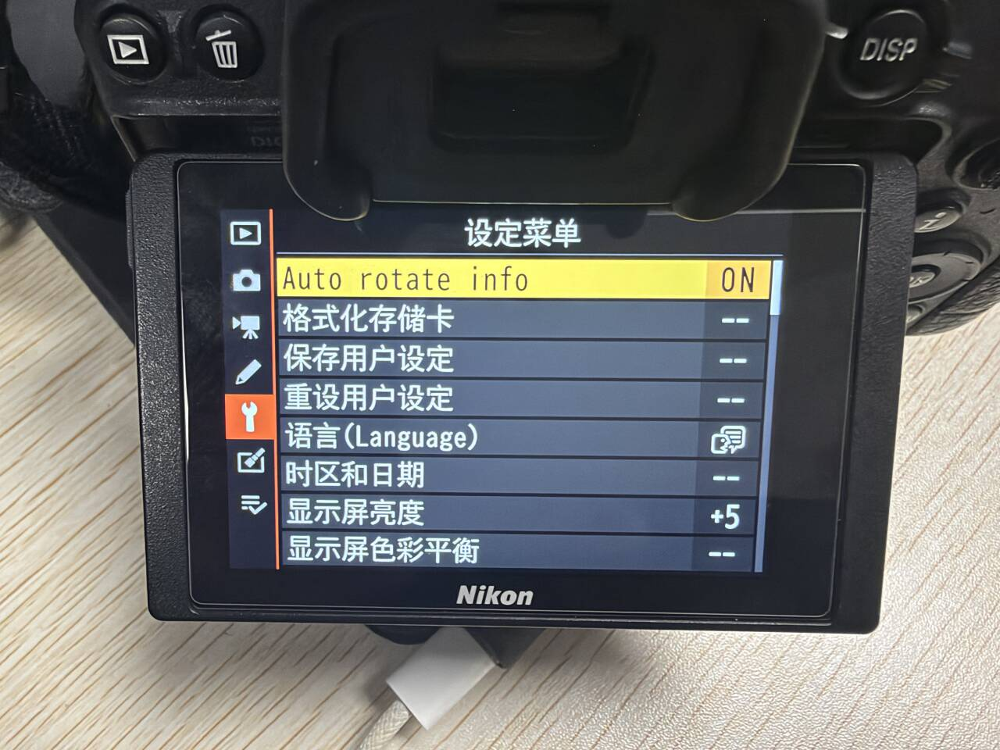
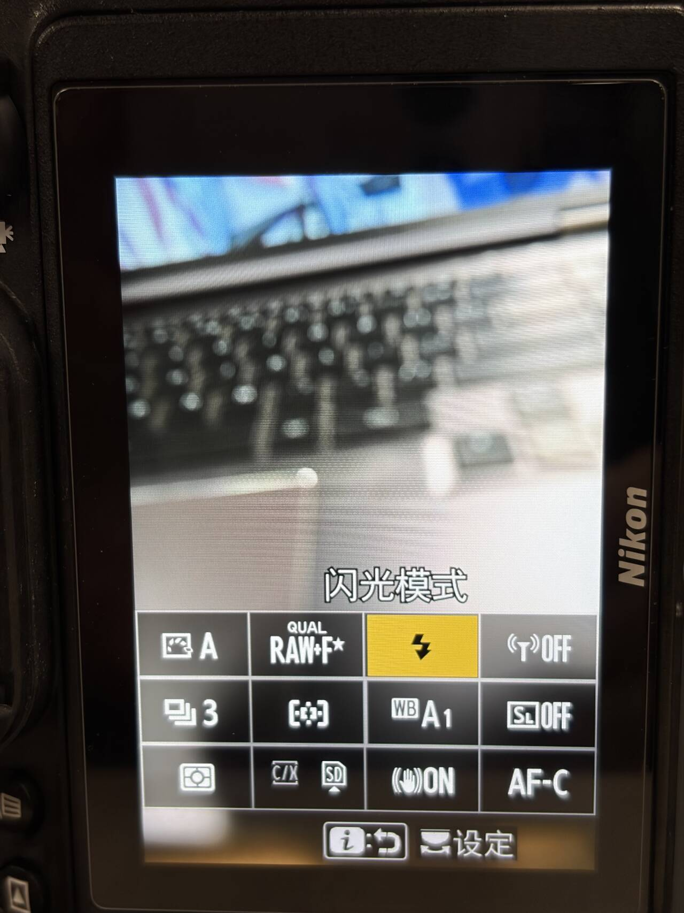
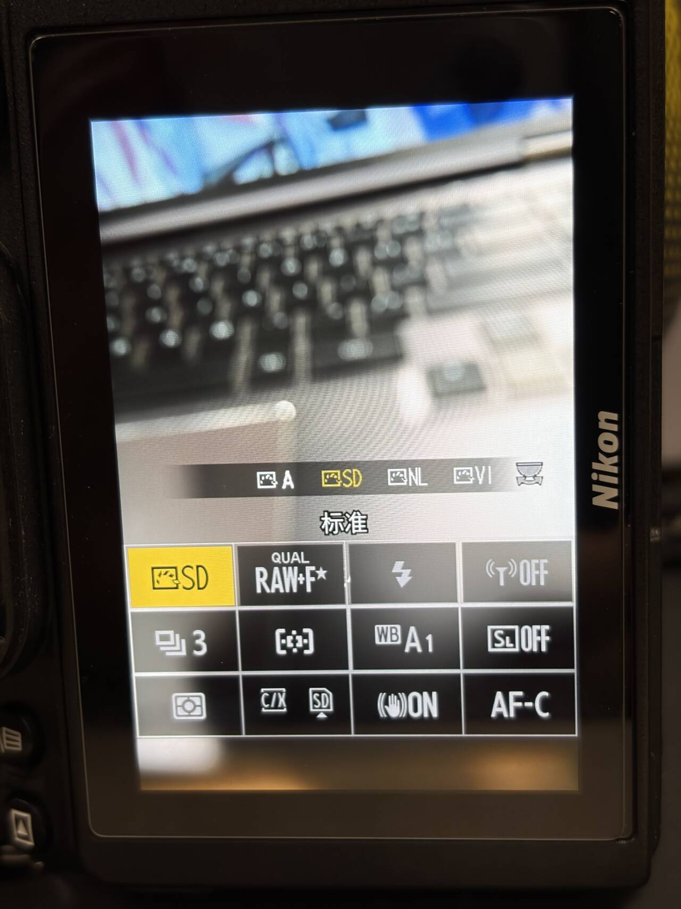

# Portrait display / 后屏竖拍界面

On the rear screen, shooting information, the 4×3 i menu, its supported settings panels, and the live histogram rotate with the camera. The directional buttons and touch targets follow the portrait i-menu layout.

竖拿相机时，后屏的拍摄信息、4×3 i 菜单、支持的 i 菜单设置页及实时直方图会转正。方向键和触控位置跟随 i 菜单的竖拍布局。

In movie mode, the L/R audio meters and microphone indicators, including **WIDE**, appear upright on the left, clear of the battery, memory-card, and ISO information. The tracking **OK / Exit** hint strip and its inline icons rotate together with their text; their backgrounds and clear areas follow the same layout.

视频竖拍时，L/R 音频电平条及 **WIDE** 等麦克风指示在左侧转正，避开电池、存储卡和 ISO 信息。跟踪对焦的 **OK／退出** 提示栏及行内图标与文字一起转正，背景和清除区域跟随同一布局。

In the Setup Menu, open **Auto rotate info** and choose Enable or Disable. The current state appears on the right. The setting is enabled by default and saved to `Z72APP.CFG`. The physical MENU screens, playback interface, and electronic viewfinder use the camera’s standard orientation.

在「设定菜单」中打开 **自动旋转信息显示**，选择「启用」或「禁用」。列表右侧显示当前状态。此项默认开启，并保存到 `Z72APP.CFG`。实体 MENU、回放界面和电子取景器使用相机原有朝向。

The photo AF-area i-menu picker, its command-dial strip, and the live-view status icon support [Wide-area AF (C1/C2)](custom-wide-area-af.md) in portrait orientation.

竖拍时，可以在照片 i 菜单的 AF 区域模式中用方向键、触摸或波轮切换 [宽区域 AF（C1/C2）](custom-wide-area-af.md)。取景状态栏也会随方向显示当前预设的图标。

The photo AF-area picker and command-dial strip also include [Subject tracking](subject-tracking.md) in AF-C.

照片 AF-C 下，竖拍 i 菜单的 AF 区域选项和波轮条中也可以选择[主体跟踪](subject-tracking.md)。

## Verification / 验证

Portrait display was verified on a Z 7II. The localized Setup Menu label was also verified in Simplified Chinese and English.

后屏竖拍界面已在 Z 7II 实机验证。设定菜单的简体中文和英文标签也已实机验证。

The movie portrait layout, including the audio meters, WIDE indicator, and tracking hints, passed hardware verification on November 15, 2026. Local checks also cover both portrait orientations, restoration of native audio coordinates, and the battery-percentage display.

视频竖拍的音频电平、WIDE 指示及跟踪对焦提示已于 2026-11-15 实机验证通过。本地检查还覆盖两侧竖拿、原厂音频坐标恢复和电量百分比显示。

## Setup Menu / 设定菜单

## Portrait i menu / 竖拍 i 菜单

## Command-dial quick adjustment / 波轮快速调整

## i-menu settings / i 菜单设置页

## Live view / 取景画面

## Movie live view / 视频取景画面

## 版本更新 / Version history

### v0.1.0-preview.44

- 调整 ISO 或曝光补偿时，后屏保留竖拍取景布局。
- Keeps the portrait live-view layout active while adjusting ISO or exposure compensation.

### v0.1.0-preview.42

- 视频画面忙时暂缓更新电平条布局，收紧竖拍电量文字的重定位范围。
- Defers audio-meter layout updates while movie live view is busy and tightens battery-text positioning in portrait orientation.
- 合并模块在完成初始化后再启用竖拍绘制，修正开机阶段的初始化顺序。
- Enables portrait drawing after module initialization to address a startup ordering issue.

### v0.1.0-preview.36

- 竖拍时，快门速度、光圈、ISO、触控 AF 和 i 按钮的触摸位置跟随画面。曝光快调面板和触控模式提示随取景转正。倒置拍摄时，后屏取景信息、快调和 i 菜单采用 180° 布局。
- In portrait live view, the shutter speed, aperture, ISO, touch AF, and i touch targets follow the display. Exposure adjustment panels and touch-mode prompts rotate with the view. Upside-down shooting rotates rear-screen information, quick adjustments, and the i menu by 180°.
- 从横拍切到竖拍时先清除旧电量文字，再画 ISO 框和电量。
- Clears the old battery text before drawing the ISO control and battery display when rotating from landscape to portrait.

### v0.1.0-preview.22

- 竖拍照片 AF-C 下，可在 i 菜单的 AF 区域选项和波轮条中选择主体跟踪。
- Added Subject tracking to the portrait i-menu AF-area picker and command-dial strip in photo AF-C.

### v0.1.0-preview.21

- 竖拍 i 菜单、波轮条和取景状态栏支持自定义宽区域 AF（C1/C2）。
- Added Wide-area AF (C1/C2) to the portrait i menu, command-dial strip, and live-view status bar.

### v0.1.0-preview.14

- 视频竖拍时，左侧显示转正的 L/R 电平条与 WIDE 等麦克风指示，跟踪对焦提示栏同步转正。
- Movie portrait view rotates the L/R audio meters and microphone indicators, including WIDE, along the left edge and rotates the tracking hint strip.

### v0.1.0-preview.6

- 「自动旋转信息显示」随相机语言显示简体中文、繁体中文或英文。
- Auto rotate info follows the camera language in Simplified Chinese, Traditional Chinese, and English.

### v0.1.0-preview.5

- 首次发布后屏竖拍界面，支持拍摄信息、4×3 i 菜单、支持的设置页和实时直方图转正。
- Added portrait rotation for rear-screen shooting information, the 4×3 i menu, supported settings panels, and the live histogram.
