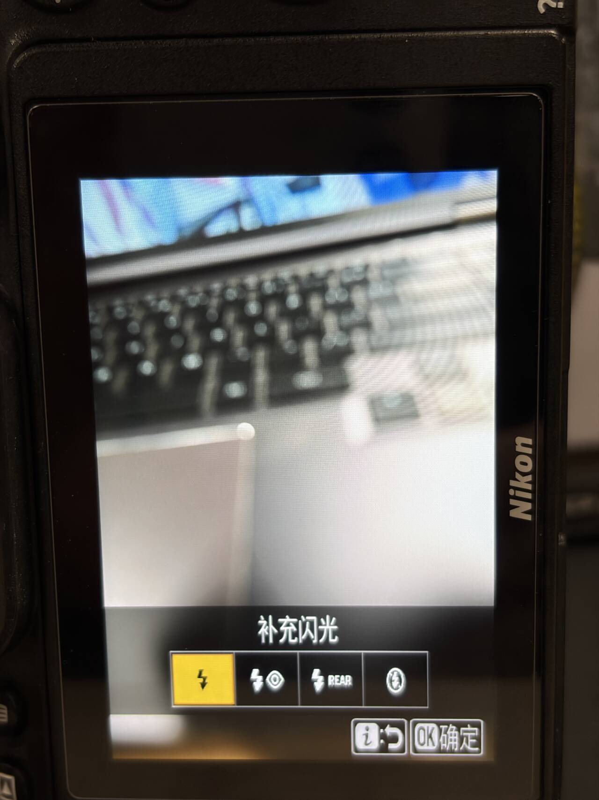
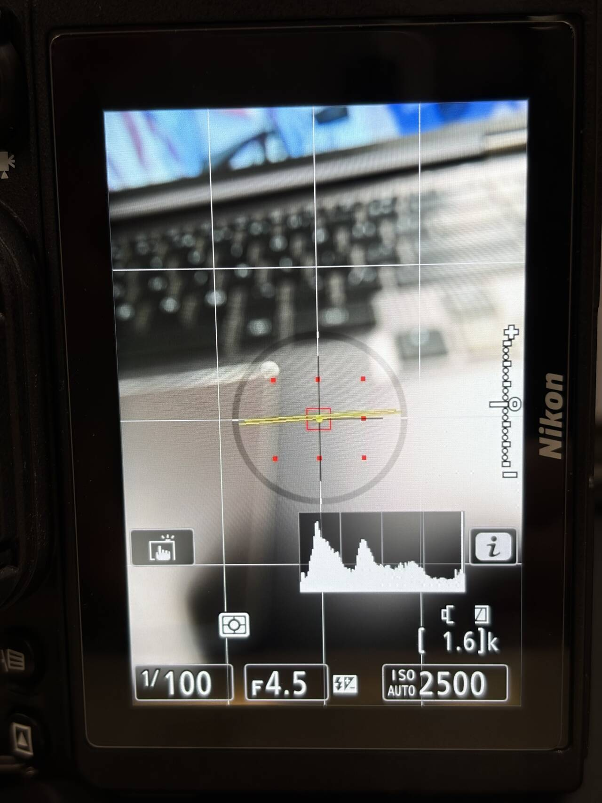
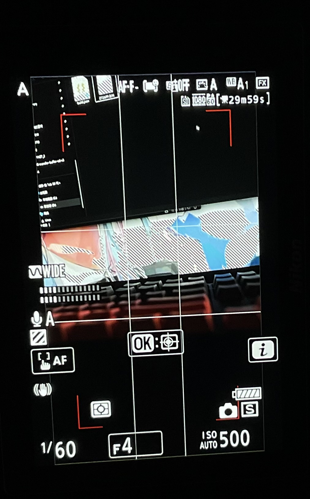

# Portrait display / 后屏竖拍界面

[English README](../README.md) · [中文说明](../README.zh-CN.md)

On the rear screen, shooting information, the 4×3 i menu, its supported settings panels, and the live histogram rotate with the camera. The directional buttons and touch targets follow the portrait i-menu layout.

竖拿相机时，后屏的拍摄信息、4×3 i 菜单、支持的 i 菜单设置页及实时直方图会转正。方向键和触控位置跟随 i 菜单的竖拍布局。

In movie mode, the L/R audio meters and microphone indicators, including **WIDE**, appear upright on the left, clear of the battery, memory-card, and ISO information. The tracking **OK / Exit** hint strip and its inline icons rotate together with their text; their backgrounds and clear areas follow the same layout.

视频竖拍时，L/R 音频电平条及 **WIDE** 等麦克风指示在左侧转正，避开电池、存储卡和 ISO 信息。跟踪对焦的 **OK／退出** 提示栏及行内图标与文字一起转正，背景和清除区域跟随同一布局。

In the Setup Menu, open **Auto rotate info** and choose Enable or Disable. The current state appears on the right. The setting is enabled by default and saved to `Z72APP.CFG`. The physical MENU screens, playback interface, and electronic viewfinder use the camera’s standard orientation.

在「设定菜单」中打开 **自动旋转信息显示**，选择「启用」或「禁用」。列表右侧显示当前状态。此项默认开启，并保存到 `Z72APP.CFG`。实体 MENU、回放界面和电子取景器使用相机原有朝向。

## Verification / 验证

Portrait display was verified on a Z 7II. The localized Setup Menu label was also verified in Simplified Chinese and English. [Menu localization](menu-localization.md)

后屏竖拍界面已在 Z 7II 实机验证。设定菜单的简体中文和英文标签也已实机验证。[菜单本地化](menu-localization.md)

The movie portrait layout, including the audio meters, WIDE indicator, and tracking hints, passed hardware verification on November 15, 2026. Local checks also cover both portrait orientations, restoration of native audio coordinates, and the battery-percentage display.

视频竖拍的音频电平、WIDE 指示及跟踪对焦提示已于 2026-11-15 实机验证通过。本地检查还覆盖两侧竖拿、原厂音频坐标恢复和电量百分比显示。

## Setup Menu / 设定菜单

## Portrait i menu / 竖拍 i 菜单

## Command-dial quick adjustment / 波轮快速调整

## i-menu settings / i 菜单设置页

## Live view / 取景画面

## Movie live view / 视频取景画面

