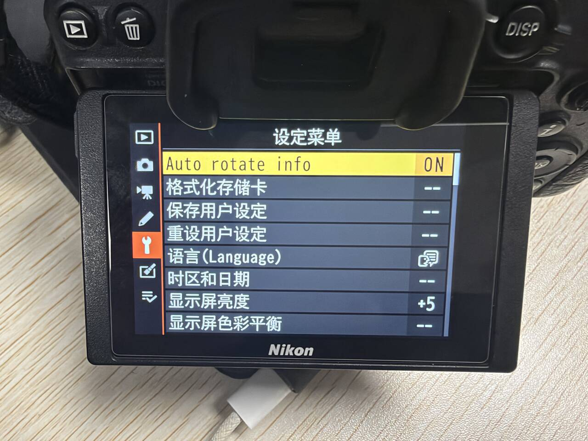
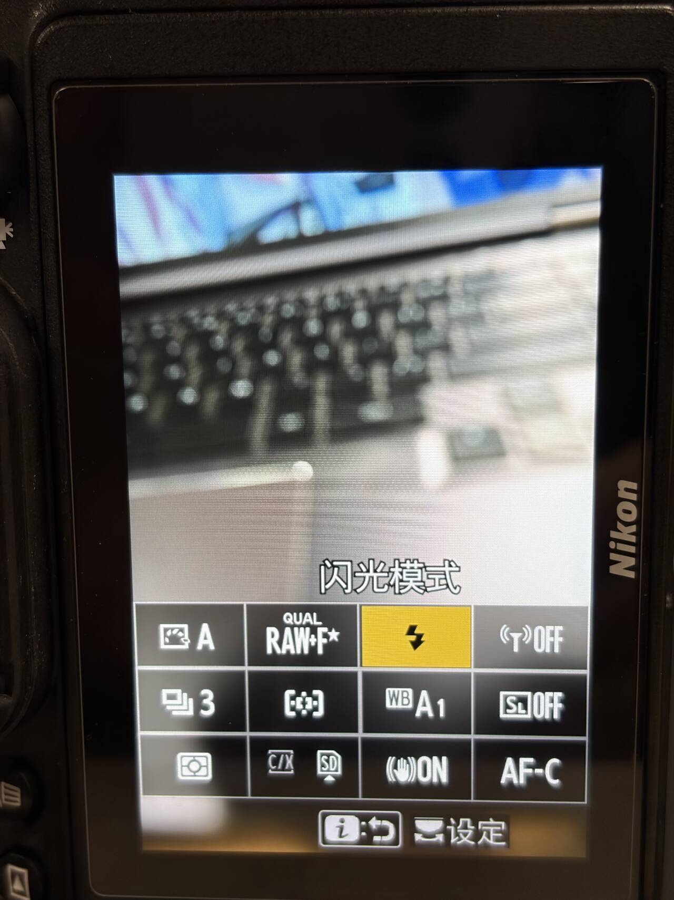
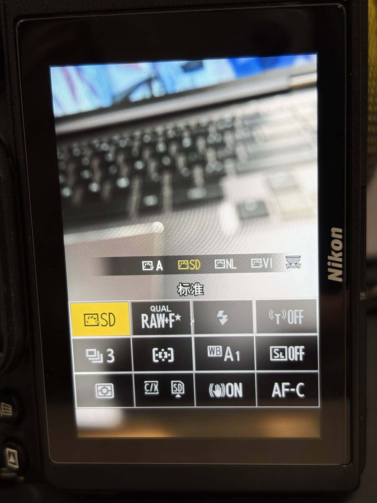
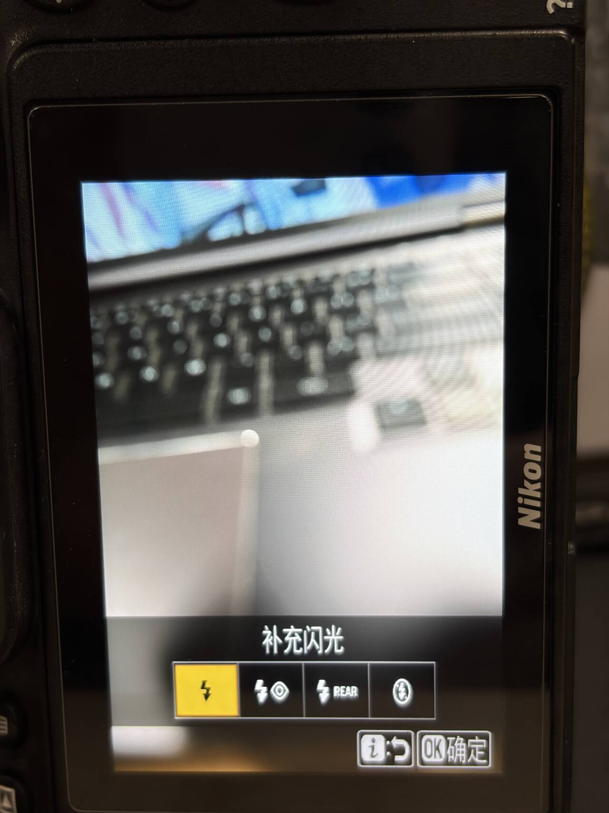
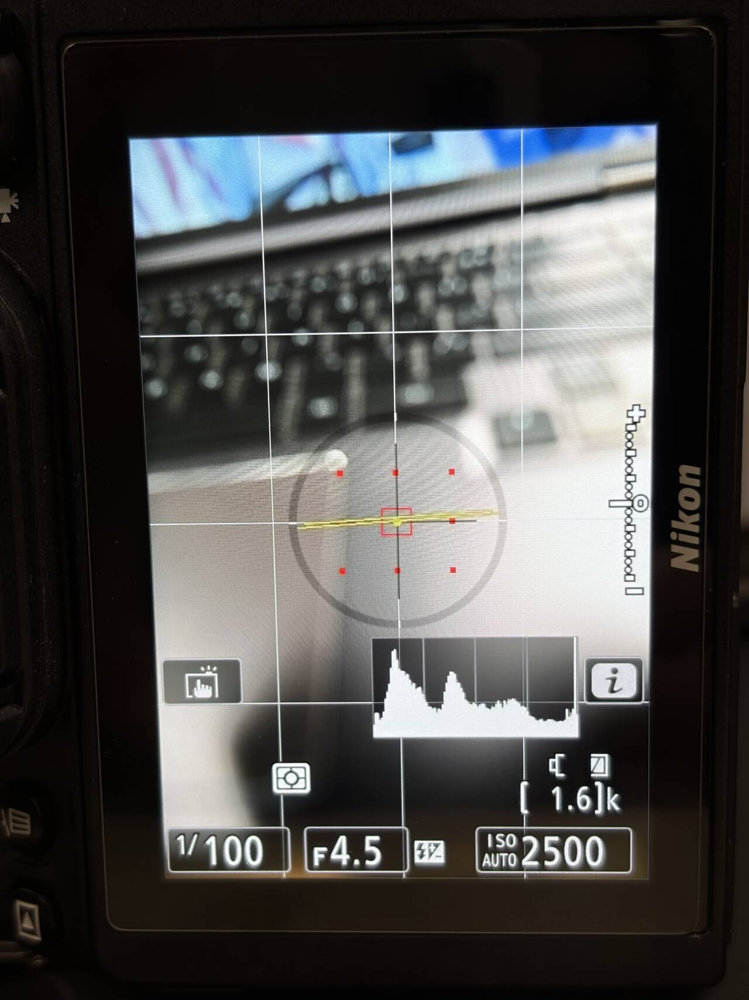

# Portrait display / 后屏竖拍界面

[English README](../README.md) · [中文说明](../README.zh-CN.md)

On the rear screen, shooting information, the 4×3 i menu, its supported settings panels, and the live histogram rotate with the camera. The directional buttons and touch targets follow the portrait i-menu layout.

竖拿相机时，后屏的拍摄信息、4×3 i 菜单、支持的 i 菜单设置页及实时直方图会转正。方向键和触控位置跟随 i 菜单的竖拍布局。

In the Setup Menu, open **Auto rotate info** and choose Enable or Disable. The current state appears on the right. The setting is enabled by default and saved to `Z72APP.CFG`. The physical MENU screens, playback interface, and electronic viewfinder use the camera’s standard orientation.

在「设定菜单」中打开 **Auto rotate info**，选择「启用」或「禁用」。列表右侧显示当前状态。此项默认开启，并保存到 `Z72APP.CFG`。实体 MENU、回放界面和电子取景器使用相机原有朝向。

## Verification / 验证

Portrait display was verified on a Z 7II. The combined module passed local integration checks and is awaiting a camera retest.

后屏竖拍界面已在 Z 7II 实机验证。组合版已通过本地集成检查，待实机复测。

## Setup Menu / 设定菜单

## Portrait i menu / 竖拍 i 菜单

## Command-dial quick adjustment / 波轮快速调整

## i-menu settings / i 菜单设置页

## Live view / 取景画面

