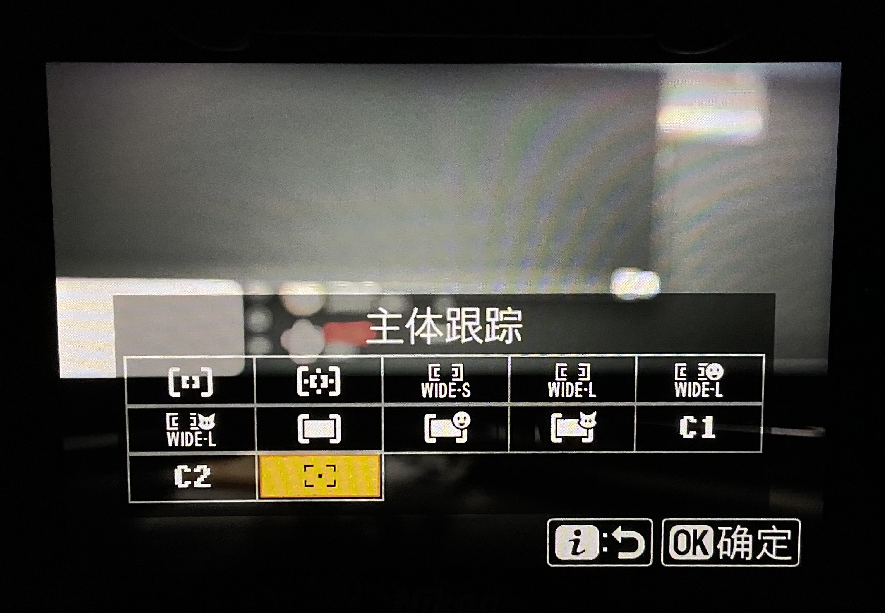
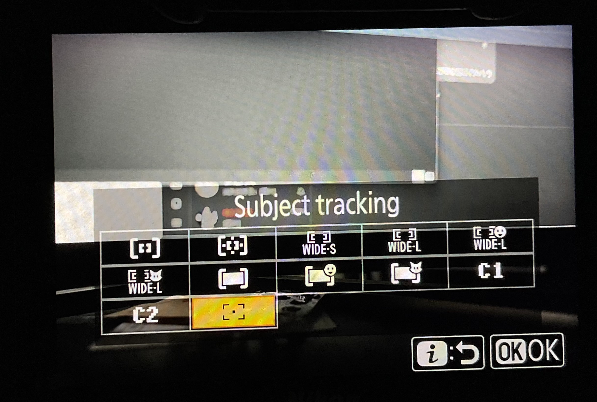
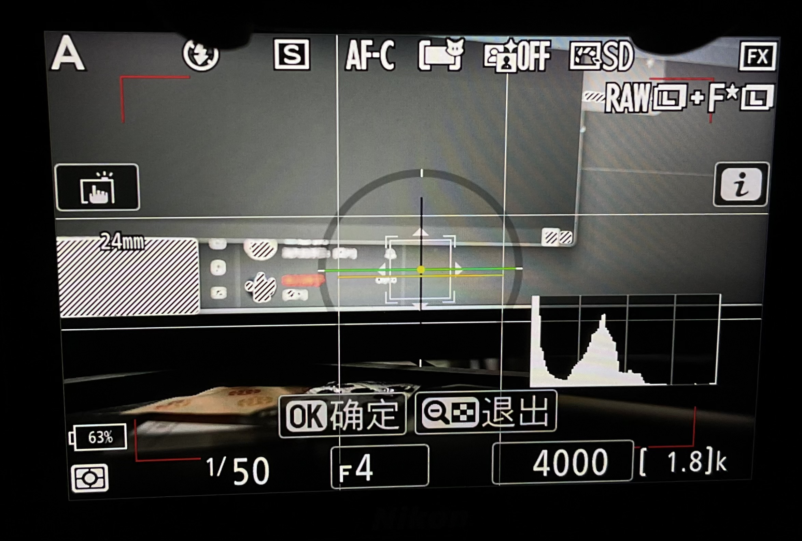
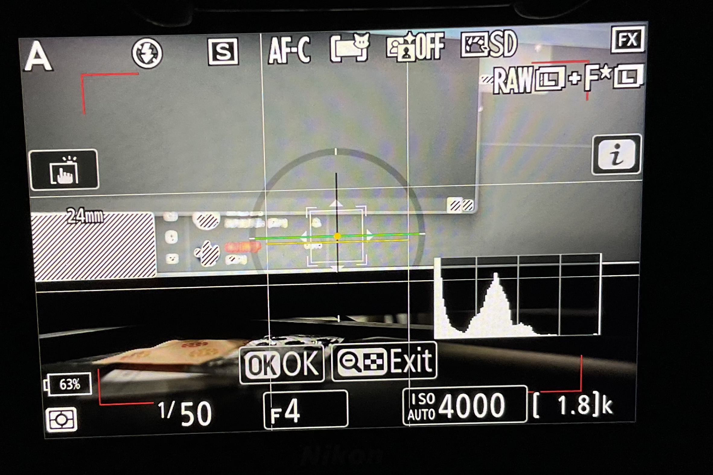

# Subject tracking / 主体跟踪

## 中文

1. 在照片模式下选用 **AF-C**，然后从照片拍摄菜单或 i 菜单的「AF 区域模式」选择「主体跟踪」。i 菜单也支持用波轮切换，包括竖拍时的显示。
2. 用方向键把起始框移到目标上。半按快门或按住 AF-ON 开始跟踪，松开时对焦框回到起始位置。如果机身设为仅 AF-ON 对焦，使用 AF-ON 启动。
3. 保持「主体跟踪」关机，下次在匹配的照片 AF-C 设置下开机会直接恢复起始框。选择其他 AF 区域或按 W（Q）可退出主体跟踪。

可在「f2 → 自定义控制 → AF 区域模式」中将主体跟踪分配给 Fn1 或 Fn2，另一个按钮可分配 C1 或 C2。如果使用后键对焦，请保留 AF-ON 的原厂对焦功能。[AF 区域快捷切换](af-area-shortcut.md)

此模式使用 Z 7II 原厂自动区域 AF 的主体跟踪和镜头驱动。模式和快捷键分配与其他扩展共用 `Z72APP.CFG`，更新时可保留已有配置。

## English

1. In photo mode, use **AF-C** and choose **Subject tracking** under **AF-area mode** in the Photo Shooting Menu or the i menu. The i menu also supports command-dial selection, including in portrait orientation.
2. Use the directional buttons to place the targeting reticle over the subject. Half-press the shutter-release button or hold AF-ON to start tracking. Release it to return the focus point to its starting position. If the camera is set to AF-ON only, use AF-ON.
3. If Subject tracking is selected at shutdown, its targeting reticle returns at startup with matching photo AF-C settings. Select another AF area or press W (Q) to exit.

In **f2 → Custom controls → AF-area mode**, you can assign Subject tracking to Fn1 or Fn2 and C1 or C2 to another button. If you use back-button focus, keep the native AF-ON assignment. [AF-area shortcuts](af-area-shortcut.md)

This mode uses the Z 7II's native Auto-area AF subject tracking and lens drive. The mode and shortcut assignments share `Z72APP.CFG` with the other extensions. You can keep your existing file when updating.

## 实机截图 / Camera screenshots

### i 菜单的 AF 区域选择 / i-menu AF-area selection

| 简体中文 | English |
| --- | --- |
|  |  |

### 取景时的起始框 / Targeting reticle in live view

| 简体中文 | English |
| --- | --- |
|  |  |

## 版本更新 / Version history

### v0.1.0-preview.28

- 主体跟踪可启用「遮挡后找回主体」，使用最近可靠位置辅助低置信度时的匹配。[对焦改进](focus-improvements.md)
- Subject tracking can use the last reliable position to assist a low-confidence match when Reacquire after occlusion is enabled. [Focus improvements](focus-improvements.md)

### v0.1.0-preview.22

- 首次在照片 AF-C 中发布主体跟踪，支持照片 i 菜单、波轮和 f2 快捷键。已在 Z 7II 实机验证。
- Added Subject tracking in photo AF-C with access through the photo i menu, command dials, and f2 shortcuts. Verified on a Z 7II.
- 半按快门或按住 AF-ON 可直接从起始框跟踪，松开后回到起点。在照片 AF-C 条件下重新开机时恢复起始框。
- A half-press or AF-ON starts tracking from the targeting reticle. Releasing the control returns to the starting point. The targeting reticle returns at startup in photo AF-C.
