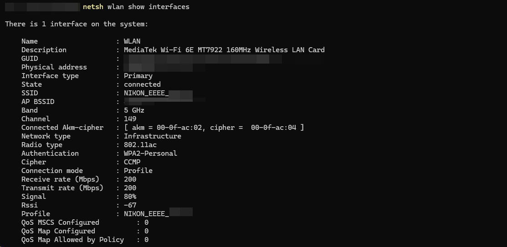
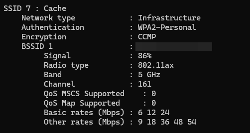
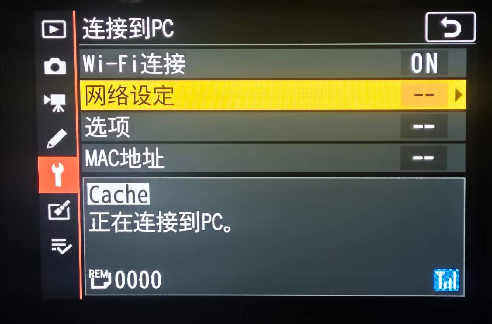

# Wi-Fi region / Wi-Fi 地区

[English README](../README.md) · [中文说明](../README.zh-CN.md)

Choose the region where the camera is actually being used through **Setup menu → Wi-Fi region**. Mainland China and United States enable 5 GHz camera hotspots (AP), including Wi-Fi 5 / 802.11ac, and allow the native Connect to PC infrastructure workflow (STA) to connect to compatible 5 GHz networks. **Follow camera** is the default and delegates to the original camera behavior without applying the extension's region or band override.

通过 **设定菜单 → Wi-Fi 地区** 选择相机的实际使用地区。「中国大陆」和「美国」支持机身建立 5 GHz Wi-Fi 5（802.11ac）热点（AP），以及原厂「连接到 PC」基础结构模式连接兼容的 5 GHz 网络（STA）。默认「跟随机身」，直接沿用原厂流程，不应用扩展的地区或频段覆盖。购买地区与实际使用地区是两回事。

## Important limits and risk notice / 使用限制与风险声明

**This is an unofficial, experimental extension for the Z 7II running C 1.70. It is not developed, approved, or certified by Nikon, and it does not change the camera's regulatory certification. Hardware verification is limited to the reported setup; it is not a guarantee of safety, compatibility, performance, or regulatory compliance.**

**这是面向 Z 7II C 1.70 的非官方实验扩展，不是尼康开发、认可或认证的功能，也不会改变设备原有的无线认证。已实机验证仅表示下述测试环境中的结果，不构成对安全性、兼容性、速度或任何地区合规性的保证。**

- Select the actual operating region and check the requirements that apply to your location and equipment before enabling wireless transmission. Do not select another country merely to obtain different channels or power limits. If neither offered region matches your location, use Follow camera rather than treating either option as a universal profile.
- The options select country profiles already included in the camera firmware. They do not promise unrestricted channels, fixed transmit power, 80 MHz operation, or a particular throughput. Driver limits and local operating requirements still apply. A menu selection or successful connection is not evidence of certification or legal permission to transmit.
- Modified native code can cause freezes, connection failures, interrupted transfers, or data loss. Back up photos, keep the original files and a recovery path, and stop using the extension if problems occur. Long-term stability, sleep/wake behavior, every access point/client, and every regulatory operating condition have not been verified.
- The project is supplied without warranty under the [MIT License](../LICENSE). Users must assess suitability for their own equipment and operating conditions. See also the repository's [risk disclaimer](../README.md#risk-disclaimer).

- 按实际使用地选择地区，并在启用无线发射前核对当地适用要求及设备条件；不要为了获得不同信道或功率限制而选择其他国家。实际所在地不属于这两个选项时，应使用「跟随机身」，不能将任一选项视为全球通用配置。
- 选项调用机身固件已内置的地区配置，不代表无限制开放全部频段，也不承诺固定发射功率、80 MHz 带宽或指定传输速度。驱动限制与实际使用地要求仍然适用；菜单可选、连接成功或本项目实测通过，都不能代替设备认证或发射许可。
- 原生代码修改可能造成死机、连接失败、传输中断或数据丢失。请备份照片、保留原文件与恢复手段，出现异常时停止使用。长期稳定性、休眠唤醒、全部路由器／客户端和所有无线运行条件尚未覆盖验证。
- 项目按 [MIT 许可证](../LICENSE)提供，不作担保。使用者应自行判断设备与实际运行条件是否适合使用。另见仓库的[风险声明](../README.zh-CN.md#风险声明)。

## Options / 选项

| Option / 选项 | Behavior / 行为 |
| --- | --- |
| Mainland China / 中国大陆 | Uses the shipped CN/38 profile. 5 GHz AP and compatible 2.4/5 GHz STA. / 使用原厂内置 CN/38；AP 使用 5 GHz，STA 可连接兼容的 2.4／5 GHz 网络。 |
| United States / 美国 | Uses the shipped US/0 profile. The same AP/STA feature paths, with that profile's limits. / 使用原厂内置 US/0；功能路径相同，采用对应配置的限制。 |
| Follow camera / 跟随机身 | Default; native behavior, without the extension's region/band override. / 默认选项；原厂行为，不应用扩展的地区／频段覆盖。 |

The two explicit regions are not interchangeable promises about permitted channels or power. The driver selects the channel automatically. AP and STA are separate native modes; the extension does not add simultaneous AP+STA operation. STA here means the native PC infrastructure workflow, not an added SnapBridge STA protocol. The AP override also covers the native phone/LSWifi hotspot entry.

两个显式地区选项不等于相同的信道或功率许可。热点交给原厂自动选信道。AP 与 STA 是原厂不同模式，本扩展不增加两者同时运行的功能。这里的 STA 指原厂 PC 基础结构流程，不增加 SnapBridge 的 STA 协议；AP 覆盖也适用于原厂手机／LSWifi 热点入口。

## Use / 使用

1. Install the [current combined module](../releases/v0.1.0-preview.12/Z72APP.BIN) after fully powering down and waiting for card access to finish. Keep the existing `Z72APP.CFG`; an already-installed SD loader host does not need a firmware update.
2. Open **Setup menu → Wi-Fi region** and select the actual operating region.
3. Close the existing wireless connection, then start a new camera hotspot or the native **Connect to PC → Network settings** infrastructure connection. If the camera retains its previous initialization, turn Wi-Fi off and back on; power-cycle if needed.
4. Use the camera's native SSID, password, network profile, and transfer workflow. Verify the actual connection using the client interface, not just an SSID scan.

1. 等待存储卡访问结束并完整关机后，替换[当前完整组合模块](../releases/v0.1.0-preview.12/Z72APP.BIN)。保留原有 `Z72APP.CFG`；已安装 SD 加载宿主时无需再次更新宿主固件。
2. 进入 **设定菜单 → Wi-Fi 地区**，选择实际使用地区。
3. 退出已有连接，再新建相机热点或通过原厂 **连接到 PC → 网络设定** 连接路由器。如果机身沿用之前的初始化状态，先关闭 Wi-Fi 再重新开启，必要时关机重启。
4. SSID、密码、网络配置和传输仍按原厂流程设置。通过电脑连接状态检查实际协议／频段，不能只凭扫描到了网络名称判断连接成功。

The selection is stored in `Z72APP.CFG` and takes effect on the next native initialization/connection. Explicit region settings use the 128-byte v12 configuration format and preserve the other extension settings. Older configurations remain readable and default to Follow camera. The setting is separate from the camera's native user-settings backup. Labels support English, Simplified Chinese, and Traditional Chinese.

选择保存在 `Z72APP.CFG`，下一次原厂初始化／连接时应用，不在菜单回调中强行中断连接。选择显式地区时使用 128 字节 v12 配置，并保留其他扩展设置；兼容读取旧配置，旧配置默认跟随机身。此设置不属于机身原厂用户设置备份。菜单支持英文、简体中文和繁体中文。

## Compatibility and performance / 兼容性与性能

- WPA2-Personal / CCMP 5 GHz STA connections have been verified. A WPA3-only network previously failed to connect; WPA3 is not added by this extension. A router reporting 802.11ax does not mean the camera supports Wi-Fi 6.
- The observed AP connection was 5 GHz, channel 149, 802.11ac, with client receive/transmit negotiation of 200/200 Mbps. This is a link rate, not a measured file-transfer speed or a guaranteed minimum. 80 MHz operation has not been verified.
- The released module has no automatic Wi-Fi log export, capability probes, diagnostic snapshot buffers, or extra experimental 80 MHz ACS attempt. It keeps the radio setup, safety checks, failure restoration, and native channel selection needed by the verified path.
- Region handling is provided by the SD module and runtime RAM callbacks. It does not rewrite the host firmware, the original radio firmware images, the body sales-region data, or NVM.

- 已验证 WPA2-Personal／CCMP 的 5 GHz STA 连接。此前 WPA3-only 网络连接失败；本扩展不增加 WPA3 支持。路由器扫描信息显示 802.11ax，不代表相机支持 Wi-Fi 6。
- 本次 AP 为 5 GHz、信道 149、802.11ac，电脑收发协商各 200 Mbps。该数值不是文件传输实测速率，也不是最低速度保证；80 MHz 运行尚未验证。
- 发布版没有自动 Wi-Fi 日志导出、能力探测、诊断快照缓冲或额外的试验性 80 MHz 选信道尝试；保留已验证路径所需的无线设置、安全检查、失败恢复与原厂自动选信道。
- 地区处理来自 SD 模块和运行期 RAM 回调，不改写宿主固件、原厂无线固件镜像、机身销售地区数据或 NVM。

## Hardware verification / 实机验证

**On November 14, 2026, the user confirmed that the log-free combined module passed camera testing with both Mainland China and United States: 5 GHz STA connection and a 5 GHz Wi-Fi 5 AP.** The 54,340-byte public module is byte-for-byte identical to that tested build. Local checks cover setup/failure handling, region persistence and legacy migration, menu transitions, native callback ABI/cache publication, and the absence of diagnostic output. These checks do not replace the limitations above.

**2026-11-14，用户确认无日志完整组合模块实机验证通过：「中国大陆」「美国」都能连接 5 GHz Wi-Fi，并建立 5 GHz Wi-Fi 5 AP。** 公开发布的 54,340 字节模块与实测版本逐字节一致。本地检查覆盖设置与失败分支、地区保存及旧配置迁移、菜单切换、原厂调用约定和缓存发布，以及无诊断输出；这些检查不替代上述限制说明。

The first screenshot shows the client's actual AP connection. The second shows the compatible 5 GHz WPA2 router used for STA testing; it is a scan result, not the camera's negotiated PHY. The camera photo shows its native PC connection workflow. The successful STA result for both region choices is based on the user's reported test, not on the scan screenshot alone.

第一张为电脑实际连接相机 AP 的状态；第二张为 STA 测试所用兼容路由器的 5 GHz WPA2 扫描信息，不是相机的协商协议；相机照片展示原厂 PC 连接流程。两个地区的 STA 成功结论来自用户实测确认，不单凭扫描截图或“正在连接”文字认定成功。

