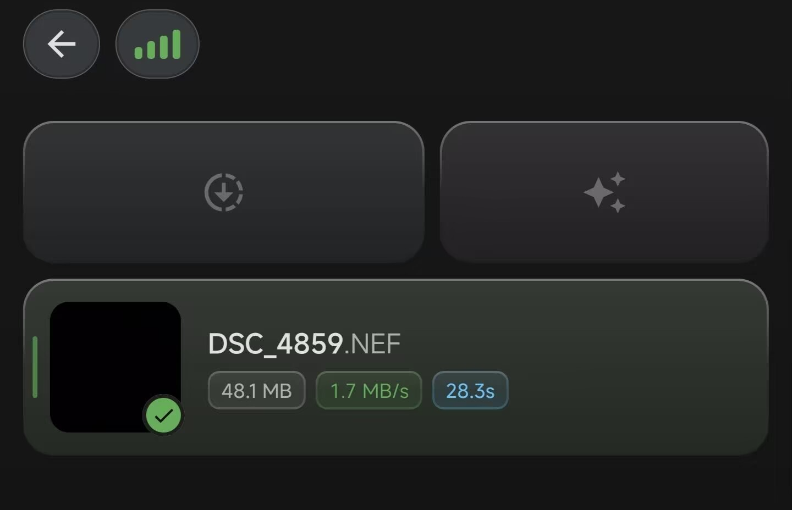
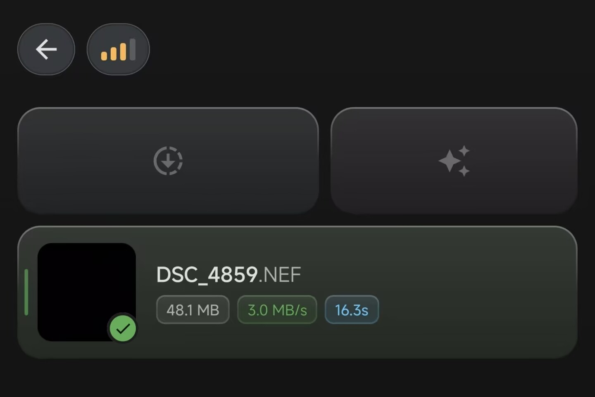
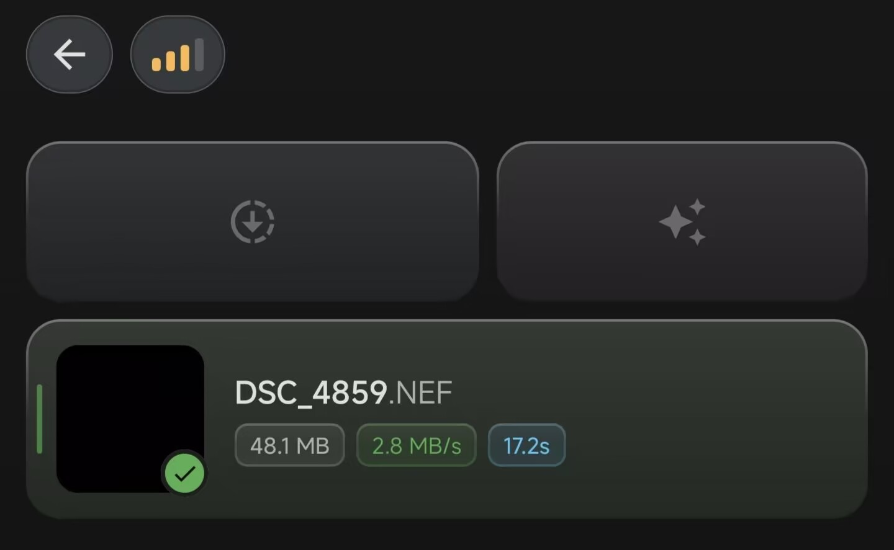
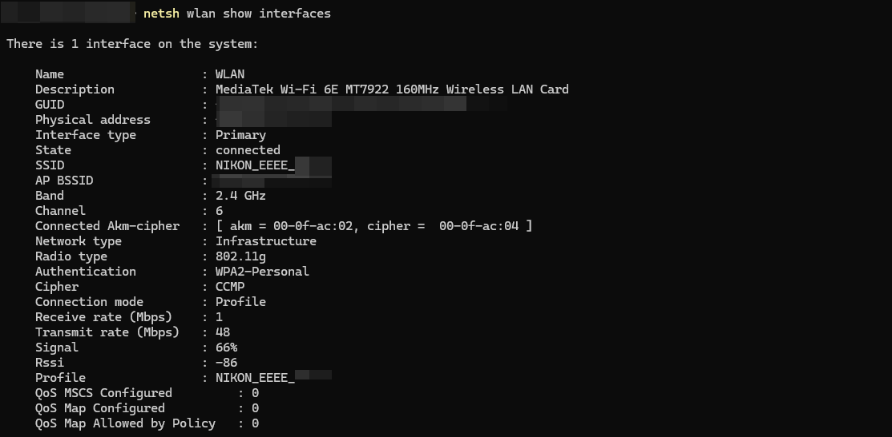
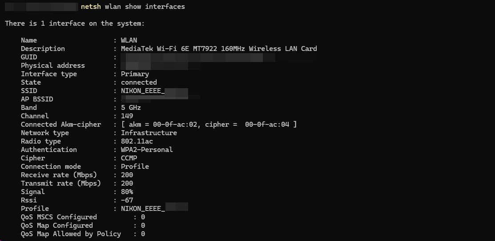
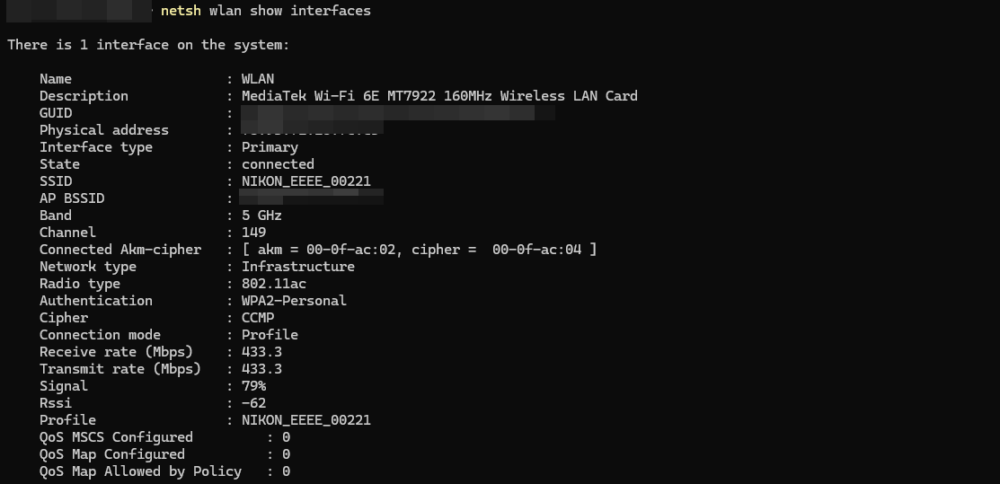
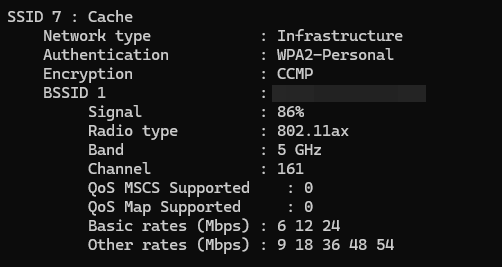
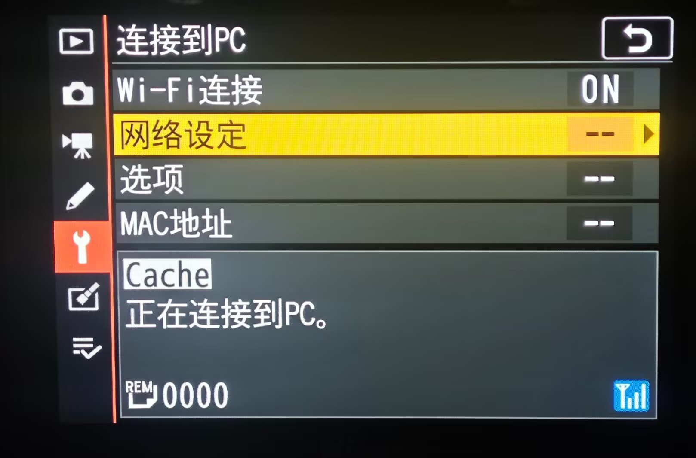

# WiFi 设置 / Wi-Fi settings

**Setup menu → Wi-Fi settings** contains two controls: **Wi-Fi region** and **Enable 80 MHz WiFi**. The region control offers Mainland China, United States, and Follow camera; Follow camera is the default. The 80 MHz switch defaults to off. Existing `Z72APP.CFG` preferences are preserved.

**设定菜单 → Wi-Fi 设置**统一包含「Wi-Fi 地区」和「开启 80 MHz WiFi」两个子设置。新配置默认跟随机身、80 MHz关闭；已有 `Z72APP.CFG` 的地区、开关和其他扩展设置继续保留。

```text
设定菜单 / Setup menu
└─ Wi-Fi 设置 / Wi-Fi settings                  --
   ├─ Wi-Fi 地区 / Wi-Fi region                 --
   │  ├─ 中国大陆 / Mainland China
   │  ├─ 美国 / United States
   │  └─ 跟随机身 / Follow camera
   └─ 开启 80 MHz WiFi / Enable 80 MHz WiFi      ON / OFF
      ├─ 启用 / Enable
      └─ 禁用 / Disable
```

Confirming or cancelling either child returns to Wi-Fi settings with that row selected. Back from Wi-Fi settings returns to the native Setup menu. Labels support English, Simplified Chinese, and Traditional Chinese.

子设置确认或取消后回到「Wi-Fi 设置」，保留对应行焦点；父菜单返回原厂设定菜单。菜单支持英文、简体中文和繁体中文。

## Important limits and risk notice / 使用限制与风险声明

Choose the profile for the camera's actual operating region and follow the applicable local wireless requirements. Use **Follow camera** in other regions. The camera's driver selects the channel under the active profile.

按相机的实际使用地选择地区，并遵守当地无线使用要求。其他地区请选择「跟随机身」。机身驱动按当前地区配置选择信道。

## Wi-Fi region / Wi-Fi 地区

Select the region where the camera is actually being used. The camera's purchase/sales region and its operating region are different concepts.

按相机的实际使用地选择地区；机身购买／销售地区与实际使用地区是不同概念。

| Option / 选项 | Behavior / 行为 |
| --- | --- |
| Mainland China / 中国大陆 | Uses the camera's Mainland China profile. 5 GHz AP and compatible 2.4/5 GHz STA. / 使用机身内置中国大陆配置；AP使用5 GHz，STA可连接兼容的2.4／5 GHz网络。 |
| United States / 美国 | Uses the camera's United States profile and its limits, through the same AP/STA feature paths. / 使用机身内置美国配置，功能路径相同，采用对应配置的限制。 |
| Follow camera / 跟随机身 | Default; delegates to native behavior without a region/band override. The extension's 80 MHz request is also bypassed. / 默认；不覆盖原厂地区／频段，也不应用扩展的80 MHz请求。 |

Use AP for the camera hotspot, including the native phone/LSWifi hotspot entry. Use STA through the native **Connect to PC** workflow. The camera runs one mode at a time.

AP 为相机热点，包括原厂手机／LSWifi 入口。STA 通过原厂「连接到 PC」使用。相机一次运行一种模式。

## Enable 80 MHz WiFi / 开启 80 MHz WiFi

- **Off (default)** uses the selected region's automatic AP bandwidth setting.
- **On:** for Mainland China or United States, enables compatible 80 MHz AP operation where allowed by the driver. Actual bandwidth and link rate depend on the camera and client connection.
- **Follow camera:** delegates to native behavior regardless of the saved switch value. The switch does not change STA bandwidth negotiation.

- **关闭（默认）**时，热点沿用所选地区的自动带宽设置。
- **开启：** 中国大陆／美国设置下，启用驱动允许且兼容的80 MHz热点连接。实际带宽和速率以相机与客户端的连接结果为准。
- **跟随机身：** 即使保存的开关为开启，也沿用原厂流程。该开关不改变STA带宽协商。

## Use / 使用

1. Open **Setup menu → Wi-Fi settings**, choose the actual region, and set **Enable 80 MHz WiFi** as required.
2. Close the existing wireless connection and create a new hotspot or native **Connect to PC → Network settings** infrastructure connection. If the camera reuses its previous initialization, turn Wi-Fi off and back on, or power-cycle.
3. Continue using the native SSID/password, profile, and transfer workflow. Inspect an actual connected client to check its band/protocol/rate.

1. 进入 **设定菜单 → Wi-Fi 设置**，选择实际使用地区，并按需设置 **开启80 MHz WiFi**。
2. 退出已有连接，再新建相机热点或原厂 **连接到PC → 网络设定** 基础结构连接；若仍复用旧初始化，关闭Wi-Fi再开启，必要时关机重启。
3. SSID、密码、配置与传输继续按原厂流程操作。使用实际连接状态核对频段／协议／速率。

Preferences are saved in `Z72APP.CFG` and apply to the next wireless connection. Changing a setting does not restart an active connection. Existing configurations and other extension preferences are preserved; older configurations default the new switch to off. These settings are separate from the camera's native user-settings backup.

设置保存在 `Z72APP.CFG`，用于下一次无线连接，修改选项不会强行重启已有连接。继续兼容旧配置，旧配置的新开关默认关闭，其他扩展偏好保持不变。此设置独立于原厂用户设置备份。

## Transfer performance / 传输性能实测

The following results were recorded with a **Hong Kong-market Z 7II**. SnapBridge timings, third-party app throughput, and Windows client link rates are separate measurements. The Windows screenshots show the negotiated rates on that computer. Results depend on the client, signal conditions, and files being transferred.

以下实测使用**港行Z 7II**。以下分别记录 SnapBridge 传输用时、第三方应用吞吐量和 Windows 电脑的协商速率。实际结果取决于客户端、信号条件和传输文件。

### SnapBridge: the same six photos / SnapBridge：相同六张照片

The same six photos, each **8256 × 5504**, were transferred under each setting. The table shows the total time for all six photos.

三种设置均传输相同六张照片，每张分辨率 **8256 × 5504**。下表为整批照片的传输总耗时。

| Camera setting / 相机设置 | Total time / 总耗时 |
| --- | ---: |
| Follow camera (Hong Kong-market native behavior) / 跟随机身（港行原厂） | 57.48 s |
| Mainland China, 80 MHz off / 中国大陆，80 MHz关闭 | 33.65 s |
| Mainland China, 80 MHz on / 中国大陆，80 MHz开启 | 36.97 s |

### Third-party app: the same RAW / 第三方应用：相同RAW

The screenshots show **DSC_4859.NEF, 48.1 MB** in all three cases. File size, rate units, and elapsed time are retained as displayed by the app.

三张截图均为 **DSC_4859.NEF，48.1 MB**；大小、速率单位及耗时按应用显示原样保留。

| Camera setting / 相机设置 | App rate / 应用显示速度 | Elapsed / 耗时 |
| --- | ---: | ---: |
| Follow camera (Hong Kong-market native behavior) / 跟随机身（港行原厂） | 1.7 MB/s | 28.3 s |
| Mainland China, 80 MHz off / 中国大陆，80 MHz关闭 | 3.0 MB/s | 16.3 s |
| Mainland China, 80 MHz on / 中国大陆，80 MHz开启 | 2.8 MB/s | 17.2 s |

In these samples, Mainland China with 80 MHz off was faster than with it on in both apps. Higher negotiated bandwidth did not produce a proportional file-transfer gain. Signal, interference, positioning, client behavior, protocol overhead, and camera file supply can affect results; this comparison does not isolate their individual contributions.

这组记录中，两种应用都是大陆设置、80 MHz关闭时略快于开启。更高协商带宽没有带来同比例的文件提速。信号、干扰、摆放、客户端、协议开销及相机供数均可能影响结果，这组对比未分别测量各项贡献。

<details>
<summary>Third-party app screenshots / 第三方应用原始截图</summary>

Follow camera / 跟随机身：



Mainland China, 80 MHz off / 中国大陆，80 MHz关闭：



Mainland China, 80 MHz on / 中国大陆，80 MHz开启：



</details>

### Windows connection snapshots / Windows连接状态截图

The supplied PC snapshots show 2.4 GHz/802.11g for Follow camera, 5 GHz/802.11ac at 200/200 Mbps for Mainland China with 80 MHz off, and 5 GHz/802.11ac at 433.3/433.3 Mbps with it on. They were captured on the PC at their respective moments, not during a measured phone transfer. The native-setting snapshot's instantaneous receive/transmit values are 1/48 Mbps.

所附电脑截图分别为：跟随机身时2.4 GHz／802.11g；大陆、80 MHz关闭时5 GHz／802.11ac、收发各200 Mbps；大陆、80 MHz开启时5 GHz／802.11ac、收发各433.3 Mbps。这是电脑各时刻的连接状态，不是手机测速过程中的协商测量。跟随机身那张的瞬时收／发值为1／48 Mbps。

<details>
<summary>Connection-state screenshots / 连接状态原始截图</summary>

Follow camera / 跟随机身：



Mainland China, 80 MHz off / 中国大陆，80 MHz关闭：



Mainland China, 80 MHz on / 中国大陆，80 MHz开启：



</details>

## Compatibility / 兼容性

- Compatible 5 GHz WPA2-Personal/CCMP STA connections have been verified.
- Wi-Fi settings are provided by the SD module. With the supported SD loader already installed, updates only require replacing the module file.

- 已验证 5 GHz WPA2-Personal／CCMP STA 连接。
- Wi-Fi设置由SD模块提供；已有支持的SD加载宿主时，更新只需替换模块文件。

## Verification / 验证

**Wi-Fi settings passed hardware verification on November 14, 2026.**

**Wi-Fi 设置已于2026-11-14通过实机验证。**

Verified features include the grouped Wi-Fi settings menu, 5 GHz STA and Wi-Fi 5 AP operation for Mainland China and United States, and an 80 MHz AP connection with an observed 433.3 Mbps client link rate.

已验证统一Wi-Fi设置菜单、大陆／美国的5 GHz STA与Wi-Fi 5 AP连接，以及80 MHz热点下客户端433.3 Mbps的协商速率。

The screenshots show the 5 GHz WPA2 network used for the STA test and the camera's Connect to PC screen.

截图展示 STA 实测使用的 5 GHz WPA2 网络和原厂「连接到 PC」界面。





## 版本更新 / Version history

### v0.1.0-preview.42

- 浏览器相册支持相机接入路由器后的 STA 连接。同一局域网内可使用路由器分配给相机的 IP 打开相册。
- Browser Gallery supports STA connections. Devices on the same LAN can open the gallery at the camera's router-assigned IP address.

### v0.1.0-preview.30

- 在相机热点上加入浏览器相册。相册开启期间延后 Wi-Fi 空闲关闭，关闭相册后恢复原厂计时。
- Added Browser Gallery on the camera hotspot. Wi-Fi idle disconnection is deferred while the gallery is enabled and resumes on the native timer when the gallery is turned off.

### v0.1.0-preview.24

- FTP 上传支持通过热点或路由器传输。打开 FTP 菜单、正在上传或开启自动发送时会延后 Wi-Fi 空闲关闭。
- FTP upload works over a camera hotspot or router connection. The Wi-Fi idle timeout is deferred while the FTP menu is open, an upload is active, or auto send is enabled.

### v0.1.0-preview.13

- 将地区选择纳入「Wi-Fi 设置」，并加入 80 MHz 热点开关。实机在兼容客户端上测得 433.3 Mbps 的协商速率。
- Grouped region selection under Wi-Fi settings and added an 80 MHz hotspot switch. A compatible client negotiated a 433.3 Mbps link in camera testing.
- 「跟随机身」沿用原厂连接流程。80 MHz 设置在下一次建立兼容热点时生效。
- Follow camera uses the native connection behavior. The 80 MHz setting applies the next time a compatible hotspot starts.

### v0.1.0-preview.12

- 首次加入 Wi-Fi 地区选择。中国大陆和美国配置支持 5 GHz Wi-Fi 5 热点，以及原厂「连接到 PC」连接兼容的 5 GHz 路由器。
- Added Wi-Fi region selection. The Mainland China and United States profiles support 5 GHz Wi-Fi 5 hotspots and connections to compatible 5 GHz routers through the native Connect to PC workflow.
