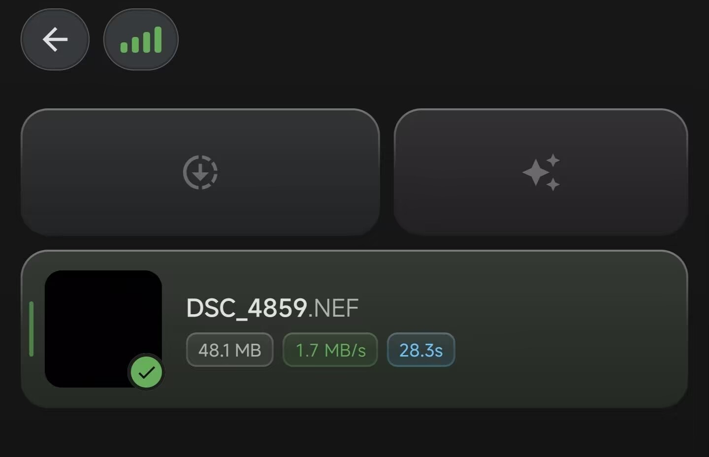
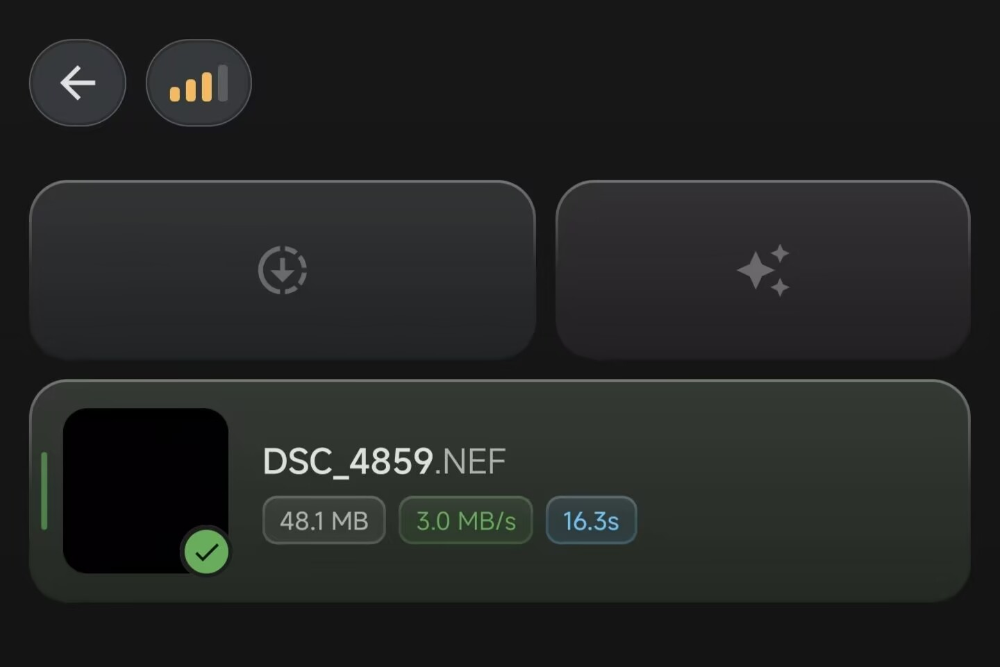
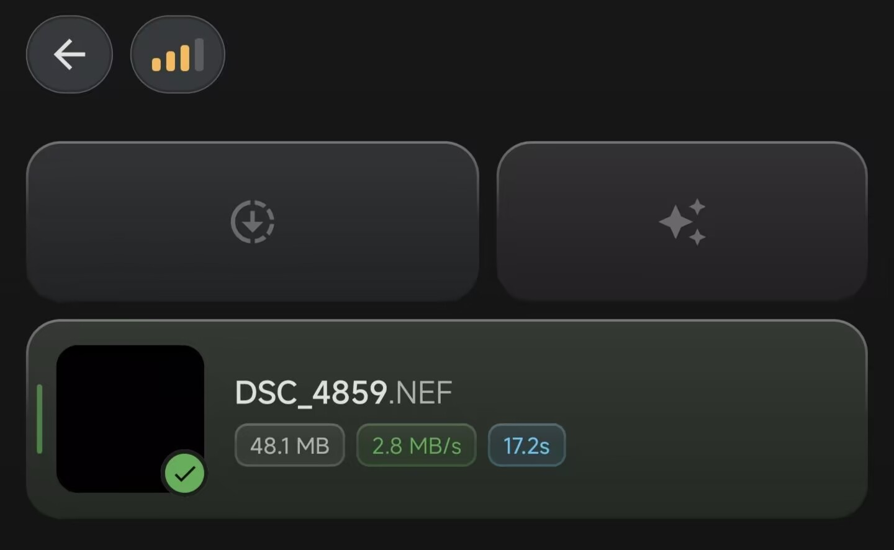
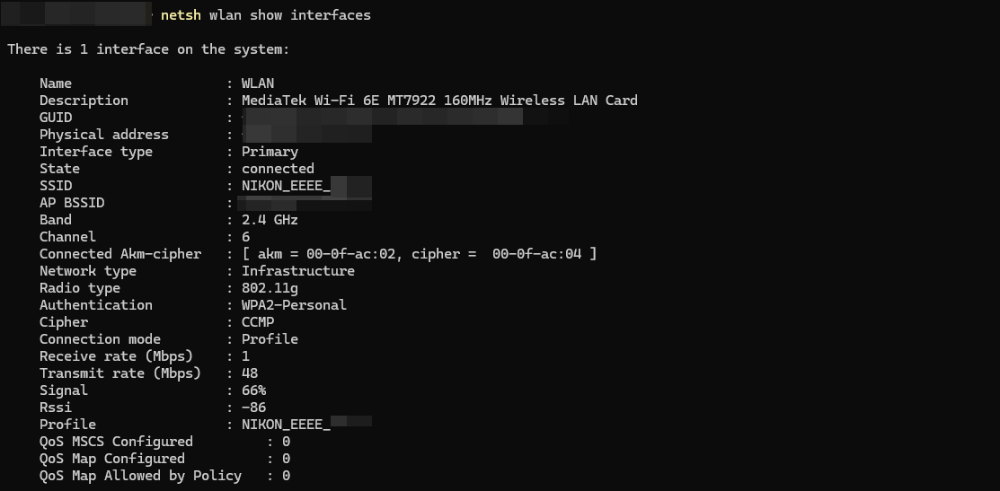
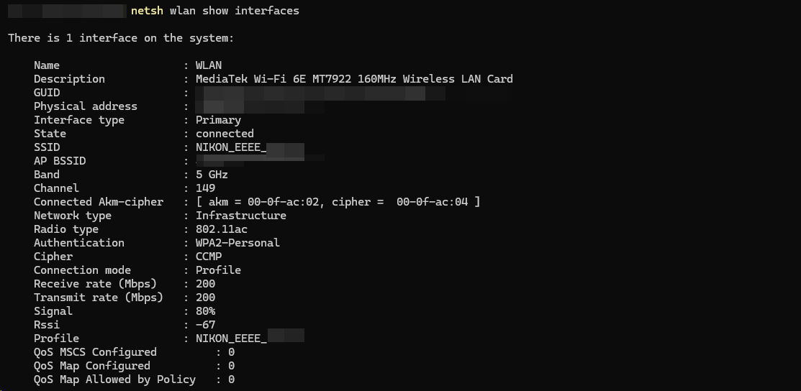
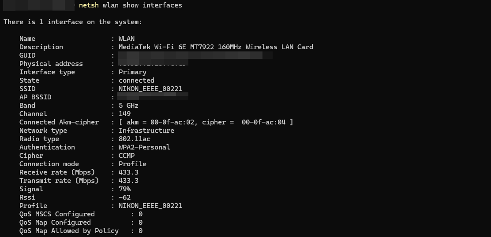
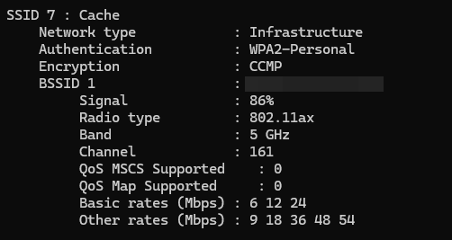
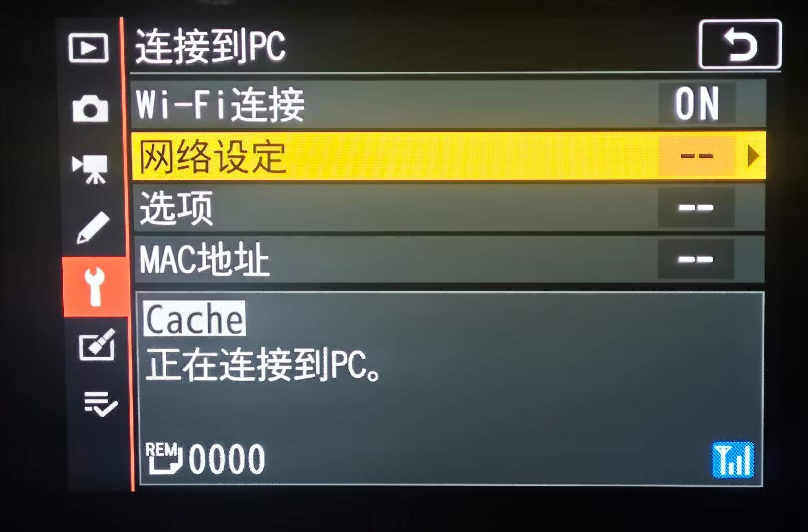

# WiFi 设置 / Wi-Fi settings

[English README](../README.md) · [中文说明](../README.zh-CN.md)

**Setup menu → Wi-Fi settings** contains two controls: **Wi-Fi region** and **Enable 80 MHz WiFi**. The region control offers Mainland China, United States, and Follow camera; Follow camera is the default. The 80 MHz switch defaults to off. Existing `Z72APP.CFG` preferences are preserved.

**设定菜单 → Wi-Fi 设置**统一包含「Wi-Fi 地区」和「开启 80 MHz WiFi」两个子设置。新配置默认跟随机身、80 MHz关闭；已有 `Z72APP.CFG` 的地区、开关和其他扩展设置继续保留。

```text
设定菜单 / Setup menu
└─ Wi-Fi 设置 / Wi-Fi settings                  --
   ├─ Wi-Fi 地区 / Wi-Fi region                 --
   │  ├─ 中国大陆 / Mainland China
   │  ├─ 美国 / United States
   │  └─ 跟随机身 / Follow camera
   └─ 开启 80 MHz WiFi / Enable 80 MHz WiFi      ON / OFF
      ├─ 启用 / Enable
      └─ 禁用 / Disable
```

Confirming or cancelling either child returns to Wi-Fi settings with that row selected. Back from Wi-Fi settings returns to the native Setup menu. Labels support English, Simplified Chinese, and Traditional Chinese.

子设置确认或取消后回到「Wi-Fi 设置」，保留对应行焦点；父菜单返回原厂设定菜单。菜单支持英文、简体中文和繁体中文。

## Important limits and risk notice / 使用限制与风险声明

**This is an unofficial extension for the Z 7II running C 1.70. It is not developed, approved, or certified by Nikon, and it does not change the camera's regulatory certification. Hardware verification is limited to the reported setup; it is not a guarantee of safety, compatibility, performance, or regulatory compliance.**

**这是面向 Z 7II C 1.70 的非官方扩展，不是尼康开发、认可或认证的功能，也不会改变设备原有的无线认证。已实机验证仅表示下述测试环境中的结果，不构成对安全性、兼容性、速度或任何地区合规性的保证。**

- Select the actual operating region and check the requirements that apply to your location and equipment before enabling wireless transmission. Do not select another country merely to obtain different channels or power limits. If neither offered region matches your location, use Follow camera rather than treating either option as a universal profile.
- The options select country profiles already included in the camera firmware. They do not promise unrestricted channels, fixed transmit power, 80 MHz operation, or a particular throughput. Driver limits and local operating requirements still apply. A menu selection or successful connection is not evidence of certification or legal permission to transmit.
- Modified native code can cause freezes, connection failures, interrupted transfers, or data loss. Back up photos, keep the original files and a recovery path, and stop using the extension if problems occur. Long-term stability, sleep/wake behavior, every access point/client, and every regulatory operating condition have not been verified.
- The project is supplied without warranty under the [MIT License](../LICENSE). Users must assess suitability for their own equipment and operating conditions. See also the repository's [risk disclaimer](../README.md#risk-disclaimer).

- 按实际使用地选择地区，并在启用无线发射前核对当地适用要求及设备条件；不要为了获得不同信道或功率限制而选择其他国家。实际所在地不属于这两个选项时，应使用「跟随机身」，不能将任一选项视为全球通用配置。
- 选项调用机身固件已内置的地区配置，不代表无限制开放全部频段，也不承诺固定发射功率、80 MHz 带宽或指定传输速度。驱动限制与实际使用地要求仍然适用；菜单可选、连接成功或本项目实测通过，都不能代替设备认证或发射许可。
- 原生代码修改可能造成死机、连接失败、传输中断或数据丢失。请备份照片、保留原文件与恢复手段，出现异常时停止使用。长期稳定性、休眠唤醒、全部路由器／客户端和所有无线运行条件尚未覆盖验证。
- 项目按 [MIT 许可证](../LICENSE)提供，不作担保。使用者应自行判断设备与实际运行条件是否适合使用。另见仓库的[风险声明](../README.zh-CN.md#风险声明)。

## Wi-Fi region / Wi-Fi 地区

Select the region where the camera is actually being used. The camera's purchase/sales region and its operating region are different concepts.

按相机的实际使用地选择地区；机身购买／销售地区与实际使用地区是不同概念。

| Option / 选项 | Behavior / 行为 |
| --- | --- |
| Mainland China / 中国大陆 | Uses the camera's Mainland China profile. 5 GHz AP and compatible 2.4/5 GHz STA. / 使用机身内置中国大陆配置；AP使用5 GHz，STA可连接兼容的2.4／5 GHz网络。 |
| United States / 美国 | Uses the camera's United States profile and its limits, through the same AP/STA feature paths. / 使用机身内置美国配置，功能路径相同，采用对应配置的限制。 |
| Follow camera / 跟随机身 | Default; delegates to native behavior without a region/band override. The extension's 80 MHz request is also bypassed. / 默认；不覆盖原厂地区／频段，也不应用扩展的80 MHz请求。 |

The explicit regions are not interchangeable promises about permitted channels or power. The driver chooses the channel. AP and STA remain separate native modes; simultaneous AP+STA is not added. STA here means the native Connect to PC infrastructure workflow, not an added SnapBridge STA protocol. The AP path includes the native phone/LSWifi hotspot entry.

两个显式地区选项不等于相同的信道或功率许可，信道仍由驱动选择。AP与STA保持原厂的独立模式，不增加同时运行能力。STA指原厂「连接到PC」基础结构流程，不增加SnapBridge的STA协议；AP包括原厂手机／LSWifi热点入口。

## Enable 80 MHz WiFi / 开启 80 MHz WiFi

- **Off (default):** retains the selected region's existing automatic AP bandwidth path, without the extra 80 MHz candidate selection. Off does not force a fixed 40 MHz width.
- **On:** for Mainland China or United States, enables compatible 80 MHz AP operation where allowed by the driver. Actual bandwidth and link rate depend on the camera and client connection.
- **Follow camera:** delegates to native behavior regardless of the saved switch value. The switch does not change STA bandwidth negotiation.

- **关闭（默认）：** 使用对应地区原有的AP自动带宽流程，不额外选择80 MHz组合；关闭不等于强制固定为40 MHz。
- **开启：** 中国大陆／美国设置下，启用驱动允许且兼容的80 MHz热点连接。实际带宽和速率以相机与客户端的连接结果为准。
- **跟随机身：** 即使保存的开关为开启，也沿用原厂流程。该开关不改变STA带宽协商。

## Use / 使用

1. Fully power down after card access finishes, then install the [current combined module](../releases/v0.1.0-preview.13/Z72APP.BIN). Keep `Z72APP.CFG`. An already-installed SD loader host does not need another firmware update.
2. Open **Setup menu → Wi-Fi settings**, choose the actual region, and set **Enable 80 MHz WiFi** as required.
3. Close the existing wireless connection and create a new hotspot or native **Connect to PC → Network settings** infrastructure connection. If the camera reuses its previous initialization, turn Wi-Fi off and back on, or power-cycle.
4. Continue using the native SSID/password, profile, and transfer workflow. Inspect an actual connected client to check its band/protocol/rate.

1. 等待存储卡访问结束并完整关机，替换[当前完整组合模块](../releases/v0.1.0-preview.13/Z72APP.BIN)，保留 `Z72APP.CFG`；已有SD加载宿主无需再次刷机。
2. 进入 **设定菜单 → Wi-Fi 设置**，选择实际使用地区，并按需设置 **开启80 MHz WiFi**。
3. 退出已有连接，再新建相机热点或原厂 **连接到PC → 网络设定** 基础结构连接；若仍复用旧初始化，关闭Wi-Fi再开启，必要时关机重启。
4. SSID、密码、配置与传输继续按原厂流程操作。使用实际连接状态核对频段／协议／速率。

Preferences are saved in `Z72APP.CFG` and apply to the next wireless connection. Changing a setting does not restart an active connection. Existing configurations and other extension preferences are preserved; older configurations default the new switch to off. These settings are separate from the camera's native user-settings backup.

设置保存在 `Z72APP.CFG`，用于下一次无线连接，修改选项不会强行重启已有连接。继续兼容旧配置，旧配置的新开关默认关闭，其他扩展偏好保持不变。此设置独立于原厂用户设置备份。

## Transfer performance / 传输性能实测

The following results were recorded with a **Hong Kong-market Z 7II**. SnapBridge timings, third-party app throughput, and Windows client link rates are separate measurements. Link negotiation is not file-transfer throughput; Windows screenshots do not establish the phone's negotiated rate. Results depend on the client, signal conditions, and files being transferred.

以下实测使用**港行Z 7II**。SnapBridge计时、第三方应用吞吐和Windows电脑连接状态属于不同测量；电脑截图不代表手机各轮的协商速率，协商Mbps也不等于照片传输MB/s。实际结果会受客户端、信号条件和传输文件影响。

### SnapBridge: the same six photos / SnapBridge：相同六张照片

The same six photos, each **8256 × 5504**, were transferred under each setting. The table shows the total time for all six photos.

三种设置均传输相同六张照片，每张分辨率 **8256 × 5504**。下表为整批照片的传输总耗时。

| Camera setting / 相机设置 | Total time / 总耗时 |
| --- | ---: |
| Follow camera (Hong Kong-market native behavior) / 跟随机身（港行原厂） | 57.48 s |
| Mainland China, 80 MHz off / 中国大陆，80 MHz关闭 | 33.65 s |
| Mainland China, 80 MHz on / 中国大陆，80 MHz开启 | 36.97 s |

### Third-party app: the same RAW / 第三方应用：相同RAW

The screenshots show **DSC_4859.NEF, 48.1 MB** in all three cases. File size, rate units, and elapsed time are retained as displayed by the app.

三张截图均为 **DSC_4859.NEF，48.1 MB**；大小、速率单位及耗时按应用显示原样保留。

| Camera setting / 相机设置 | App rate / 应用显示速度 | Elapsed / 耗时 |
| --- | ---: | ---: |
| Follow camera (Hong Kong-market native behavior) / 跟随机身（港行原厂） | 1.7 MB/s | 28.3 s |
| Mainland China, 80 MHz off / 中国大陆，80 MHz关闭 | 3.0 MB/s | 16.3 s |
| Mainland China, 80 MHz on / 中国大陆，80 MHz开启 | 2.8 MB/s | 17.2 s |

In these samples, Mainland China with 80 MHz off was faster than with it on in both apps. Higher negotiated bandwidth did not produce a proportional file-transfer gain. Signal, interference, positioning, client behavior, protocol overhead, and camera file supply can affect results; this comparison does not isolate their individual contributions.

这组记录中，两种应用都是大陆设置、80 MHz关闭时略快于开启。更高协商带宽没有带来同比例的文件提速。信号、干扰、摆放、客户端、协议开销及相机供数均可能影响结果，这组对比未分别测量各项贡献。

<details>
<summary>Third-party app screenshots / 第三方应用原始截图</summary>

Follow camera / 跟随机身：



Mainland China, 80 MHz off / 中国大陆，80 MHz关闭：



Mainland China, 80 MHz on / 中国大陆，80 MHz开启：



</details>

### Windows connection snapshots / Windows连接状态截图

The supplied PC snapshots show 2.4 GHz/802.11g for Follow camera, 5 GHz/802.11ac at 200/200 Mbps for Mainland China with 80 MHz off, and 5 GHz/802.11ac at 433.3/433.3 Mbps with it on. They were captured on the PC at their respective moments, not during a measured phone transfer. The native-setting snapshot's instantaneous receive/transmit values are 1/48 Mbps.

所附电脑截图分别为：跟随机身时2.4 GHz／802.11g；大陆、80 MHz关闭时5 GHz／802.11ac、收发各200 Mbps；大陆、80 MHz开启时5 GHz／802.11ac、收发各433.3 Mbps。这是电脑各时刻的连接状态，不是手机测速过程中的协商测量。跟随机身那张的瞬时收／发值为1／48 Mbps。

<details>
<summary>Connection-state screenshots / 连接状态原始截图</summary>

Follow camera / 跟随机身：



Mainland China, 80 MHz off / 中国大陆，80 MHz关闭：



Mainland China, 80 MHz on / 中国大陆，80 MHz开启：



</details>

## Compatibility / 兼容性

- Compatible 5 GHz WPA2-Personal/CCMP STA connections have been verified. WPA3-only network compatibility is not confirmed. An AP advertising 802.11ax does not establish Wi-Fi 6 support in the camera.
- Wi-Fi settings are provided by the SD module. With the supported SD loader already installed, updates only require replacing the module file.

- 已验证兼容的5 GHz WPA2-Personal／CCMP STA连接，WPA3-only网络的兼容性尚未确认。路由器显示802.11ax不代表相机支持Wi-Fi 6。
- Wi-Fi设置由SD模块提供；已有支持的SD加载宿主时，更新只需替换模块文件。

## Release / 发布版本

**Release `v0.1.0-preview.13` passed hardware verification on November 14, 2026.** The module is **57,556 bytes**. Its [SHA-256](../releases/v0.1.0-preview.13/SHA256SUMS) is `faa51983cf816686a041db8c7c4757a3992f10d0bdc23738fa33014ddb868b08`.

**`v0.1.0-preview.13` 已于2026-11-14通过实机验证。** 模块为 **57,556字节**，[SHA-256](../releases/v0.1.0-preview.13/SHA256SUMS) 为 `faa51983cf816686a041db8c7c4757a3992f10d0bdc23738fa33014ddb868b08`。

Verified features include the grouped Wi-Fi settings menu, 5 GHz STA and Wi-Fi 5 AP operation for Mainland China and United States, and an 80 MHz AP connection with an observed 433.3 Mbps client link rate. The operating limits and risk notices above still apply.

已验证统一Wi-Fi设置菜单、大陆／美国的5 GHz STA与Wi-Fi 5 AP连接，以及80 MHz热点下客户端433.3 Mbps的协商速率。上述使用限制与风险说明仍然适用。

The following screenshots show a compatible 5 GHz WPA2 network and the native Connect to PC interface. The router's advertised radio type is separate from the camera's negotiated connection.

以下展示兼容的5 GHz WPA2网络和原厂连接到PC界面；路由器广播的无线类型与相机实际协商的连接类型应分开理解。




