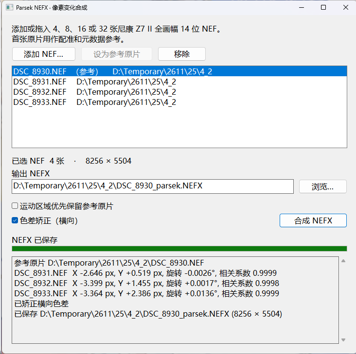

# Parsek NEFX

将同一场景的 Nikon Z7 II 多张 NEF 配准并合成为一张 NEFX。输入为 FX 大尺寸的 14 位未压缩或无损压缩 NEF，支持 4、8、16 或 32 张。请使用相同快门速度、光圈、ISO 和相机方向拍摄。第一张决定输出的坐标系、白平衡和拍摄元数据。

## Windows 图形界面

下载并运行 [parsek-nefx-gui.exe（Windows x64）](../../releases/parsek-nefx-gui.exe)，或运行自行构建的 `tools/parsek_nefx/target/release/parsek-nefx-gui.exe`。[SHA-256 校验](../../releases/SHA256SUMS)。程序启动时读取 Windows 显示语言，中文系统显示简体中文，其他语言显示英文。

多选或拖入 NEF 原片。首张为参考原片，选中其他原片后可点击 **设为参考原片**。输出默认位于参考原片旁，可编辑输出路径或点击 **浏览**。点击 **合成 NEFX** 后，窗口显示进度和处理记录。

**移除全部** 清空原片列表，磁盘上的文件保留。**仅计算** 支持 2 至 32 张原片，在处理记录中显示相对参考原片的平移、旋转、相关系数和跳过的帧，无需设置输出路径。



**色差矫正（横向）** 默认勾选。它根据参考原片内嵌的 Nikon 镜头参数，在融合后校正红、蓝通道，并从输出的镜头参数中移除已应用的横向色差项。其余镜头参数会保留。镜头无可用参数时会继续合成，并在处理记录中提示。

## 构建和命令行

在 Windows PowerShell 中，从仓库根目录运行：

```powershell
cargo build --release --locked --manifest-path tools/parsek_nefx/Cargo.toml
$frames = (Get-ChildItem -LiteralPath 'D:/Temporary/2611/25/4' -Filter '*.NEF' -File |
    Sort-Object Name).FullName
& ./tools/parsek_nefx/target/release/parsek-nefx.exe --correct-ca -o './corrected.NEFX' @frames
```

命令行通过 `--correct-ca` 启用横向色差矫正。

按文件名排序前请确认第一张是想要保留的参考画面。4／8 张生成 8256 × 5504，16／32 张生成 16512 × 11008。程序会报告每张的亚像素平移、旋转和相关系数，并跳过无法可靠配准的帧。目标文件已存在时会报错。32 张原始 Bayer 数据约占 2.7 GiB 内存。

配准在灰度金字塔上最大化归一化相关性，RGB 融合直接取原始 Bayer 样本。每个颜色通道用对齐后的样本对学习 256 × 256 的误差直方图，再根据几何距离和样本与局部中值的相似度加权。遇到风吹树叶这类主体运动，可以加上 `--reference-motion`，让融合优先保留与第一张一致的样本。[Henry Gordon Dietz 的 Parsek 论文](https://doi.org/10.2352/EI.2024.36.15.COIMG-142)

NEFX 写入 14 位线性 RGB 和从融合结果生成的 Nikon RAW 预览。普通 EXIF JPEG 缩略图仍来自第一张。Rust 实现使用自己的亚像素配准和融合权重，输出可能与参考 C++ 程序有差异。NEF 解码由 rawler 提供。[rawler 源码](https://github.com/dnglab/dnglab)
